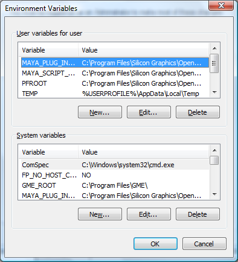
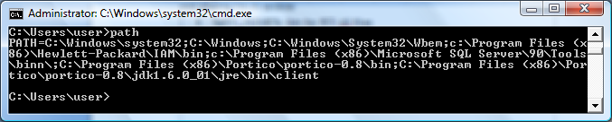
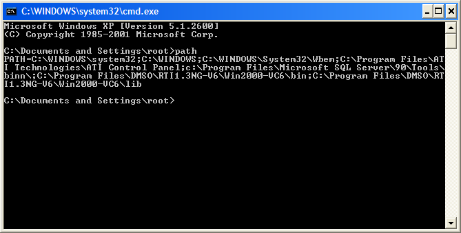
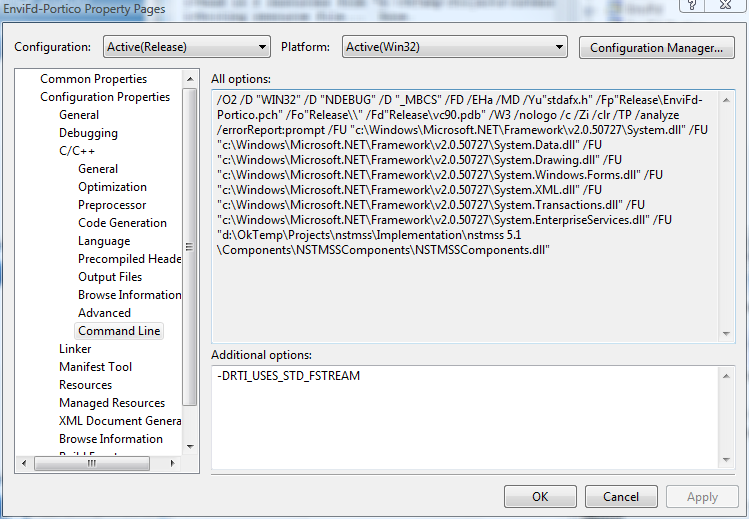
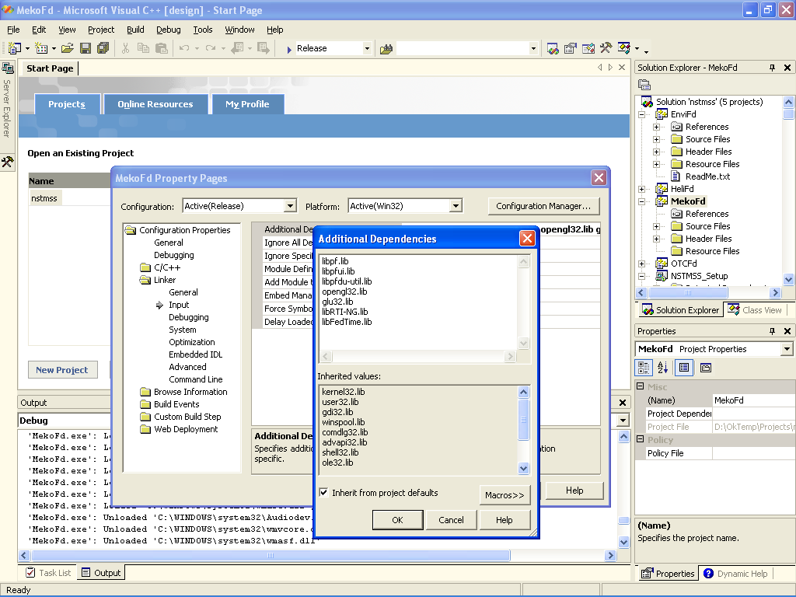
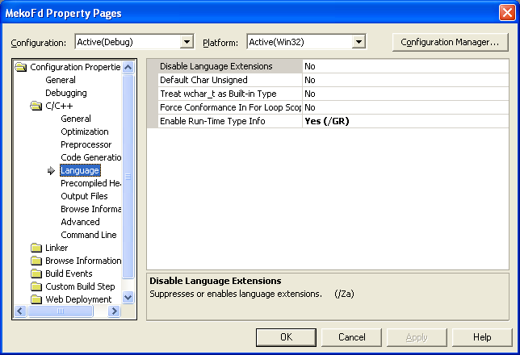
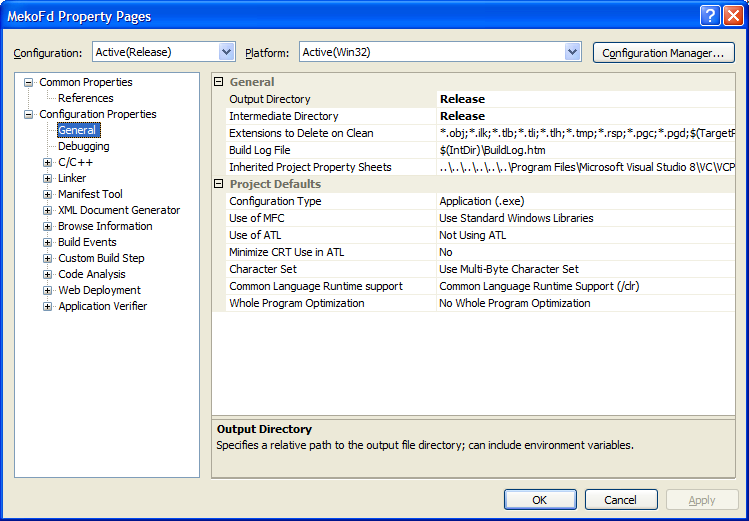
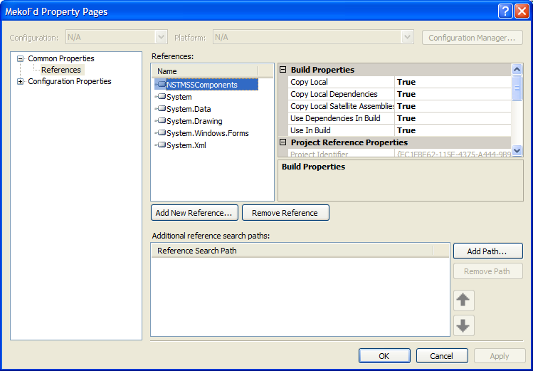
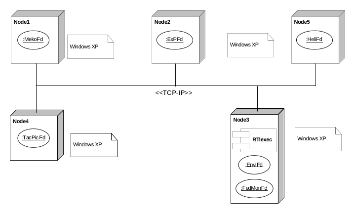

# NavySim Development Environment Configuration Manual

> Source: *Documentation/NavySim Development Environment Configuration Manual.docx* — Okan TOPÇU (okantopcu@hotmail.com), September 11, 2017. Written for **Windows 7**.
>
> See also: [Installation Manual](InstallationManual.md) · [MekoFd Installation Manual](Maritime/MekoFd/InstallationManual.md) · [NFL Release Notes](NFL/ReleaseNotes.md)
>
> **Note:** Sections 1–6 describe the legacy C++/Performer toolchain (DMSO RTI / Portico, SGI OpenGL Performer, Visual Studio 2008/2010), still needed for the parts that have not been modernized. The .NET 10 / Fora parts are set up as in [0. Current .NET 10 suite](#0-current-net-10-suite).

## Contents

- [0. Current .NET 10 suite](#0-current-net-10-suite)
- [1. Portico environment configuration](#1-portico-environment-configuration)
- [2. DMSO RTI environment configuration](#2-dmso-rti-environment-configuration)
- [3. SGI OpenGL Performer configuration](#3-sgi-opengl-performer-configuration)
- [4. MS Visual Studio configuration](#4-ms-visual-studio-configuration)
- [5. Coding guidelines](#5-coding-guidelines)
- [6. Running the NSTMSS federation](#6-running-the-nstmss-federation)
- [Abbreviations](#abbreviations)

## 0. Current .NET 10 suite

### 0.1 Prerequisites

- Windows with a stable **.NET 10 SDK** (the `global.json` files of NFL and EnviFd exclude previews).
- **Git**. The suite is a local Git repository whose root is the `NavySim` folder; it has no remote.
- A built **Fora** RTI server for the live tests (see the [NFL Release Notes](NFL/ReleaseNotes.md)).

### 0.2 Repository

| Folder | Under version control |
|---|---|
| `Documentation`, `Implementation` | Yes |
| `Private`, `Resources`, `Implementation/Tools/Sen/Docs` | No |
| Build output (`bin`, `obj`, `Output`), logs, snapshot copies (`Modernization/before-*`, `Modernization/*/before`, `artifacts`, `Validation/*/before`) | No |

The rules are in `NavySim/.gitignore`. A snapshot copy is no longer needed before a large change: commit, and the history keeps the previous state.

### 0.3 Building

`Implementation/NavySim.slnx` builds every .NET 10 part, grouped as on disk:

| Solution folder | Projects |
|---|---|
| FdApps/EnviFd | SimulationLayer, PresentationLayer, EnviFdUI-WPF, EnviFd.Tests |
| FdApps/MekoFd | MekoFd.Core, .Simulation, .AssetPipeline, .Hla.Fora, .Rendering.Stride, .App, MekoFd.ParityTests |
| Library/NFL | NFL, NFL.Fora.Tests |

```powershell
cd C:\OkPer\Projects\NavySim\Implementation
dotnet build NavySim.slnx -c Release
```

Each part also keeps its own solution (`EnviFd.slnx`, `MekoFd.slnx`, `NFL.sln`) for working on it alone; EnviFd and MekoFd have their own `Build.ps1` scripts as well. ExMFd (.NET Framework 4.6), Sen (.NET Framework 3.5), FedMonFd and the C++ MekoFd build from their own solutions with the legacy toolchain below.

### 0.4 Versions

The suite version (`NavySimSuiteVersion`, e.g. `2026.1`) is in `Implementation/Directory.Build.props`; the version of each part is in the `Version.props` of its folder (`FdApps/EnviFd`, `FdApps/MekoFd`, `Library/NFL`). Never set a version in a `.csproj` or `AssemblyInfo.cs`. The rules for raising a version are in [Version Control](Architecture/01.1-VersionControl.md).

## 1. Portico environment configuration

### 1.1 Version

Use **Portico 1.0** (DMSO 1.3 compatible).

### 1.2 RTI environment configuration

Right-click **Computer** → **Properties** → **Advanced system settings** → **Environment Variables**.



*Figure 1. Setting environment variables*

Add the following to the *system variables*:

**Table 1. RTI environment variables (Portico)**

| Variable | Value |
|---|---|
| `RTI_HOME` | Portico home directory (typically `C:\Program Files (x86)\Portico\portico-0.8`) |
| `JAVA_HOME` | JRE home directory (e.g., `C:\Program Files (x86)\Portico\portico-0.8\jdk1.6.0_01\jre`) |

Append to the existing `PATH` variable:

- `%RTI_HOME%\bin` — RTI DLL files
- `%JAVA_HOME%\bin\client` — `jvm.dll`

Check the result by opening a console (`cmd`) and typing `path`.



*Figure 2. Checking the PATH variable*

> The example paths point to `portico-0.8`, while §1.1 requires Portico 1.0 — adjust the paths to the installed version.

### 1.3 Host configuration

From v0.9 onwards Portico no longer uses a central RTI. All federates operate peer-to-peer, so **there is no need to start an RTI**.

## 2. DMSO RTI environment configuration

### 2.1 Version

Use **DMSO RTI NG 1.3 v6**.

### 2.2 RTI environment configuration

Right-click **Computer** → **Properties** → **Advanced system settings** → **Environment Variables** (see Figure 1).

Add the following to the *system variables*:

**Table 2. RTI environment variables (DMSO)**

| Variable | Value |
|---|---|
| `RTI_HOME` | RTI home directory (typically `C:\Program Files\DMSO`) |
| `RTI_BUILD_TYPE` | RTI distribution type (i.e., `RTI1.3NG-V6`) |

Append to the existing `PATH` variable:

- RTI DLLs: `%RTI_HOME%\%RTI_BUILD_TYPE%\Win2000-VC6\lib`
- Bin dir: `%RTI_HOME%\%RTI_BUILD_TYPE%\Win2000-VC6\bin`

Check the result by opening a console (`cmd`) and typing `path`.



*Figure 3. Checking the PATH variable*

A second check: run `rtiexec.exe` in the console.

### 2.3 Host configuration

All NSTMSS federates and `rtiexec.exe` can run on a network or on a single host without a network. Make sure the network adapter has a link, and that all hosts can ping each other.

To run on a single host without network connectivity, first install the Microsoft Loopback Adapter (see [2.4](#24-microsoft-loopback-adapter-configuration)).

### 2.4 Microsoft Loopback Adapter configuration

1. Open **Start → Control Panel**. In classic view, double-click **Add Hardware**. The Add Hardware Wizard appears.
2. Click **Next**. When asked *"What do you want the wizard to do?"*, select **Install the hardware that I manually select from a list** and click **Next**.
3. Select **Network adapters** from the list of hardware types and click **Next**.
4. Select **Microsoft** as the vendor and **Microsoft Loopback Adapter** from the *Network Adapters* list, then click **Next** to install.
5. Click **Finish**.

The Microsoft Loopback Adapter now appears in the Network Connections folder.

## 3. SGI OpenGL Performer configuration

Check that the OpenGL Performer version to be installed matches the Performer version required by the NSTMSS federate. Restart the computer after installing OpenGL Performer.

### 3.1 License configuration

Copy `license.dat` into the Performer installation folder.

### 3.2 GLUT 3.7.6 installation

- Copy the `lib` and `dll` files to the `performer\lib` directory.
- Copy `glut.h` to the `performer\include\GL` directory.

### 3.3 Environment configuration

Open the environment variables window (see Figure 1) and add the following system variable. The `pfuInitSmokes()` call in MekoFd needs `ifl_database`.

**Table 3. Environment variables (Performer)**

| Variable | Value |
|---|---|
| `IFL_DATABASE` | `C:\Program Files\Silicon Graphics\OpenGL Performer\Data\ifl_database0` |

## 4. MS Visual Studio configuration

> The source document titles this section both *"MS Visual Studio .NET 2008"* (table of contents) and *"MS Visual Studio 2010"* (heading).

### 4.1 .NET 3.5

- Install .NET 3.5 Service Pack 1.

### 4.2 Configuration after installing Visual Studio

- Open **Tools → Import and Export Settings**, select **Import selected environment settings** and browse to the settings file in the current NSTMSS project directory.
- Add the preprocessor directive `-DRTI_USES_STD_FSTREAM` as shown in Figure 4.



*Figure 4. Fixing the fstream header error*

### 4.3 Configuration for a new project

**VC++ directories** — for a C++ project, open *Project Properties → Configuration Properties → VC++ Directories* and add:

| Include | Lib |
|---|---|
| `Performer_home\include` | `Performer_home\lib` |
| `Performer_home\include\performer` | `Performer_home\lib\debug` |
| `RTI_HOME\include` | `RTI_HOME\lib` |

**SGI OpenGL Performer** — in *Project Properties → Linker → Input → Additional Dependencies* add:

```
libpf.lib libpfui.lib libpfdu-util.lib opengl32.lib glu32.lib libpfv.lib
```



*Figure 5. Project settings*

**RTI libraries**

| RTI | Release | Debug |
|---|---|---|
| DMSO | `libRTI-NG.lib`, `libFedTime.lib` | `libRTI-NGd.lib`, `libFedTimed.lib` |
| Portico | `libRTI-NG.lib`, `libFedTime.lib` | — |

**RTTI** — make sure the RTTI (Runtime Type Info) compile flag is enabled.



*Figure 6. Federate project settings — RTTI flag*

**CLR** — make sure *Common Language Runtime Support* is selected.



*Figure 7. CLR support*

**NFL** — to use the NFL library, open the project settings and add a new reference from the *Projects* tab.



*Figure 8. Project settings — references*

### 4.4 VC 6.0 DLLs

For **debug** builds only: the RTI libraries need the old VC 6.0 debug DLLs. Copy the following files into `Windows\System32` or into the MekoFd installation folder:

- `MSVCP60D.DLL`
- `MCVCRTD.DLL` *(as written in the source; probably `MSVCRTD.DLL`)*
- `MSVCIRTD.DLL`

### 4.5 Using MDX .NET 1.1 libraries

To use the .NET 1.1 Managed DirectX (MDX) assemblies with Visual Studio 2005 and .NET 2.0, disable Loader Lock: **Debug → Exceptions → Managed Debugging Assistants**, uncheck **LoaderLock**.

### 4.6 Build errors

#### DirectX error

```
Fatal error C1113: #using failed on 'c:\documents and settings\temp\desktop\ms\ms 531\nstmss 5.0\mekofd\microsoft.directx.dll'
```

**Solution:** MekoFd uses DirectX for mouse and keyboard event handling. Install DirectX and add it to the project.

## 5. Coding guidelines

### 5.1 Coding convention

- **Pascal casing** for class names, property names and event names — mixed case starting with a capital, possibly with embedded capitals (e.g., `CcommCenter`).
- **Camel casing** for public and protected class fields, defined objects and class methods — first letter lowercase, may include uppercase letters (e.g., `tableIndex`, `setScreenResolution`, `mainWindow`).
- **Private fields** paired with properties start with an underscore (e.g., `_cursor`); the matching property starts with an uppercase letter followed by camel casing (e.g., `Cursor`).
- Put the opening brace immediately after the statement:

  ```cpp
  if (...) {
      ...
  };
  ```

- In general, do one thing per line.

### 5.2 Security guidelines

- Sanitize all input. Treat all input as harmful until proven otherwise; check every input for type, length and range.

## 6. Running the NSTMSS federation

1. Check network connectivity and make sure all hosts can ping each other.
2. Run `rtiexec` first.
3. Start the federates in any order — the start order is not important.

A typical deployment is shown below.



*Figure 9. Recommended NSTMSS deployment diagram*

> All NSTMSS federates and `rtiexec` can also run on a single host without a network; make sure the network adapter has a (pseudo) link.

## Abbreviations

| Term | Meaning |
|---|---|
| CLR | Common Language Runtime |
| DLL | Dynamic Link Library |
| DMSO | U.S.A. Defense Modeling and Simulation Office |
| EnviFd | Environment Federate |
| GL | Graphics Library |
| GLUT | GL Utility Toolkit |
| MDX | Managed DirectX |
| MS | Microsoft |
| NSTMSS | Naval Surface Tactical Maneuvering Simulation System (pronounced *"NiSTMiSS"*) — former name of NavySim |
| RTI | Runtime Infrastructure |
| RTTI | Runtime Type Info |
| SGI | Silicon Graphics Inc. |
