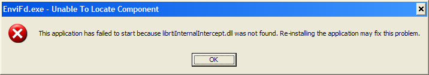

# EnviFd Installation Manual

> Source: *Implementation/FdApps/EnviFd/Docs/EnviFd Installation and User Manual.docx* (Section 1)
>
> See also: [EnviFd User Manual](EnviFd/UserManual.md) · [EnviFd Release Notes](ReleaseNotes.md) · [Development Environment Configuration](../DevelopmentEnvironmentConfiguration.md)

## EnviFd 5.0.0 installation

Use Windows with the .NET 10 Desktop Runtime. Building from source requires the .NET 10 SDK and the local Fora package feed. The historical WiX installer is outside the current solution.

From `Implementation/FdApps/EnviFd/Code`:

```powershell
./Build.ps1 -Offline -Locked -Test
./Publish.ps1 -Offline
./artifacts/publish/EnviFdApp.exe
```

Keep the publish directory together, including `Fom/NavySim.xml`, the Fora client assemblies and NFL shared helpers. `Fom/NavySim.xml` is the default packaged model and is resolved relative to the application. Native RTI DLLs and .NET Framework 3.5 are not required by 5.0.0.

Start Fora, then select its address and federation in the connection panel. Defaults are `localhost:15164` and `NSTMSS`; MekoFd must use the same federation and compatible model. The application sends the selected XML content to the RTI.

For connection errors, check that Fora is listening on the selected protocol port, the FDD file exists and the federate name is unique. The packaged XML matches NFL's model tables; an alternate XML can be selected in the UI. Close the window normally to finish resign/disposal.

See the [source build guide](../../../Implementation/FdApps/EnviFd/Code/README.md) for generation/import, tests and the NFL dependency boundary.

## Historical installation reference

The instructions below are retained from the earlier installation manual and apply to its archived releases.

## Contents

- [1. Pre-installation](#1-pre-installation)
- [2. Installation](#2-installation)
- [3. Troubleshooting](#3-troubleshooting)
- [References](#references)

## 1. Pre-installation

### Hardware and software prerequisites

**Table 1. EnviFd hardware and software requirements**

| Component | Configuration |
|---|---|
| RAM | EnviFd uses 24 MB RAM |
| Hard disk space | EnviFd uses 8 MB hard disk space |
| Others | CD-ROM drive for installation |
| Operating system | Microsoft Windows Vista |
| Runtime environment | Microsoft .NET 3.5 |
| HLA library | DMSO RTI 1.3 NG 6 or Portico 0.8 |

> Installation requires **local administrator rights**.

## 2. Installation

Run `setup.exe`. The installer checks whether EnviFd is already installed:

- If the **current** version is detected, the installer asks whether to **remove** or **repair** it.
- If a **previous** version is detected, the installer uninstalls it.

Then follow the installer screens.

> The source says "follow the screens shown below", but no installer screenshots are included.

## 3. Troubleshooting

### Missing DLL: `LibRTI-NG.dll` not found

- Install DMSO RTI or Portico.
- Configure the RTI environment variables as described in [1].

### Unable to locate component

- Install DMSO RTI.
- Configure the RTI environment variables as described in [1].



*Figure 1. Unable to locate component error*

## References

1. Topçu, O., *NSTMSS Development Environment Configuration Manual*, November 17, 2004. — see [Development Environment Configuration](../DevelopmentEnvironmentConfiguration.md) for the latest version.
