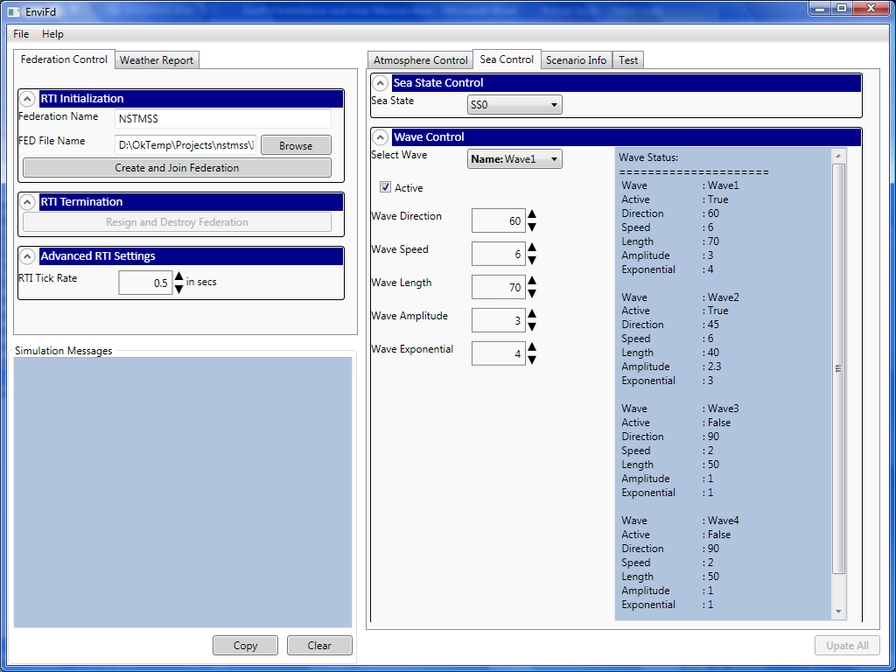
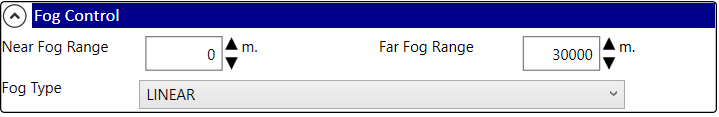
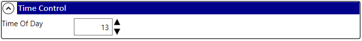
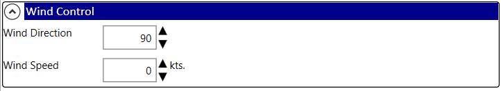
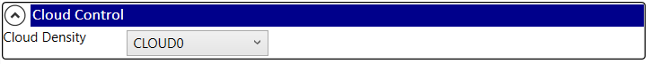
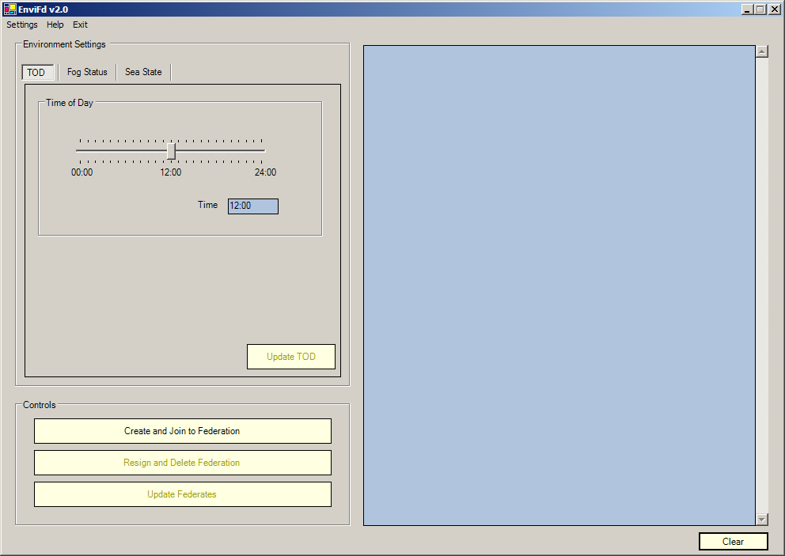
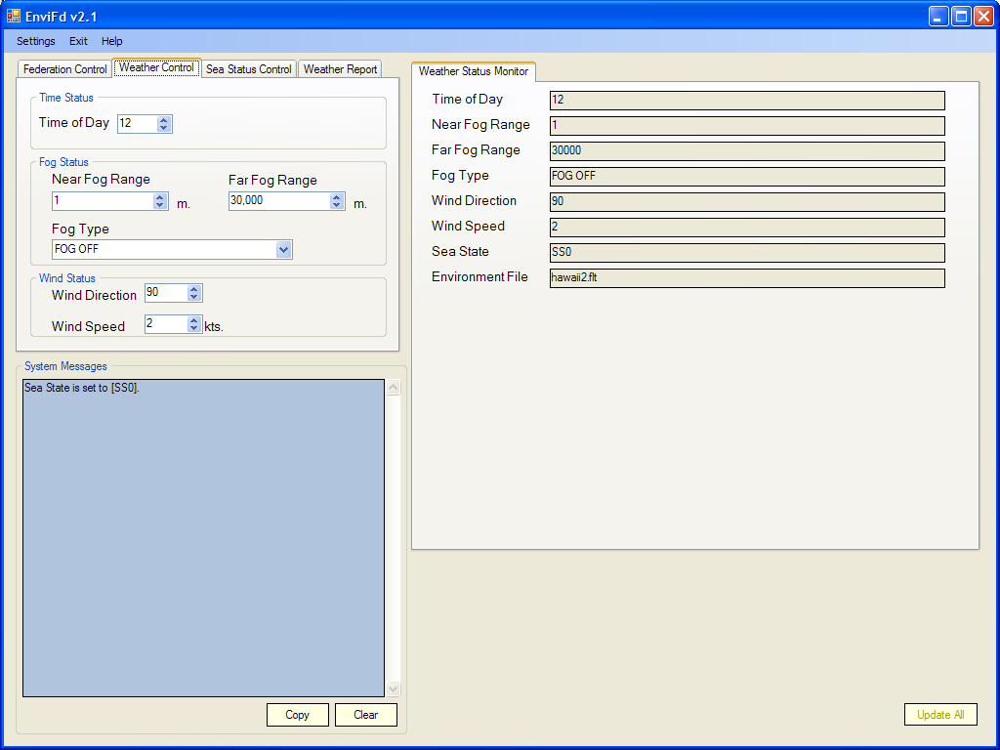
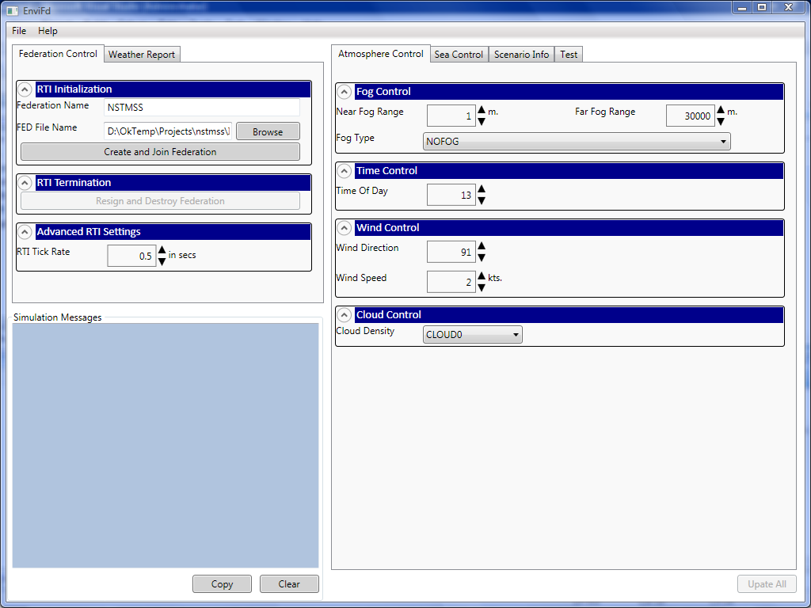

# EnviFd User Manual

> Source: *Implementation/FdApps/EnviFd/Docs/EnviFd Installation and User Manual.docx* (Sections 2–3)
>
> See also: [EnviFd Installation Manual](InstallationManual.md) · [EnviFd Release Notes](ReleaseNotes.md) · [EnviFd Architecture](EnviFd/Architecture.md)

## Current use — 5.0.0

Enter the Fora protocol address, federation name and FDD path, then create/join. Defaults are `localhost:15164`, `NSTMSS` and the packaged `Fom/NavySim.xml`. The federate name defaults to `EnviFd`.

After connection, EnviFd declares P/S and waits for an active Environment subscriber. StartRegistration creates the Environment object; Update On sends current values for the relevant fields (11 for MekoFd). Changes stay local while those fields are Off and are sent as a fresh snapshot when interest returns. Use the TOD, fog, cloud, wind, sea-state controls and their Update buttons, or automatic update mode. Scenario's supported nine fields supply title/description, start time, report interval, location, terrain and geographic origin. BeginToPlay starts the simulation clock and periodic weather reporting; a nonpositive report interval disables periodic reports. WeatherReport uses the HF [3,30) MHz region and sends only while an active report subscription produces interaction On. Interaction Off suppresses manual and periodic sends.

Resign stops the clock/report timers and the session. Subscriber rejoin reuses the current Environment and sends latest control values. Full EnviFd reconnect retains control values/settings, creates a fresh connection and waits for new advisory callbacks before registering a fresh object. Fora Messages displays detailed local client logs, including P/S, updates, RTI exceptions and cleanup; it scrolls to the latest entry. Window close waits for resign/disposal, including repeated close requests. Generated MekoFd remains compatible.

The screenshots and historical descriptions below document older releases. For the current deployment see the [installation manual](InstallationManual.md).

## Contents

- [1. Overview](#1-overview)
- [2. Settings](#2-settings)
- [3. Tabs](#3-tabs)
- [4. Version history (screenshots)](#4-version-history-screenshots)
- [Abbreviations](#abbreviations)

## 1. Overview

The Environment Federate (EnviFd) is known as **"Environment"** in the federation. With this GUI the user sets the time of day (TOD), fog status, sea state and other environment settings for the virtual environment.

- At start-up all buttons are disabled except **Create and Join to Federation**.
- After joining the federation, the **Update** buttons are enabled.
- All user activity (e.g., a button click) is shown in the status text area. Click **Clear** to empty it.

### Update methods

| Method | Behaviour |
|---|---|
| **Instant (automatic) update** | Changes to relevant fields are queued for transmission; Off fields remain local until On. |
| **Manual update** | The user clicks an update button. **Update Federates** sends changes for relevant fields; the other update buttons send their related settings while those fields are On. |

Select the update method from the **Settings** menu item.

> Historical note: the current WPF application includes the simulation clock.

## 2. Settings

### Atmospheric effects

| Setting | Description | Control |
|---|---|---|
| **Fog Status (FS)** | Fog type (e.g., linear or exponential) and minimum/maximum fog range |  |
| **Time of Day (TOD)** | Time of day for the virtual environment |  |
| **Wind Status (WS)** | Wind direction and wind speed |  |
| **Cloud Density** | Four cloud-density classes |  |

### Environmental effects

| Setting | Description |
|---|---|
| **Sea State (SS)** | Sea state of the virtual environment |

## 3. Tabs

### TOD Status tab

Time-of-day controls set the time for the virtual environment.

### Fog Status tab

Controls the fog type, density and ranges in the virtual environment.

### Sea State tab

Select **SS0–SS9** under Sea Control. Selection applies reference Hs/Tp and the ANEP mean wind at 19.5 m. The card shows reference and current wind; Atmosphere Control → Wind Speed permits a separate 0–100 kn override. Selecting another SS restores its reference wind. SS1 Tp=3 s, SS9 Hs=15 m and SS9 wind=65 kn are labelled simulation choices. The old individual-wave controls have been removed.

With automatic updates enabled, SS sends SeaState/WindSpeed together and a separate wind edit sends WindDirection/WindSpeed. Otherwise use Update All. Meko applies SS before explicit WindSpeed in a combined update; across separate updates, the later SS resets wind and the later wind overrides it. Reported wind is knots at 19.5 m; direction remains independently editable. Detailed custom spectral parameters are not yet transmitted. [Source table and physical limits](../Maritime/Shared/SeaConditions.md).

## 4. Version history (screenshots)

### Version 2.0

*Figure 2. Version 2.0*

### Version 2.1

*Figure 3. Version 2.1*

### Version 3.0

*Figure 4. Version 3.0*

## Abbreviations

| Term | Meaning |
|---|---|
| EnviFd | Environment Federate |
| FS | Fog Status |
| GUI | Graphical User Interface |
| SS | Sea State |
| TOD | Time of Day |
| WS | Wind Status |
