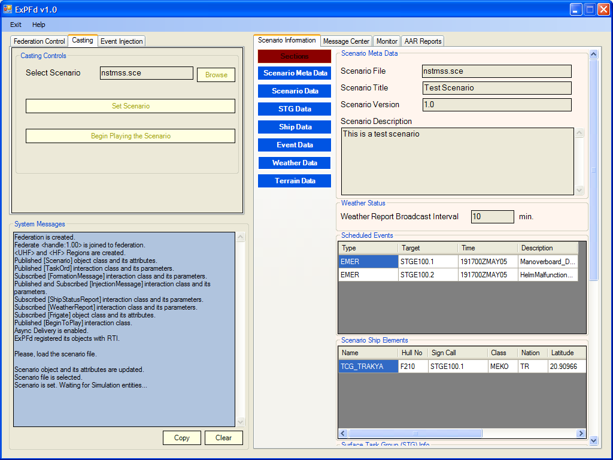
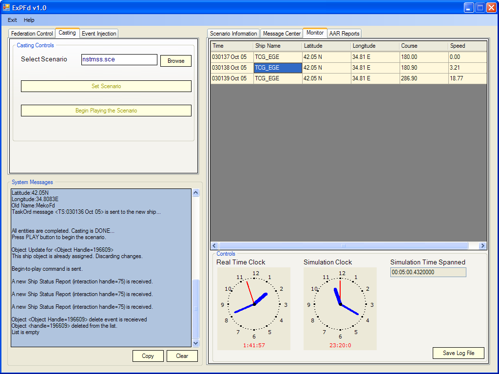
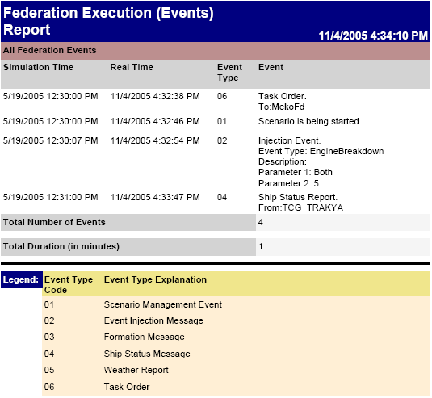
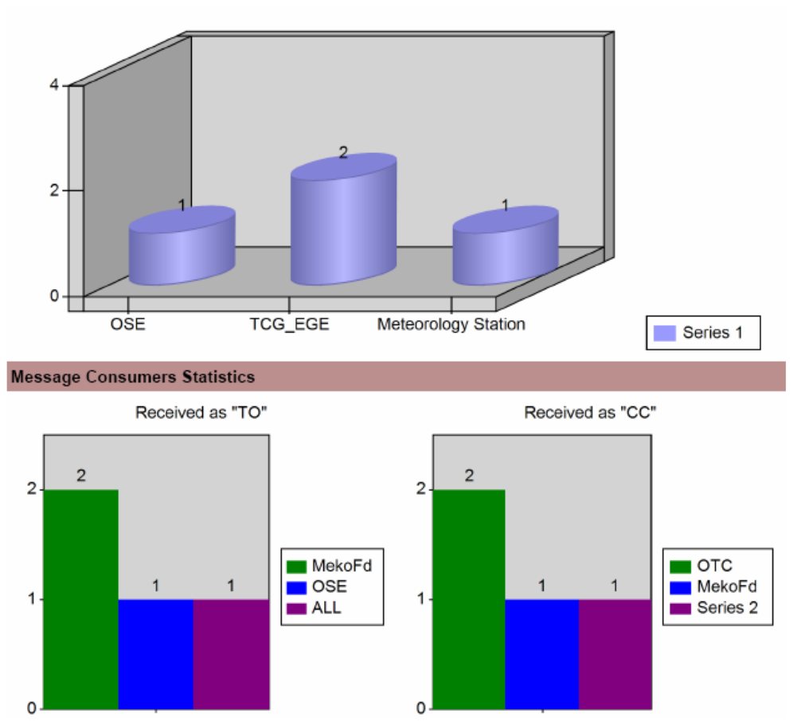

# ExMFd User Manual

> Source: *Implementation/FdApps/ExMFd/Docs/ExMFd Installation and User Manual.docx* (Sections 2–3)
>
> See also: [ExMFd Installation Manual](InstallationManual.md) · [ExMFd Release Notes](ReleaseNotes.md) · [NavySim Architecture – Exercise Manager Federate](../Architecture/03-Federates.md#36-exercise-manager-federate) · [Scenario file format](../Architecture/05-SupportingTools.md)

*ExPFd v1.0 — Federation Control / Casting tabs and Scenario Information*

## Contents

- [1. Introduction](#1-introduction)
- [2. Functionality](#2-functionality)
  - [2.1 Scenario parser](#21-scenario-parser)
  - [2.2 Scenario distributor (casting module)](#22-scenario-distributor-casting-module)
  - [2.3 Event injector](#23-event-injector)
  - [2.4 Data collector (data logging module)](#24-data-collector-data-logging-module)
  - [2.5 After Action Review (AAR) reporter](#25-after-action-review-aar-reporter)
- [Abbreviations](#abbreviations)

## 1. Introduction

The Exercise Manager Federate (ExMFd) — formerly the Exercise Planner Federate (ExPFd), also called the *Scenario Manager* — selects the training scenario and distributes it to the participants (TacPicFd and the ship federates), injects the events defined in the scenario into the federation execution, and collects data to generate a report about the federation execution.

Scenario management lets Surface Task Group (STG) members train autonomously on a common scenario whose state changes dynamically through a set of predefined events. The collected data — **Critical Performance Data (CPD)** — is available as a report for after action review. Injected events (e.g., man overboard, engine failure) reach the human players as textual messages through the NSTMSS **Tactical Messaging System (TMS)**.

## 2. Functionality

### 2.1 Scenario parser

Selects a scenario from the scenario database. The scenario for an exercise is defined textually by the user in a language ExMFd can parse (XML). See the [scenario file format](../Architecture/05-SupportingTools.md).

### 2.2 Scenario distributor (casting module)

Distributes the scenario data and the roles to the other simulation entities. Scenario distribution includes multicasting the mission details to STG members over TMS. **Role casting** is automatic: ExMFd sends a task order message (TaskOrd) over TMS.

### 2.3 Event injector

Event injection increases the training value of an exercise; injected events generally change the course of the simulation. ExMFd injects the events defined in the scenario file into the target federate(s) at their target time.

- **Scheduled event injection** — events defined at scenario composition time.
- **Instant event injection** — events injected at run time.

When a ship receives an event injection message, its functionality is reduced automatically according to the event type. Supported events:

| Event |
|---|
| Man overboard |
| Engine breakdown |
| Helm failure |
| Radio failure |

### 2.4 Data collector (data logging module)

Listens to the activities during the exercise (i.e., messaging activities). ExMFd provides an interface to monitor the simulation run:

- **Monitor tab** — ship status reports showing the location of the ships in the scenario.
- **Simulation clock** — simulation time and the time elapsed since the scenario began.
- **Real-time clock** — current system time.

*Figure 1. ExMFd monitoring interface*

### 2.5 After Action Review (AAR) reporter

ExMFd generates several kinds of reports to review the scenario run:

| Report | Content |
|---|---|
| **Scenario Information** | The current scenario in a user-friendly form, easy to print or export |
| **Ship-Based Positions** | Position, course and speed of each ship over time |
| **Tactical Message System (TMS)** | All tactical messages sent by the federates over time, plus statistics charts: total sent messages by type, messages sent per entity, messages received per entity |
| **Time-Based Events** | Simulation events over time |
| **Federation Execution** | All simulation events in time order and the total duration of simulation time |

> The source says "five kinds of reports" but names four in the list; the Federation Execution report is described in the following sentences and is included here as the fifth. *Time-Based Events* and *Federation Execution* may refer to the same report.

*Figure 2. ExMFd report sample*

## Abbreviations

| Term | Meaning |
|---|---|
| AAR | After Action Review |
| CPD | Critical Performance Data |
| ExMFd | Exercise Manager Federate (formerly ExPFd, Exercise Planner Federate) |
| STG | Surface Task Group |
| TMS | Tactical Messaging System |
