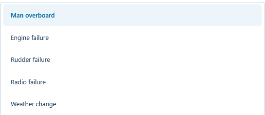
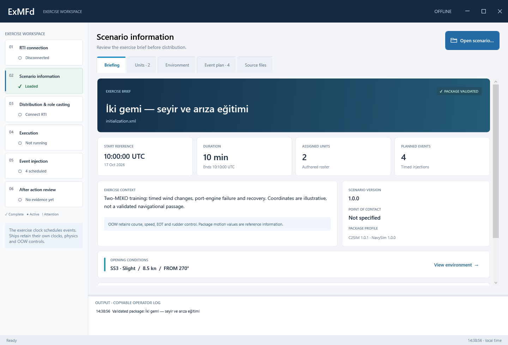
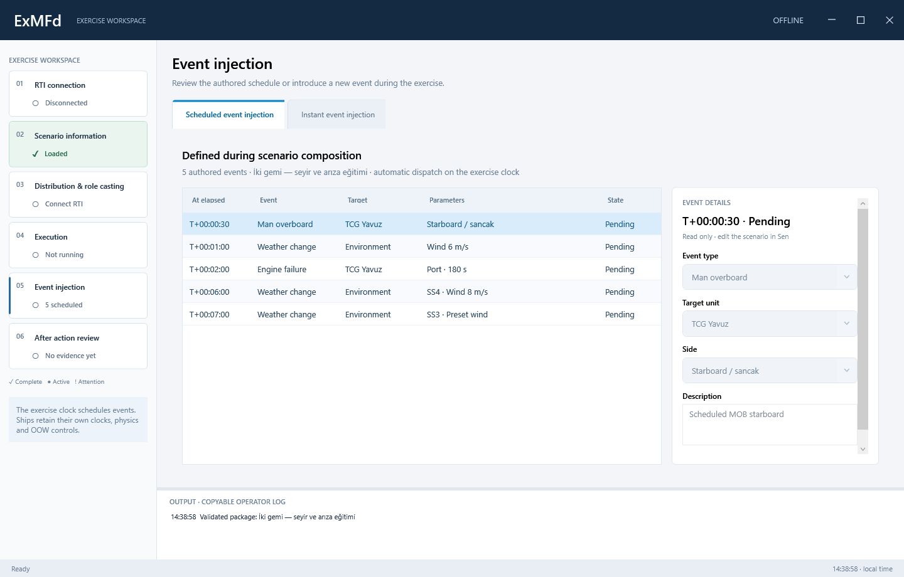
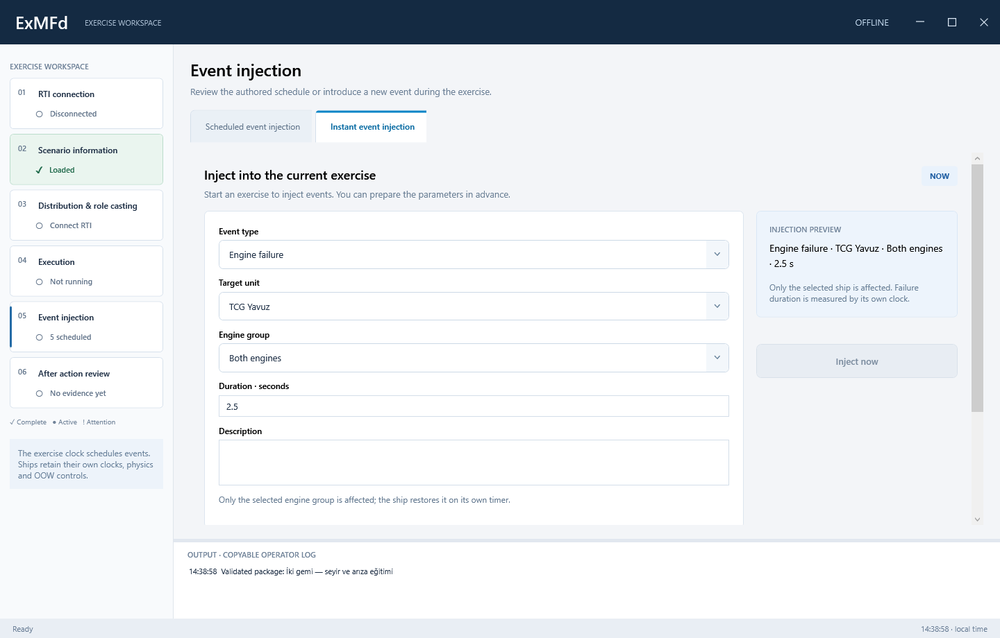
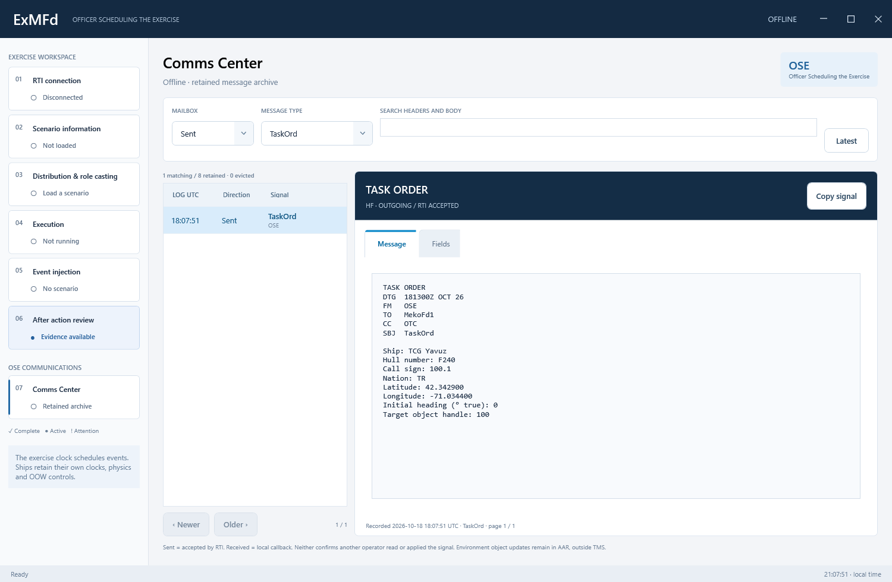
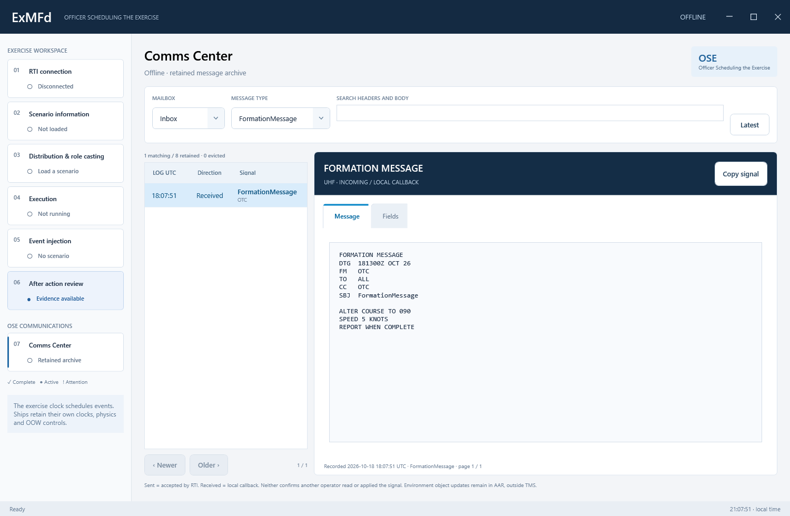

# ExMFd User Manual — 4.0.0

ExMFd loads scenarios authored in [Sen](../Sen/UserManual.md), distributes assignments, schedules event injection and collects evidence for after action review. It represents the **Officer Scheduling the Exercise (OSE)**. Six workspaces follow the exercise workflow; the independent **Comms Center** provides the OSE tactical-message archive.

The application header contains the window controls; the separate Windows title bar is removed. Drag the dark header to move the window, double-click it to maximize/restore, or right-click it for the Windows system menu. Use the top-right buttons to minimize, maximize/restore or close; Alt+F4 also closes through the normal disconnect/cleanup path. Window edges remain resizable. Startup still maximizes on the active monitor, and maximized content stays within its work area above the taskbar.

Action buttons use a common rounded style: blue for primary actions such as Open scenario, Connect, Distribute and Run; outlined secondary actions; soft red for Stop; and lighter in-page shortcuts. Hover/press feedback, a keyboard-focus ring and readable disabled states identify available actions. Open scenario includes a folder icon.

Dropdowns use rounded white fields, a clear arrow, blue focus outline and a matching option list. Arrow keys change selection; Escape dismisses the list. Disabled scheduled-event fields remain readable and cannot be edited. Tables use flat tinted headers, alternating rows, hover/selection highlights and a visible focused cell. Sort-enabled headers show the active direction; column resize handles remain available. The scenario picker uses matching table headers and rows.

The workspace buttons show both progress and the selected page. A blue bar on the left identifies the open page; it does not replace that step's status colour.

| Appearance | Meaning |
|---|---|
| Green / check mark | Connected, scenario loaded, distribution completed, schedule completed or all event sends accepted, according to the label. |
| Blue / dot | Running, ready to run, queued events or review evidence available. |
| Amber / exclamation mark | Paused, stopped, incomplete distribution or an action requiring attention. |
| Neutral / open circle | Not started or waiting for a prerequisite. |

Each button includes a status label and a tooltip. Distribution turns green only when all initial assignment and weather actions have successful send evidence in the current run; partial success remains amber. A successful send still means RTI acceptance, not confirmed application. AAR's availability label does not mean the review or export has been completed.

Disconnect resets connection-dependent readiness while retaining the loaded scenario and available review evidence. Loading another scenario clears the previous distribution/execution indicators; New run uses only the new run's evidence. Statuses update only when their values change, without flashing on idle refreshes.

## 1. RTI connection

Start Fora and the required ship applications. Enter the RTI address, federation name and a unique ExMFd federate name. Browse to the full path of the NavySim FDD XML, then select **Connect**. The default FDD is `Fom/NavySim.xml` beside the application. **Disconnect** resigns this manager without stopping other federates.

**Discover participants** lists discovered MEKO/Knox object owners. The ship application's federate name must match its scenario SystemName. A vessel's display name can differ. Discovery establishes presence and object class; it does not prove successful application or operator readiness.

EnviFd is optional. ExMFd publishes scenario weather through Environment OC. An independent EnviFd can provide external weather changes and meteorology broadcasts; it is not required by the event schedule.

## 2. Scenario information

Select **Open scenario** and choose the entry XML, for example `Hawaii.xml`. The browser starts in the user's Documents / Scenario Projects folder and hides supporting files. Keep `Hawaii.NavySim.xml` beside its entry; legacy `navysim.xml` packages remain readable.

Scenario Information uses five section tabs with the same rounded, accent-colour header treatment as EnviFd:

| Section | Review workflow |
|---|---|
| **Briefing** | Scenario title and validation badge; UTC start, duration, unit/event totals, training context, version/contact/profile and opening conditions. Use the environment/event shortcuts or **Copy briefing** for a structured text summary. |
| **Units** | Select an authored ship in the roster to inspect hull, class, nation, call sign, allocated federate, UUID and geographic position. True heading is initial placement; speed is an authored reference. The OOW retains motion control after placement. |
| **Environment** | Initial sea state, shared preset wave references, wind speed in knots and m/s, and a compass indicating true wind **FROM** bearing. Explicit wind is distinguished from sea-state reference wind, including explicit zero. Grid-north offset is shown separately. |
| **Event plan** | Authored weather/ship lanes on a duration-scaled timeline, event table and selectable/copyable description. These are scheduled package events, without a live NOW marker. Dispatch status remains in Event injection. |
| **Source files** | Full entry path, actual package profile and both validated XML documents read-only. |

Additional views: [unit details](images/current/scenario-units.png) · [initial environment](images/current/scenario-environment.png) · [event plan](images/current/scenario-events.png). Captures use the included two-MEKO training package in an offline UI test session.

The selected tab and ship remain selected during routine refreshes. Content scrolls within the workspace at compact window sizes; packages with no events have an explicit empty plan. Editing remains in Sen. Routes, OTC/STG organization and legacy mission orders are outside the current profile.

Both documents validate before the current package is replaced. Stop a running/paused schedule before loading another package.

## 3. Distribution & role casting

1. **Check readiness** checks required ship names, object classes and ambiguous allocations.
2. **Distribute & assign** publishes general information, UTC reference, origin and a one-minute reporting interval as Scenario attributes. Each ship receives an HF **TaskOrd**, targeted using its discovered object-instance handle in the legacy FederateId parameter.
3. TaskOrd supplies name, hull number, call sign, nation, geographic position and **initial true heading** before Begin. Grid-north offset is included. **The OOW controls course and speed** after placement; this does not enable autopilot or set speed, engines or rudder. Assignment after Begin cannot change the ship’s position/heading. Use current binaries and FDD 5.1.0 in a freshly created compatible federation; an already-created 5.0.0 federation does not contain InitialHeading.
4. Successful distribution leaves the manager **Prepared**, with elapsed time zero. **Execution → Run** sends BeginToPlay once.

Allocation is authored in Sen using vessel UUID and SystemName. ExMFd does not silently choose the first available ship. Live own-ship acceptance currently covers MEKO; a discovered Knox class does not validate Knox execution.

**RTI accepted** means the update/send request succeeded. The base FOM has no application acknowledgement for assignment or event execution. This is not labelled confirmed application.

## 4. Execution

Execution displays scenario reference time, elapsed/duration, local wall clock, progress, event markers and the current position. Hover a marker for event time, target, source and dispatch state. Monitoring, Traffic log and Evidence are subpages. Their tabs use the same rounded headers, blue active accent and keyboard-focus indication as Scenario Information and the Scheduled/Instant Event Injection tabs.

| Control | Effect |
|---|---|
| Run | Send BeginToPlay once and advance this manager's schedule. |
| Pause injector / Resume | Freeze/resume injection only. Ship clocks, physics and controls continue. |
| Stop injector | Cancel unsent local work. No ship stop command is sent. |
| New run | Rearm authored events under a new local run ID and redistribute assignments. Existing ship motion is retained; an already-begun ship does not reapply initial position. Live additions are not rearmed. |
| Retry failed | Explicit resend. An uncertain RTI response may follow a successful send; retry can duplicate effects because the base FOM has no event-ID/receipt contract. |
| Disconnect | Stop the local injector and resign; retain the last report in memory. |

The monotonic manager clock schedules events only. Quiet intervals generate no control messages. Initial UTC is configuration, not continuous synchronization. Network delay affects arrival; there is no lockstep or retroactive integration.

## 5. Event injection

The workspace separates two workflows. Both use the same event types and show only the parameters relevant to the selected type. The Scheduled and Instant tabs use the common modern section-header style.

Views: [scheduled event inspection](images/current/injection-scheduled.png) · [instant engine-failure form](images/current/injection-instant.png). These offline captures demonstrate the UI; Inject now remains disabled until the exercise state permits dispatch.

### Scheduled event injection

Author these events in **Sen → Event Timeline** before the exercise. Select an event in ExMFd's scheduled table to inspect its time, target, parameters and dispatch state. The inspector is read-only; edit the package in Sen, then reload it before distribution. Authored events execute automatically when their elapsed time is due. New run rearms them.

### Instant event injection

Use this tab during a running or paused exercise. Choose the event type, select the target when applicable and complete the fields below. Review the preview and select **Inject now**. The event uses the current elapsed time; there is no future-time input. Recent instant events are listed separately from the authored schedule. They are not rearmed by New run.

| Event type | Active parameters |
|---|---|
| Man overboard | Target unit, **Side: Port / Starboard**, description. No engine, radio, duration or weather inputs. |
| Engine failure | Target unit, **Engine group: Port / Starboard / Both**, positive duration in seconds, optional description. |
| Rudder failure | Target unit, duration in seconds, optional description. No component selector. |
| Radio failure | Target unit, **Radio channel: HF / UHF / Both**, duration in seconds, optional description. |
| Weather change | Sea state, wind speed and wind FROM direction. No target or machinery inputs. |

Inline validation explains incomplete or invalid input; **Inject now** is disabled until the form and exercise state allow dispatch. Failures must fit within the remaining exercise time. Overlapping failures on the same component are rejected before dispatch. The outcome reports RTI acceptance separately from application confirmation.

The ship expires failures on its own timer, even while ExMFd is paused or absent. Expected expiry entries in the execution timeline send no recovery interaction and do not confirm repair.

Weather accepts SS 0–9, wind speed in **m/s** and true wind **FROM degrees** [0,360). Blank means unchanged. SS applies reference wind first; explicit wind in the same update wins. Independent publishers can overwrite supplied fields.

Man overboard requires a description of up to 4,096 characters. Port/iskele and Starboard/sancak are relative to the target ship facing the bow. Scheduled and instant events both preserve the selected side in the typed HF message and AAR. The ship reports the event; no person model, objective or automatic manoeuvre is created.

Invalid input does not pause a healthy schedule. Dispatch errors pause further injections and remain visible for operator action.

## 6. After action review

Execution / Monitoring collects actual HF status reports: signed position, course and speed in knots. The default interval is **one minute of ship-local time** after BeginToPlay, subject to HF availability. An empty grid before a report is not evidence of failed assignment.

Execution / Traffic log records locally accepted sends as Sent and remote callbacks as Received: FormationMessage, TaskOrd, the four typed injection events, ShipStatusReport and WeatherReport. Select a row for its body, including EventId, target and child-specific fields. Message statistics and the message list also include **Weather Change** rows for RTI-accepted Environment object updates sent by ExMFd: initial weather distribution, scheduled changes and instant changes. Each successful broadcast counts once, independent of ship count. Details identify the object-update transport, command/run IDs, elapsed time and only the fields sent; wind speed is in knots on the wire. Request-value cache replays are not new exercise events and are not counted. **WeatherReport** remains a separate received interaction type. Counts describe recorded sends/callbacks, not presumed recipient deliveries or reads.

AAR offers Scenario, Ship positions, Tactical messages, Message statistics and Time-based events. Refresh and export JSON evidence, a five-sheet Excel workbook, selected-table CSV, printable HTML or Windows Print / PDF. Preview shows at most 1,000 rows; exports contain all retained rows.

Collection retains up to 100,000 messages and 100,000 positions. Older rows are evicted and message eviction is counted. Loading another package clears collection; new runs retain session telemetry and prior journal evidence. Export before closing or replacing the package. Disconnect retains the last report, but crash recovery and automatic persistent archiving are absent.

## 7. Comms Center — OSE tactical messages

Select **Comms Center** under **OSE COMMUNICATIONS** in the left navigation. It is available without a loaded scenario, remains browseable offline, and does not start/pause the exercise clock.

- **All traffic / Inbox / Sent** selects direction; **Message type** selects a TMS interaction.
- Search matches FM, TO, CC, subject and every retained body field.
- Select a row or use **Newer / Older**. **Latest** returns to the newest matching signal. All retained records are reachable across 100-row pages; the display is not restricted to AAR's latest 1,000 rows.
- The **Message** tab shows a complete scrollable signal: type, UTC **DTG, FM, TO, CC, SBJ**, then the type-specific body. **Fields** retains original decoded values; numeric presentation rounding does not alter them.
- **Copy signal** copies the complete formatted signal. Row previews are not the full message.

TaskOrd, FormationMessage, WeatherReport, ShipStatusReport and the four concrete injection events each retain their own body fields. Formation's BodyLine1–3 remain in order, with their whitespace preserved; reading a formation signal does not execute its instructions. TaskOrd is a role assignment: its name/hull/call-sign/nation/position and optional initial heading are distinct from a manoeuvring order. Outgoing signals originate in the existing Casting and Event Injection workflows; this page is their reader/archive.

ExMFd transmits TMS headers as **FM OSE**, independent of the RTI federate name. TaskOrd TO uses the current known ship name or initial participant address; CC is OTC. The object-instance target remains authoritative. Incoming headers are shown as received.

**Sent = RTI accepted**; **Received = callback observed by this OSE**. Neither is a delivery/read/application receipt. HF/UHF subscriptions still bound what OSE can observe. Environment **Weather Change** object updates stay in the exercise traffic log/AAR, separate from WeatherReport tactical signals.

The archive retains up to **100,000 TMS records**, with visible eviction counts. Scenario loads reset AAR collection but retain the current connection's Comms archive; disconnect retains it for reading. A successful new RTI connection starts a fresh archive. The mailbox is in memory, not crash-persistent storage. The current selection remains stable on idle refresh and as new traffic arrives.

[TMS architecture and preserved legacy formats](../Architecture/TacticalMessagingSystem.md).

[Architecture](Architecture.md) · [Known issues](Known%20Issues.md) · [Release notes](ReleaseNotes.md) · [Historical manual](History/UserManual.md).
