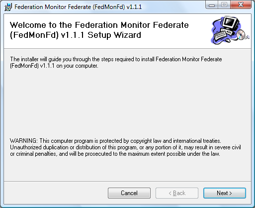
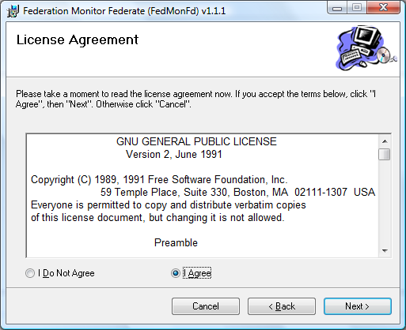
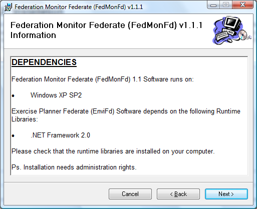
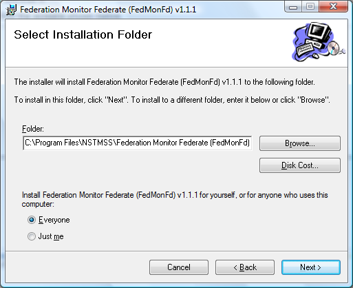
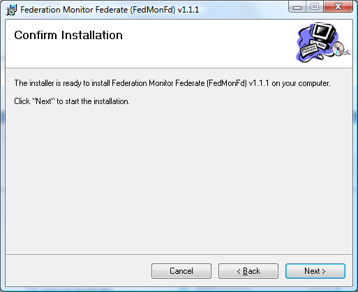
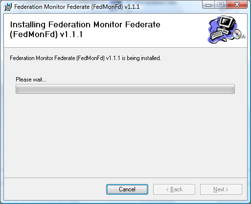
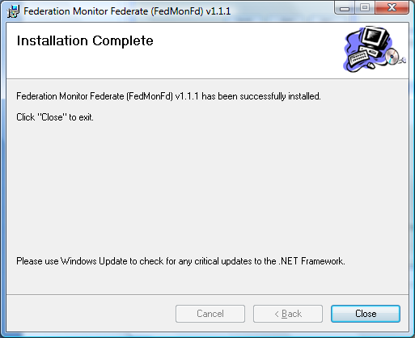
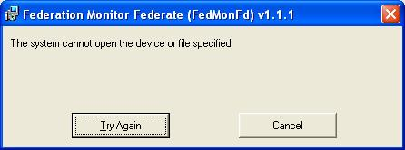
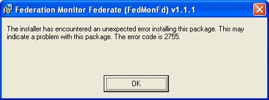

# FedMonFd Installation Manual

> Source: *Implementation/FdApps/FedMonFd/Docs/FedMonFd Installation and User Manual.docx* (Section 1)
>
> See also: [FedMonFd User Manual](FedMonFd/UserManual.md) · [FedMonFd Release Notes](ReleaseNotes.md) · [Development Environment Configuration](../DevelopmentEnvironmentConfiguration.md)

## Contents

- [1. Pre-installation](#1-pre-installation)
- [2. Installation](#2-installation)
- [3. Post-installation](#3-post-installation)
- [4. Troubleshooting](#4-troubleshooting)
- [References](#references)

## 1. Pre-installation

### Hardware and software prerequisites

**Table 1. FedMonFd hardware and software requirements**

| Component | Configuration |
|---|---|
| RAM | FedMonFd uses 55 MB RAM |
| Hard disk space | FedMonFd uses 12 MB hard disk space |
| Others | CD-ROM drive for installation |
| Operating system | Microsoft Windows Vista |
| Runtime environment | Microsoft .NET 2.0 |
| HLA library | DMSO RTI 1.3 NG 6 |

> Installation requires **local administrator rights**.

## 2. Installation

Run `setup.exe`. The installer checks whether FedMonFd is already installed:

- If the **current** version is detected, the installer asks whether to **remove** or **repair** it.
- If a **previous** version is detected, the installer uninstalls it.

Then follow the installer screens:

| | |
|---|---|
|  |  |
|  |  |
|  |  |
|  | |

*Figure 1. Installation*

## 3. Post-installation

- Configure the environment variables for DMSO RTI 1.3-NG-6 [1].

## 4. Troubleshooting

### Missing DLL: `LibRTI-NG.dll` not found

- Install DMSO RTI.
- Configure the RTI environment variables as described in [1].

### `MSVCR71.dll` not found

- Copy `{NSTMSS Installation Directory}\NSTMSS4.1\msvcr71.dll` to `{NSTMSS Installation Directory}\NSTMSS4.1\FedMonFd1.0\`.

### "The system cannot open the device or file specified"

- **Problem:** the installation file is on an encrypted volume, or the `Temp` folder is encrypted.

  

  

  *Figure 2. System cannot find the file specified error*

- **Solution:** open the folder or volume properties and clear the encryption option.

## References

1. Topçu, O., *NSTMSS Development Environment Configuration Manual*, November 17, 2004. — see [Development Environment Configuration](../DevelopmentEnvironmentConfiguration.md) for the latest version.
