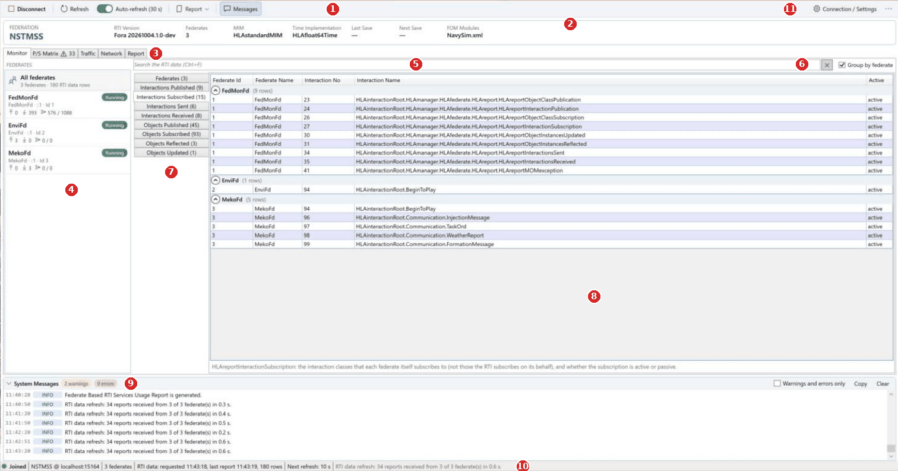
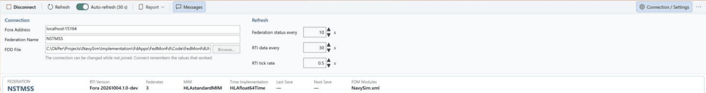
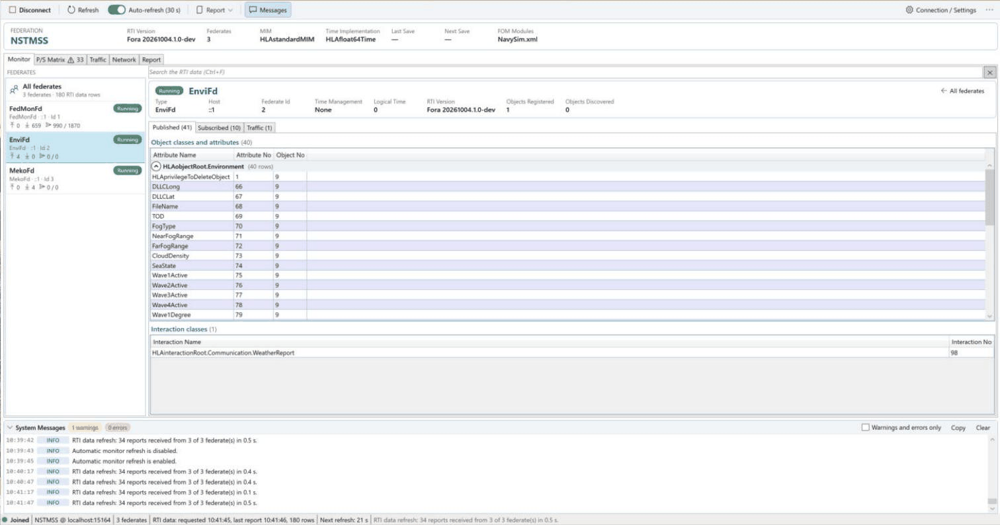
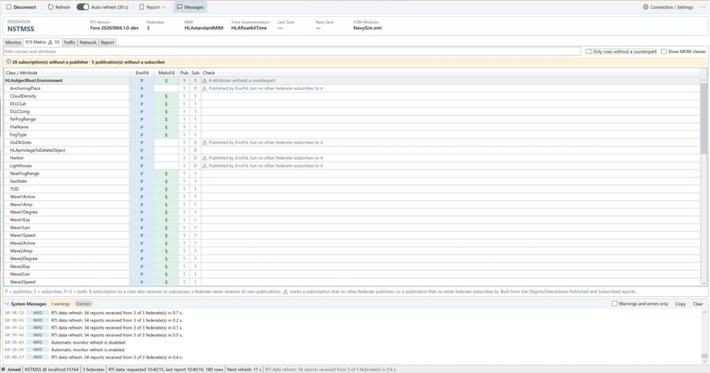
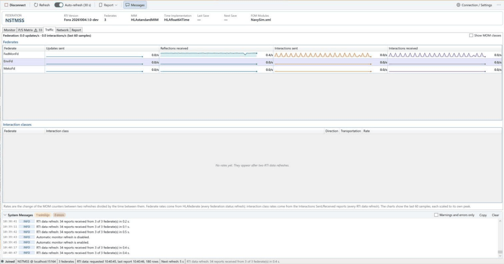
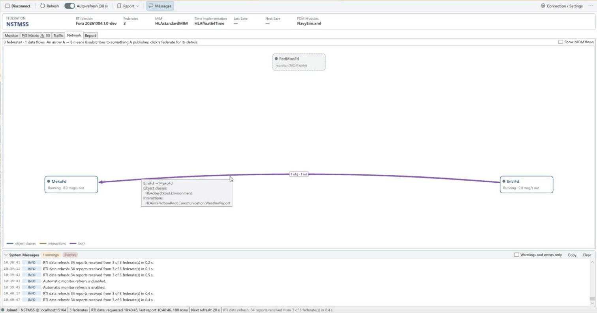
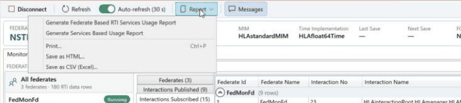
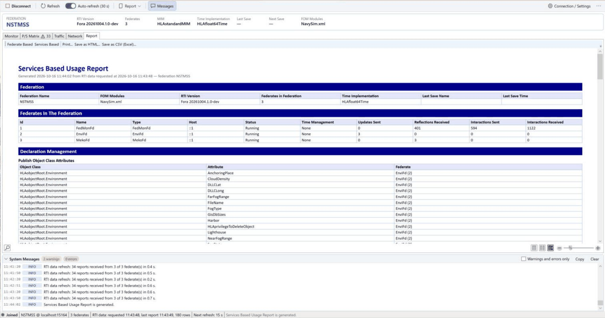
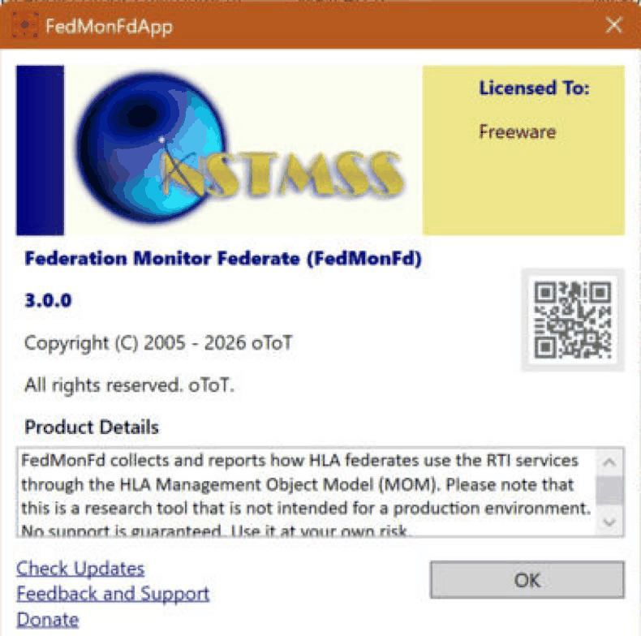

# FedMonFd User Manual

> Applies to FedMonFd **3.0.0** (.NET 10, Fora). The FedMonFd 2.0.0 manual is kept in *Implementation/FdApps/FedMonFd/Docs/Archive/FedMonFd Installation and User Manual.docx*.
>
> See also: [FedMonFd Installation Manual](InstallationManual.md) · [FedMonFd Release Notes](ReleaseNotes.md) · [FedMonFd Architecture](FedMonFd/Architecture.md) · [NavySim Architecture – Federation Monitor Federate](../Architecture/03-Federates.md#35-federation-monitor-federate)

## Contents

- [1. Introduction](#1-introduction)
- [2. Before you start](#2-before-you-start)
- [3. The main window](#3-the-main-window)
- [4. Connecting to a federation](#4-connecting-to-a-federation)
- [5. Federation and federates (Monitor tab)](#5-federation-and-federates-monitor-tab)
- [6. RTI data tables](#6-rti-data-tables)
- [7. P/S Matrix](#7-ps-matrix)
- [8. P/S Diagrams](#8-ps-diagrams)
- [9. Traffic](#9-traffic)
- [10. Services](#10-services)
- [11. Network](#11-network)
- [12. Reports](#12-reports)
- [13. System messages](#13-system-messages)
- [14. Disconnecting and exiting](#14-disconnecting-and-exiting)
- [15. Troubleshooting](#15-troubleshooting)
- [16. Quick reference](#16-quick-reference)
- [Abbreviations](#abbreviations)

## 1. Introduction

The Federation Monitor Federate (FedMonFd) shows what is happening in a running NavySim federation and how each federate uses the RTI services. It joins the federation like any other federate, but it is a **stealth federate**: it does not publish or subscribe to any ship, environment or scenario data, so it does not change the exercise. All information comes from the HLA **Management Object Model (MOM)**, which every IEEE 1516-2025 RTI provides.

With FedMonFd you can:

- see the federation (name, FOM modules, RTI version, number of federates, saves) and every joined federate (type, host, state, time management, message counters);
- select one federate and see what it publishes, what it subscribes to and its traffic;
- see in one **P/S matrix** who publishes and who subscribes to each class and attribute, with a warning for a subscription nobody publishes or a publication nobody subscribes to;
- follow the **message rates** of each federate and interaction class as small charts;
- see the **data flows** between federates as a diagram;
- generate two usage reports, print them (also to PDF) and save them as HTML or CSV (Excel).

## 2. Before you start

| You need | Notes |
|---|---|
| Windows with the .NET 10 Desktop Runtime | See the [Installation Manual](InstallationManual.md). |
| A running **Fora RTI** | Default address `localhost:15164`. FedMonFd cannot work without an RTI. |
| The federation's FDD (FOM) | FedMonFd ships `Fom\NavySim.xml` next to `FedMonFdApp.exe` and selects it by default. Use the same FDD as the other federates. |
| Other federates (optional) | FedMonFd can start alone, but it only shows itself until other federates join. |

Start the program with **FedMonFdApp.exe**. The order of starting FedMonFd and the other federates does not matter: whoever comes first creates the federation, and FedMonFd also sees federates that join or leave later.

FedMonFd remembers your last connection (address, federation, FDD), the refresh rates, the view options and the window size and position, in `%LOCALAPPDATA%\NavySim\FedMonFd\settings.json`. Delete that file to return to the defaults.

## 3. The main window

*Figure 1. FedMonFd joined to NSTMSS with EnviFd and MekoFd; All federates, Interactions Subscribed grouped by federate*

| No | Area | Purpose |
|---|---|---|
| 1 | Command bar | **Connect** / **Disconnect**, **Refresh** (F5), the **Auto-refresh** switch (with the RTI data period), the **Report** menu and **Messages** (shows or hides the message log, Ctrl+L). |
| 2 | Federation card | The federation: name, RTI version, number of federates, MIM, time implementation, last and next save, FOM modules. Before the first data arrive it shows a short note. |
| 3 | View tabs | **Monitor** (federates and RTI data), **P/S Matrix** (with the number of unmatched rows, e.g. *⚠ 33*), **P/S Diagrams**, **Traffic**, **Services**, **Network**, **Report**. |
| 4 | Federate list | *All federates* and every joined federate with its state badge and counters (section 5). |
| 5 | Search box | Filters the RTI data tables (Ctrl+F; Esc or ✕ clears). |
| 6 | Group by federate | Puts the rows of each federate under a foldable header (section 6). |
| 7 | Table tabs | The Federates table and the eight RTI data tables, each with its row count. With a single federate selected, its card and the Published / Subscribed / Traffic tabs appear here instead (section 5.3). |
| 8 | Table | The selected table; the note below it names the MOM report behind it. |
| 9 | System Messages | The message log; click its title bar to fold or unfold it (section 13). |
| 10 | Status bar | Connection state (grey: not joined, orange: connecting/resigning, green: joined), federation @ address, number of federates, last RTI data request and number of rows, countdown to the next refresh, last message. |
| 11 | Connection / Settings, ⋯ | Opens the settings panel (section 4). **⋯** has **About FedMonFd** and **Exit**. |

The bar between the federate list and the tables and the bar above System Messages can be dragged; FedMonFd remembers both. Columns of every table can be resized and sorted by clicking their headers.

### 3.1 Keyboard shortcuts

| Key | Action |
|---|---|
| F5 | Refresh the federation status and the RTI data now |
| Ctrl+F | Go to the search box of the RTI data tables |
| Ctrl+P | Print the current report |
| Ctrl+L | Show or hide System Messages |
| Esc (in a search box) | Clear the search |
| Alt+F4 | Close the window (no confirmation) |

## 4. Connecting to a federation

### 4.1 Connection / Settings panel

*Figure 2. The Connection / Settings panel (while joined, the connection fields are read-only)*

The panel below the command bar opens when FedMonFd starts and after a failed connection, and closes after a successful one. **Connection / Settings** opens and closes it at any time.

| Field | Default | Meaning |
|---|---|---|
| **Fora Address** | `localhost:15164` | Host and port of the Fora RTI. Use the computer name or IP address of the RTI host when it runs on another computer, e.g. `rti-pc:15164`. |
| **Federation Name** | `NSTMSS` | The federation execution to monitor. Must be exactly the name the other federates use. |
| **FDD File** | `…\Fom\NavySim.xml` | The FOM/FDD file. **Browse…** opens in the folder of the current file. The file is read on this computer and sent to the RTI; the RTI does not need a copy. |
| **Federation status every** | 10 s (5–600) | How often the federation card and the federate list (names, states) are refreshed — and the federate counters, when they are not sent by the RTI. |
| **RTI data every** | 30 s (20–3600) | How often the RTI data tables (section 6) are requested again. |
| **P/S declarations every** | 5 s (2–600) | How often only the publications and subscriptions are requested, to follow federates that change their P/S interests at run time (section 8.1). Light: two MOM requests per federate. |
| **RTI tick rate** | 0.5 s (0.05–1) | How often the screen is updated with the data received from the RTI. Smaller values update faster but use more CPU. |
| **Counters sent by the RTI every** | on, 2 s (1–60) | The RTI sends the counters of every federate (updates, reflections, interactions, objects, logical time) by itself at this period, without being asked (MOM `HLAsetTiming`). The Traffic charts then get evenly spaced, finer samples, and FedMonFd no longer requests the counters. Switch it off to request them with the federation status as before. The line below the rates says where the counters come from. |

The connection fields can be changed only while not joined; while joined they are read-only (you can still select and copy them). The rates and the counter period can be changed at any time.

With **Counters sent by the RTI** on, FedMonFd asks the RTI for the period for every federate as soon as it appears, also for federates that join later, and stops the periodic updates again when you disconnect. The period is a property of the federate in the RTI: if two FedMonFds watch the same federation, the last one that sets it wins, and the first one to disconnect stops it for both (the other one then shows the counters only with the federation status; switch the option off and on there to start them again).

### 4.2 Connect

1. Check **Fora Address**, **Federation Name** and **FDD File**.
2. Click **Connect** in the command bar. The state in the status bar turns orange (*Connecting…*).
3. On success:
   - FedMonFd creates the federation if it does not exist yet, otherwise it joins the existing one;
   - **Connect** becomes **Disconnect**, the state turns green (*Joined*) and the settings panel closes;
   - the federation card and the federate list fill within a few seconds; the first RTI data arrive after the first refresh (or press F5);
   - FedMonFd remembers the address, federation and FDD that worked.

> If another FedMonFd is already in the federation, this one joins under a name given by the RTI. Several monitors can watch the same federation.

If the connection fails, the error appears in System Messages in red, the message log and the settings panel open, and **Connect** is enabled again (see [Troubleshooting](#15-troubleshooting)).

### 4.3 Refresh and Auto-refresh

**Refresh** (F5) asks for the federation status and all RTI data at once and restarts the RTI data period. With **Auto-refresh** on, FedMonFd does this by itself with the rates of the settings panel; the status bar counts down to the next RTI data refresh. Switch it off to read a table without it changing.

Each RTI data refresh **clears the RTI data tables** and asks every federate for its data again; the answers arrive within a second or two. One line in System Messages summarizes them, e.g. *RTI data refresh: 34 reports received from 3 of 3 federate(s) in 0.4 s.*

## 5. Federation and federates (Monitor tab)

### 5.1 Federation card

| Field | Meaning |
|---|---|
| Federation | Name of the federation execution. |
| RTI Version | Name and version of the RTI. |
| Federates | Number of joined federates, including FedMonFd. |
| MIM | The MOM/MIM module used by the RTI (normally `HLAstandardMIM`). |
| Time Implementation | Logical time type, e.g. `HLAfloat64Time`. |
| Last Save / Next Save | Name and logical time (`name @ time`) of the last and of a scheduled federation save; — when none. |
| FOM Modules | The FOM module files the federation was created with; point at the value to see a long list. |

### 5.2 Federate list

The list on the left starts with **All federates** (number of federates and RTI data rows), then one entry per joined federate:

- **name** and a **state badge**: green *Running*, orange *Saving* or *Restoring*;
- **type · host · Id** — the Id is the federate handle given by the RTI; the same Id is used in all tables and reports. `::1` or `127.0.0.1` as host means the same computer as the RTI;
- **counters**: ↑ attribute updates sent, ↓ reflections received, ▷ interactions sent / received since the federate joined.

FedMonFd's own entry shows its MOM traffic. Federates that join appear at once; federates that leave disappear.

### 5.3 One federate

Click a federate in the list (or in the [Network](#11-network) view) to see it alone.

*Figure 3. EnviFd selected: its card and the object classes and attributes it publishes, grouped by class*
 The card shows its type, host, Id, time management (`None`, `Regulating`, `Constrained` or both), logical time, RTI version, and the object instances it registered and discovered. Below it:

| Tab | Content |
|---|---|
| **Published** | *Object classes and attributes* it publishes, grouped by object class (click a group to fold it), and the *interaction classes* it publishes. |
| **Subscribed** | The same for its subscriptions, with **Active** (`active`/`passive`) and **Max Update Rate**. |
| **Traffic** | *Interactions sent* and *received* per class and transportation type, and the number of *object instances updated* and *reflected* per class. |

The numbers in the tab names are the rows shown. The search box filters these tables too. **← All federates** returns to all tables.

## 6. RTI data tables

With **All federates** selected, the right side shows the tables of every federate, one per tab on the left; each tab shows its row count, e.g. *Objects Published (45)*. The note below a table names the MOM report behind it.

| Table | Content |
|---|---|
| **Federates** | One row per joined federate with all its status values and counters, and its RTI Handle (the federate's MOM object, useful when comparing with RTI logs). |
| **Interactions Published** | The interaction classes each federate publishes. |
| **Interactions Subscribed** | The interaction classes each federate itself subscribes to, with **Active** (`active`/`passive`). |
| **Interactions Sent** / **Received** | How many interactions of each class each federate has sent / received since it joined, per **Transportation Type** (`HLAreliable`, `HLAbestEffort`). |
| **Objects Published** | One row per published attribute. **Number Of Classes** is how many object classes the federate publishes. Every published class includes the standard attribute `HLAprivilegeToDeleteObject`. |
| **Objects Subscribed** | One row per subscribed attribute, with **Active** and **Max Update Rate** (the update rate name requested, empty when none). |
| **Objects Reflected** / **Updated** | Per federate and object class, the number of object instances the federate has received updates for / has updated. |

Common columns: **Federate Id** and **Federate Name** identify the federate; **…No** is the RTI handle of the class or attribute and **…Name** its full FOM name.

- **Search:** type words into the search box; a row is shown when it contains every word in any column (e.g. `Meko Posture`). The tab shows *(shown/total)* while a search hides rows.
- **Group by federate:** puts the rows of each federate under a foldable header with its row count.
- **Published / Subscribed tables** keep their rows between refreshes: a federate's rows are replaced at once when its new set of reports is complete, so these tables (and the P/S Matrix and Diagrams) never show a half-received state. The rows of a federate that leaves are removed.
- An empty table shows a hint: either no refresh has been done yet, or the federates have no data of that kind (for example, Objects Updated stays empty until a federate updates an object instance).

## 7. P/S Matrix

The P/S Matrix shows in one table who publishes and who subscribes to each class and attribute — the *P/S Status* view planned since FedMonFd 2.0.

*Figure 4. EnviFd publishes the Environment attributes and MekoFd subscribes to most of them; four are published but not subscribed*

- **Rows:** each object class (bold, grey) followed by its attributes, then the interaction classes (light orange).
- **Columns:** one per federate that publishes or subscribes to a shown row; **Pub** and **Sub** count the federates.
- **Cells:** **P** (blue) publishes, **S** (green) subscribes, **P+S** (purple) both.
- **Check:** ⚠ marks a row without a counterpart:
  - orange — *Subscribed by …, but no other federate publishes it*: the subscriber waits for data that never comes;
  - grey — *Published by …, but no other federate subscribes to it*: the data are not used by anyone.

  A class row says how many of its attributes have no counterpart, and of which kind, e.g. *2 subscribed without a publisher · 1 published without a subscriber*; its attribute rows below tell which federates are concerned.

FedMonFd applies the HLA rules: a subscription to a class also receives the publications of its subclasses, and a federate never receives its own publications (so a federate that both publishes and subscribes to an attribute, with nobody else publishing it, is flagged). `HLAprivilegeToDeleteObject` is never flagged.

| Control | Action |
|---|---|
| Filter box | Shows the classes and attributes whose name contains every word. |
| **Only rows without a counterpart** | Shows only the flagged rows. |
| **Show MOM classes** | Also shows the HLAmanager classes. They are hidden and not counted by default, because the RTI, not a federate, publishes them. |

The banner above the table sums up the result; the tab name shows the number of flagged rows. When this number changes after a refresh, System Messages get a *P/S check* line (a warning when a subscription has no publisher). The matrix is built from the Objects/Interactions Published and Subscribed tables, so it is as current as the last RTI data refresh.

## 8. P/S Diagrams

The P/S Diagrams tab draws the Publish/Subscribe diagrams of the federation in the notation of *Distributed Simulation*, Chapter 2 (Topçu et al., 2003), from the same publications and subscriptions as the P/S Matrix.

- **Boxes** are classes. The header shows the P/S status of the class in the federation as a coloured tag (**[P]**, **[S]** or **[PS]**), the class name and «ObjectClass» or «InteractionClass». The body lists the attributes (object classes) or parameters (interactions), taken from the FDD that FedMonFd joined with; members that no federate declares are shown in grey italics.
- **Ellipses** are joined federates.
- **Arrows**: from a federate to a class = **publishes** (blue), from a class to a federate = **subscribes** (green), both ways = **publishes and subscribes** (purple). The label names the members: `P(*)`, `S(Callsign,Position)`, `PS(*)`; `*` means all attributes, and interactions are always `(*)` because they are sent and received as a whole. When a federate publishes and subscribes different attributes, the label shows both, e.g. `P(*) S(Callsign)`.

The switch at the top of the list chooses the view:

| View | Shows | Use it to |
|---|---|---|
| **By class** | One class in the middle, its publishers on the left and its subscribers on the right (class-based P/S diagram). | Check who produces and who needs a class, and which attributes each one uses. ⚠ marks a class with an unmatched publication or subscription; point at it for the attributes concerned and the federates. In the class box, each such attribute has a ⚠ (orange: nobody publishes it, grey: nobody subscribes to it). |
| **By federate** | One federate on the left and every class it publishes or subscribes to on the right, each with the federate's own tag (federate-based P/S diagram). | Review what a federate can produce and what it needs, e.g. for reuse. |

- Type into the filter box to show only the diagrams whose class, members or federates contain the words.
- **Point at an arrow** to highlight it and the members it carries; the tooltip spells them out. **Click a federate** in a class diagram to open its federate diagram, and **click a class** in a federate diagram to open its class diagram.
- **Fit** shrinks a large diagram into the window; switch it off to see it at full size with scroll bars.
- **Copy** puts the diagram on the clipboard as an image; **Save PNG…** saves it; **Export all…** saves every class and federate diagram into a folder (`PS_ObjectClass_Ship.png`, `PS_Federate_ShipFd.png`, …), ready for design documents.
- **Show MOM classes** adds the HLAmanager classes and the monitors.

If the FDD cannot be read, a class shows only the members that some federate declared, and `*` is not used; the line above the diagram says which source is used.

### 8.1 Run-time changes

Federates may change their P/S interests during the execution (publish, subscribe, unpublish, unsubscribe). FedMonFd follows them:

- **Detection.** Every *P/S declarations* period (default 5 s) FedMonFd asks every federate for its publications and subscriptions. For a federate with service reporting on (section 10), each Publish/Subscribe/Unpublish/Unsubscribe call is seen at once, and FedMonFd asks for that federate's declarations about 0.3 s later.
- **Marks.** A change is shown in the diagrams for one minute: a new arc glows with **NEW**, an arc whose members or direction changed with **CHANGED**, and a withdrawn declaration stays as a dashed, faded arc with **REMOVED** (a federate or class that only has withdrawn arcs is faded too). The list shows **CHANGED** next to the classes and federates concerned. Point at an arc for the change with its time.
- **Log.** Each change is written to System Messages, e.g. `P/S change: MekoFd now subscribes to Environment (SeaState, Wind).`, `P/S change: EnviFd no longer publishes WeatherReport.`, `P/S change: TacPicFd subscribes to Ship: + Speed, − Heading.` A federate that joins or leaves gets one line with its number of publications and subscriptions.

Changes are counted from the first complete refresh after Connect; the declarations found then are the baseline, not changes.

## 9. Traffic

The Traffic tab answers *what is happening now*: messages per second, calculated from how much the MOM counters grew between two samples. With **Counters sent by the RTI** on (default, section 4.1), the RTI sends a sample every 2 s; otherwise a sample comes with each federation status refresh.

*Figure 5. FedMonFd's own MOM traffic; EnviFd and MekoFd are idle*

| Table | Values | Updated |
|---|---|---|
| **Federates** | Updates sent, reflections received, interactions sent, interactions received — per second | every periodic RTI update (2 s), or every federation status refresh (10 s) |
| **Interaction classes** | Interactions per second per federate, class, direction and transportation type | every RTI data refresh (30 s) |

Each cell has a small chart of the last 60 values, scaled to its own highest value, and the latest value (e.g. *0.4/s*). Point at a cell to see the counter. The line above the tables sums the federation's updates and interactions per second.

- The first value appears after the second refresh. A federate that rejoins starts a new chart.
- Short peaks between two samples are averaged; a shorter counter period (down to 1 s) gives finer charts. Samples closer than 0.5 s to the previous one are skipped.
- **Show MOM classes** also lists the MOM requests and reports of the monitors, which are hidden by default. An empty *Interaction classes* table means that no federate has sent or received a (non-MOM) interaction yet.

## 10. Services

The Services tab shows which RTI services each federate calls, how often, and whether the calls succeed — the *RTI Services Usage* measured by the RTI itself, not estimated from the tables.

It uses the *Service Reporting Switch* of the HLA MOM: while it is on for a federate, the RTI sends FedMonFd a report (`HLAreportServiceInvocation`) for every HLA service the federate calls or receives as a callback.

**Federates** (left):

| Column | Meaning |
|---|---|
| **Reporting** | The switch. Click it to switch service reporting on or off; it shows *switching on…* until the RTI confirms. FedMonFd itself (and any other monitor) shows *monitor* and cannot be switched on. |
| **Calls**, **Calls/s** | Reported service calls and their rate, with a chart of the last 60 seconds. |
| **Failed** | Calls that ended with an exception. |
| **Lost** | Reports that did not arrive, found from their serial numbers. |

**Services** (right): one row per federate and service (e.g. *UpdateAttributeValues*, *SendInteraction*, *ReflectAttributeValues*), grouped by federate, busiest first: service group, calls, calls per second, failures, the last exception, and the arguments of the last call (point at it to see all of it). Type into the filter box to show only the services whose name, group or federate contains the words.

- **Report all** switches reporting on for every federate except the monitors; **Stop all** switches it off; **Reset counts** starts counting from zero.
- Every service call becomes one extra MOM message. Switch reporting on only for the federates you study, and only as long as you need it.
- FedMonFd switches reporting off for every federate it switched on when you **Disconnect**. If FedMonFd is closed abnormally, switch it off with **Stop all** next time, or restart the federate.
- The counts are kept after Disconnect and appear in both reports (section 12) as *Measured Service Invocations*. A new Connect clears them.
- If the RTI does not offer service reporting, the line above the tables says so and the switches stay disabled.

## 11. Network

The Network tab draws the federates and the data flows between them — the *Network Status* view planned since FedMonFd 2.0.

*Figure 6. EnviFd sends the Environment object class and the WeatherReport interaction to MekoFd*

- **Boxes** are federates, with a state dot and their outgoing messages per second (updates + interactions sent). FedMonFd is shown with a dashed frame as *monitor (MOM only)*.
- An **arrow A → B** means that B subscribes to something A publishes; its label counts the classes (*1 obj · 1 int*). Colour: **blue** object classes, **orange** interactions, **purple** both. More classes make a thicker arrow.
- **Point at an arrow** to list its object and interaction classes; point at a box for its incoming and outgoing flows.
- **Click a box** to open that federate in the Monitor tab.
- **Show MOM flows** adds the MOM classes (normally no flow appears, because the RTI serves MOM data).

The diagram is built from the same publications and subscriptions as the P/S Matrix, with the same rules.

## 12. Reports

### 12.1 Generating a report

1. Optionally press **Refresh** (F5) so the report uses current RTI data.
2. Open **Report** in the command bar and choose **Generate Federate Based RTI Services Usage Report** or **Generate Services Based Usage Report** (or use the buttons on the Report tab).
3. The **Report** tab opens and shows the report; System Messages confirm it.

*Figure 7. The Report menu of the command bar*

A report is a snapshot of the tables at that moment; later data do not change it. Reports can also be generated after disconnecting, from the data received before.

### 12.2 Federate Based RTI Services Usage Report

Federation and federate list, then one chapter per federate with its objects and interactions published and subscribed, objects updated and reflected, and interactions sent and received. With service reporting used (section 10), each chapter ends with the federate's *Measured Service Invocations*: calls, failures and last exception per service.

### 12.3 Services Based Usage Report

Federation and federate list, then one chapter per service group:

- **Declaration Management:** for each object class attribute and interaction class, which federates publish or subscribe to it;
- **Object Management:** for each class, which federates update, reflect, send or receive it, with counts and totals;
- **Measured Service Invocations** (when service reporting was used, section 10): for each service group, the calls and failures of each service per federate.

### 12.4 Reading, printing and saving

*Figure 8. The Report tab with a Services Based Usage Report*

| Control | Action |
|---|---|
| Scroll bar / mouse wheel | Scroll the report. |
| Magnifier (bottom left of the report) | Find text in the report. |
| Page view buttons and zoom slider (bottom right) | Page, two-page or scroll view; zoom in/out. |
| **Print…** (Report menu, Report tab or Ctrl+P) | Print with the Windows print dialog. Choose **Microsoft Print to PDF** to get a PDF file. |
| **Save as HTML…** | Save the report as a web page; it opens in any browser and can be printed from there. |
| **Save as CSV (Excel)…** | Save all report tables in one CSV file (each table under its section name) to open in Excel. |

## 13. System messages

System Messages is the panel at the bottom of the window. Its title bar shows the number of warnings and errors and, while folded, the newest message; click it (or **Messages**, Ctrl+L) to fold or unfold the panel, and drag the bar above it to change its height.

Each message has a **time**, a **level** and the text:

| Level | Colour | Examples |
|---|---|---|
| INFO | blue badge | Connection, join, declarations, discovered federates, refresh summaries, report actions |
| WARNING | amber badge and text | A federate did not answer a refresh, a MOM exception, a P/S check with unpublished subscriptions, a Fora warning |
| ERROR | red badge and bold red text | Connection failed, connection lost, an RTI call failed |

| Control | Action |
|---|---|
| **Warnings and errors only** | Hides the INFO messages. |
| **Copy** | Copies the shown messages (time, level, text) to the clipboard, e.g. for a bug report. |
| **Clear** | Empties the log and the counters. |

| Message (examples) | Meaning |
|---|---|
| `Connected to Fora RTI at localhost:15164.` | The RTI was reached. |
| `Federation <NSTMSS> is created.` / `Federation execution <NSTMSS> already exists.` | FedMonFd created the federation / joined an existing one. |
| `Federate <handle:3> is joined to federation <NSTMSS>.` | Join completed; 3 is FedMonFd's Id. |
| `Subscribed to […]`, `Published […]` | MOM declarations made after joining. |
| `Discovered HLAmanager.HLAfederate object <…> (HLAfederate_2).` | A federate (here Id 2) is known to FedMonFd. |
| `Object <…> delete event is received.` | A federate left; it is removed from the list. |
| `RTI data refresh: 34 reports received from 3 of 3 federate(s) in 0.4 s.` | One RTI data refresh is complete. A warning when fewer federates answered than were asked, or when *no report was received*. |
| `P/S check: 28 subscription(s) without a publisher, 5 publication(s) without a subscriber. See the P/S Matrix.` | The P/S Matrix result changed. |
| `P/S change: MekoFd now subscribes to Environment (SeaState, Wind).` | A federate changed its P/S interests at run time (section 8.1). |
| `MOM exception for federate …` | The RTI could not answer a request (normally harmless). |
| `… Usage Report is generated.`, `Report is saved to …` | Reporting actions. |
| `Federate is resigned from federation.`, `Federation <…> is destroyed.` / `… Federation is not destroyed.` | Disconnect results (section 14). |
| `[Fora] …` | Messages of the Fora connection, with Fora's own level. |
| `FedMonFd cannot create or join the federation: …` | Connect failed; see section 15. |
| `View update failed: …` | A view could not be rebuilt; please copy the message into a bug report. |

## 14. Disconnecting and exiting

Click **Disconnect** in the command bar. FedMonFd leaves the federation and:

- **destroys the federation** if it was the last federate in it;
- otherwise keeps it running for the other federates and reports *There are still federates joined in the federation. Federation is not destroyed.*

The tables, the P/S Matrix, the Network view and the last report stay on the screen, so you can still generate, print or save reports. The next **Connect** clears them.

**⋯ → Exit** asks for confirmation; closing the window (✕ or Alt+F4) closes without asking. While joined, FedMonFd first disconnects automatically. It saves its settings and window layout on exit.

*Figure 9. Exit confirmation*

**⋯ → About FedMonFd** shows the version and license.

*Figure 10. About FedMonFd*

## 15. Troubleshooting

| Symptom | Cause and solution |
|---|---|
| `FedMonFd cannot create or join the federation: The FP connection could not be established.` | No RTI at the Fora Address. Start the Fora RTI, check the host name and port (default 15164) and the firewall, then try again. |
| `Fora RTI at … did not answer in 20 s.` | The RTI host is unreachable or busy. Check the network and the RTI. |
| `FedMonFd cannot open the FDD file '…'.` | The FDD path is wrong. Use **Browse…** or restore `…\Fom\NavySim.xml`. |
| Connect fails with an FOM/FDD error | The FDD differs from the one the federation was created with or is invalid. Use the same FDD as the other federates. |
| The federate list shows only FedMonFd | No other federate joined *this* federation. Check that all federates use the same Federation Name and RTI address. |
| An RTI data table, the P/S Matrix, the P/S Diagrams or the Network view is empty | No RTI data refresh has been done yet, or the federates have no data of that kind. Press **Refresh** (F5). |
| `No federate is known yet; RTI reports are not requested.` | The federate list was still empty when you refreshed. Wait until it fills and refresh again. |
| `RTI data refresh: no report was received …` | The federates did not answer within 15 s; check that they are still running and refresh again. |
| The P/S Matrix flags many rows | Expected while only some federates are running: a subscription is flagged until a federate that publishes it joins. Check the flagged rows against the federation agreements. |
| Services: a switch goes back to *off* with a warning | The RTI refused the switch (see the MOM exception in System Messages), or the federate left. |
| Services: *Lost* grows | The RTI dropped reports under load. Switch reporting on for fewer federates. |
| Traffic shows 0.0/s everywhere | The federates are idle, or only one sample has arrived. Rates need two samples. |
| `This RTI does not offer HLAsetTiming …` | The RTI's MOM has no periodic updates. FedMonFd requests the counters with the federation status instead. |
| The Traffic charts become coarse after another FedMonFd disconnected | It stopped the periodic updates for all monitors. Switch **Counters sent by the RTI** off and on again. |
| Tables change while you read them | Switch **Auto-refresh** off or increase the rates in Connection / Settings. |
| A federate stays in the list after it was closed | It was not resigned properly; the RTI removes it when its connection times out. |
| `Connection to the RTI is lost …` (error) | The RTI stopped or the network failed for a long time. FedMonFd leaves the session and **Connect** is enabled again. |
| The window opens off-screen or too small | Delete `%LOCALAPPDATA%\NavySim\FedMonFd\settings.json`. |

## 16. Quick reference

| Task | Steps |
|---|---|
| Monitor a federation | Connection / Settings → check address, federation, FDD → **Connect**. |
| Refresh everything now | **Refresh** or F5. |
| Change refresh periods | Connection / Settings → *Federation status every*, *RTI data every*, *P/S declarations every*, *Counters sent by the RTI every*; or switch **Auto-refresh** off. |
| Inspect one federate | Monitor → click it in the federate list (or in Network). |
| Find who publishes / subscribes to a class | P/S Matrix → type the class name into the filter. |
| Find unmatched publications/subscriptions | P/S Matrix → **Only rows without a counterpart**. |
| Draw who publishes/subscribes a class (for a document) | P/S Diagrams → **By class** → select the class → **Save PNG…**, or **Export all…**. |
| See what a federate produces and needs | P/S Diagrams → **By federate**. |
| Follow P/S changes during the run | P/S Diagrams (NEW / CHANGED / REMOVED marks) and System Messages (`P/S change: …`); switch service reporting on for a federate to see its changes at once. |
| See what is happening now | Traffic. |
| Measure which RTI services a federate calls | Services → switch **Reporting** on for it; switch it off when done. |
| See who sends data to whom | Network; point at an arrow for the classes. |
| Make a PDF report | Report → Generate … → Ctrl+P → *Microsoft Print to PDF*. |
| Export to Excel | Report → Generate … → **Save as CSV (Excel)…**. |
| Stop monitoring | **Disconnect**. |
| Copy messages for a bug report | System Messages → **Copy**, paste into the report. |

## Abbreviations

| Term | Meaning |
|---|---|
| CSV | Comma-Separated Values |
| FDD | FOM Document Data — the FOM file(s) a federation is created with |
| FedMonFd | Federation Monitor Federate |
| FOM | Federation Object Model |
| HLA | High Level Architecture (IEEE 1516) |
| MIM | MOM and Initialization Module |
| MOM | Management Object Model |
| P/S | Publication/Subscription |
| PDF | Portable Document Format |
| RTI | Runtime Infrastructure |
