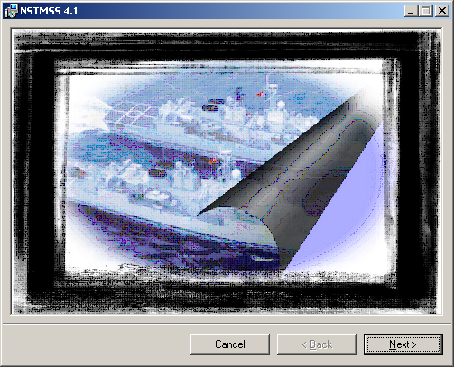
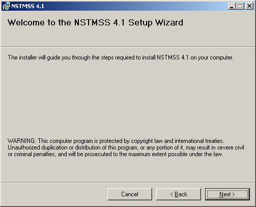
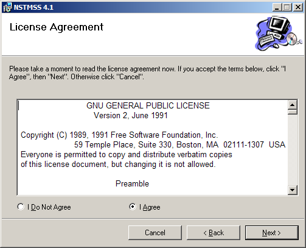
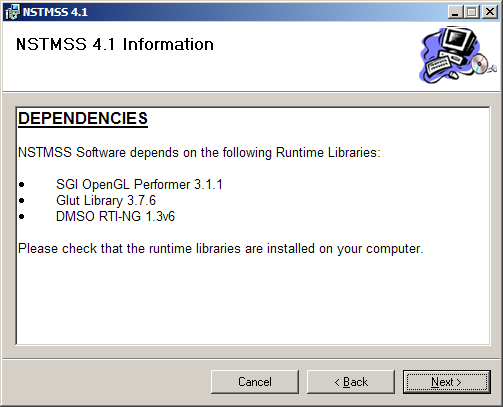
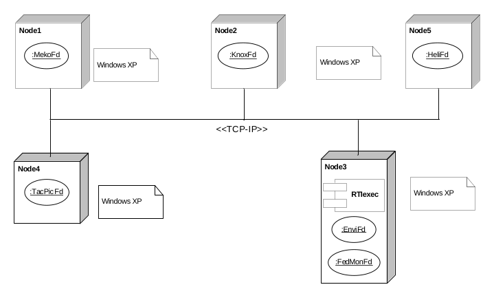

# NavySim Installation Manual

> Source: *NavySim Installation Manual.docx* (document id `nstmss_03012005`)
>
> **Note:** This manual was written for the NSTMSS 4.x/5.0 era (Windows XP, DMSO RTI 1.3-NG-6). The screenshots show the NSTMSS 4.1 installer. For current platform versions see the [Release Notes](ReleaseNotes.md).

## Contents

- [1. Pre-installation](#1-pre-installation)
  - [1.1 Hardware and software prerequisites](#11-hardware-and-software-prerequisites)
  - [1.2 Pre-installation steps for ExPFd, FedMonFd and EnviFd](#12-pre-installation-steps-for-expfd-fedmonfd-and-envifd)
- [2. Installation](#2-installation)
- [3. Post-installation](#3-post-installation)
- [4. Running the federation](#4-running-the-federation)
- [Abbreviations](#abbreviations)

## 1. Pre-installation

### 1.1 Hardware and software prerequisites

**Table 1. Hardware requirements**

| Component | Absolute minimum configuration | Recommended minimum configuration |
|---|---|---|
| RAM | 128 MB | 512 MB |
| Hard disk space | NSTMSS-All: 36 MB | NSTMSS-All: 36 MB |
| Video graphics card | — | — |
| Others | CD-ROM drive | CD-ROM drive |
| Operating system | Windows XP Service Pack 2 | — |

> Installation requires **local administrator rights**.

### 1.2 Pre-installation steps for ExPFd, FedMonFd and EnviFd

The following must be installed before these federates:

- DMSO RTI 1.3-NG-6
- Microsoft .NET Framework 2.0

## 2. Installation

1. **Run `setup.exe`.** The installer checks whether NSTMSS is already installed:
   - If the **current** version is detected, the installer asks whether to **remove** or **repair** it.
   - If a **previous** version is detected, the installer uninstalls it.
2. **Welcome screens.** Click **Next** on both welcome screens.

   
   

   *Figure 1. NSTMSS welcome screens*

3. **License agreement.** If you agree, select **I Agree** and click **Next**.

   

   *Figure 2. License agreement screen*

4. **Software dependencies.** An information screen reminds you of the runtime libraries the software depends on. If these runtimes are not installed before NSTMSS, the federates will not run.

   

   *Figure 3. Software dependencies screen*

   The NSTMSS 4.1 installer lists the following runtime libraries:
   - SGI OpenGL Performer 3.1.1
   - GLUT Library 3.7.6
   - DMSO RTI-NG 1.3v6

5. **Installation directory.** Select the installation directory. The installation then begins; wait for the *installation complete* message.

## 3. Post-installation

1. Configure the environment variables for DMSO RTI 1.3-NG-6 (see the DMSO RTI documentation).

> The original manual also lists a figure *"Configuring Data Source"* (ODBC DSN), but the step is not described in the text.

## 4. Running the federation

1. Check network connectivity and make sure all hosts can **ping** each other.
2. Run **`rtiexec`** first.
3. Start the federates in **any order** — the start order is not important.

A typical deployment is shown below.

*Figure 5. Recommended NSTMSS deployment diagram — MekoFd, KnoxFd, HeliFd and TacPicFd each on their own Windows XP node; `rtiexec`, EnviFd and FedMonFd on a shared node; all connected over TCP/IP.*

> All NSTMSS federates and `rtiexec` can also run on a **single host** without a network. In that case make sure the network adapter has a (pseudo) link.

## Abbreviations

| Term | Meaning |
|---|---|
| DLL | Dynamic Link Library |
| DMSO | U.S.A. Defense Modeling and Simulation Office |
| DSN | Data Source Name |
| EnviFd | Environment Federate |
| ExPFd | Exercise Planner Federate |
| FedMonFd | Federation Monitor Federate |
| GL | Graphics Library |
| GLUT | GL Utility Toolkit |
| HeliFd | Helicopter Federate |
| MekoFd | Meko Frigate Federate |
| NSTMSS | Naval Surface Tactical Maneuvering Simulation System (pronounced *"NiSTMiSS"*) — former name of NavySim |
| ODBC | Open Database Connectivity |
| RAM | Random Access Memory |
| RTI | Runtime Infrastructure |
| TacPicFd | Tactical Picture Federate |
