# MekoFd User Manual

> Applies to the current C# / Stride / Fora application, version **4.0.0**. Updated **2026-10-24**.
>
> See [architecture](Architecture/README.md), [current build and run instructions](../../../Implementation/FdApps/MekoFd/Code/README.md), [release notes](ReleaseNotes.md), [performance evidence](../Shared/Benchmarks.md), and the [installation manual](InstallationManual.md).

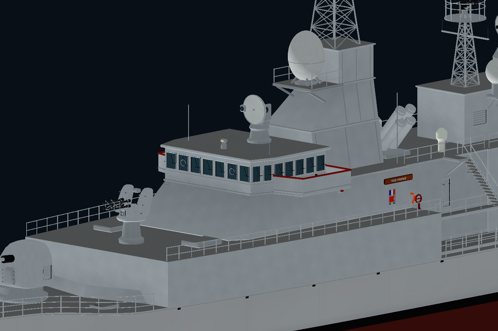

*The current application: control center at the left, ship view at the right, navigation instruments below, scenario/local display clock at the upper right, and the Fora diagnostic bar at the bottom.*

## Contents

- [1. Introduction and quick start](#1-introduction-and-quick-start)
- [2. Ship command centers](#2-ship-command-centers)
- [3. Configuration wizard](#3-configuration-wizard)
- [4. Displays and units](#4-displays-and-units)
- [5. Views for the officer](#5-views-for-the-officer)
- [6. General keyboard controls](#6-general-keyboard-controls)
- [7. Control centers user interface](#7-control-centers-user-interface)
  - [7.1 Ship Control Center (SCC)](#71-ship-control-center-scc)
  - [7.2 Message Control Center (MCC)](#72-message-control-center-mcc)
  - [7.3 Navigation Control Center (NCC)](#73-navigation-control-center-ncc)
  - [7.4 Combat Information Center (CIC)](#74-combat-information-center-cic)
  - [7.5 Transportation Control Center (TCC)](#75-transportation-control-center-tcc)
  - [7.10 Weather center](#710-weather-center)
  - [7.9 Mission summary and readiness](#79-mission-summary-and-readiness)
  - [7.6 Settings](#76-settings)
  - [7.7 Status display and Fora messages](#77-status-display-and-fora-messages)
  - [7.8 About](#78-about)
- [8. Special views and codes](#8-special-views-and-codes)
- [9. Fora connection, offline use and shutdown](#9-fora-connection-offline-use-and-shutdown)
- [10. Scenario, environment and failures](#10-scenario-environment-and-failures)
- [11. Launch options](#11-launch-options)
- [12. Troubleshooting](#12-troubleshooting)
- [13. Current scope and limitations](#13-current-scope-and-limitations)
- [Abbreviations](#abbreviations)
- [Screenshot and implementation references](#screenshot-and-implementation-references)

## 1. Introduction and quick start

MekoFd now uses the common maritime engine in `Implementation/Library/Maritime`. Launch `MekoFd.App` as before; build/run/package scripts remain in its Code folder. A separate `KnoxFd.App` starts TCG Akdeniz F257 through the same sea, weather and control UI. Knox is offline-only and retains unvalidated reference maneuvering behavior. See [shared architecture](Modules.md) and [KnoxFd manual](../KnoxFd/UserManual.md).

The current solution is **`Implementation/FdApps/MekoFd/Code/MekoFd.slnx`** (formerly `CSharp`). Runtime models/textures/sounds are under **`MekoFd/Assets`**; reference source is under **`MekoFd/archive/LegacyCode`**. See the [model/texture catalog](../../../Implementation/Library/Maritime/Assets/README.md) for the default `ships/yavuz-v1` visual profile, original `meko4.flt` diagnostic/rollback source and PBR map locations. The previous enhanced model is preserved and can be selected before launch with `--ship-profile legacy`.

MekoFd lets the Officer of the Watch (OOW) maneuver a frigate, observe other ships, review tactical messages and change the observer's position on the ship. The current application uses a three-dimensional Stride scene and SimGe-generated Fora federation code.

In a connected exercise, MekoFd publishes its own **Meko** ship and observes Meko and Knox contacts. **Knox is subscribe-only** in this federate. The offline wizard can select Knox for local visual/handling use; connected Knox participation requires a separate federate.

The Knox visual now uses the **TCG Akdeniz F257** livery adapted to the existing model: grey weathered hull, black boot topping, red underwater hull, dark decks and F257 markings. Selecting Knox suggests TCG Akdeniz / 257 / TBQR without replacing custom entries. The hull artwork remains F257 even if the editable hull-number field changes. This is a paint adaptation of the coarse original geometry, not a detailed Akdeniz reconstruction. Existing country-selected animated flags remain active.

To start a local session:

1. Launch `MekoFd.App.exe`. Standalone is the default.
2. Choose **Working area** (Boston is the default), then complete **Ship details**, **Environment**, **RTI connection** and **Review and start**. Check the ENC/terrain/harbour readiness cards. If terrain is unavailable, explicitly select **Continue with chart and sea only**.
3. Select **Start simulation**. A loading window shows the ship, lighting and environment preparation stages; **Cancel** stops startup after the current step. It closes when the simulation is ready. The SCC opens with both engines at STOP.
4. Select an engine order on each side, then set a rudder angle or ordered course.
5. Use **F4** for NAV (last TRD/ATD selection; ATD initially), **F3** for messages, **F7** for observer stations, and **F6** for settings.
6. Use **Esc** or the window close button to finish.

For a connected exercise, start Fora and select **Connect to RTI at startup**, or connect later from **F6 Settings > RTI**; see [section 9](#9-fora-connection-offline-use-and-shutdown). In an assigned scenario, ship controls can remain locked until the exercise controller supplies the required scenario data and begins the scenario.

The default MEKO handling profile is intended for stable education and tactical play. It uses open reference data scaled to MEKO candidate dimensions. It is not a certified prediction of real MEKO sea trials. To reproduce the previous handling, launch with `--hydro-profile previous`; normal startup selects the new training profile. [Profile scope and limitations](Architecture/Hydrodynamics.md).

## 2. Ship command centers

| Center | Open | Purpose |
|---|---|---|
| **SCC / SHIP CONTROL** | F2 | Port/starboard engine orders, helm, ordered course and distance steamed |
| **MCC / MESSAGE CONTROL** | F3 | Received/sent message archive and UHF formation-message editor |
| **NCC / NAVIGATION** | F4 | ATD contact selection, tactical map and TRD navigation radar |
| **CIC / COMBAT SYSTEMS** | F5 | ASuW/ASW/AAW selection and available gun training/elevation |
| **SETTINGS** | F6 | Sound, display, sea state, fog, exterior lights/TOD, automatic follow-up and ENC chart library |
| **TCC / TRANSPORTATION** | F7 | Eight Yavuz observer stations, deck walking, special views and code entry |
| **MISSION** | F9 | Received exercise briefing, ship identity and exact start prerequisites |
| **WEATHER / MET** | F10 | True wind compass/speed, sea conditions, sky, fog and last MET report |

Buttons use teal to indicate selection or keyboard focus. Click and release on the same enabled button to activate it. **Tab** moves focus and **Enter/Space** activates a focused button. In MCC text fields, Enter sends the message and Space enters a character. Shift+Tab reverses focus in MCC, CIC, Settings and TCC; SCC and NCC currently cycle forward with Tab.

Use the **‹ / › buttons at the right of each center heading** to move backward/forward through the F1 page sequence. The **nine icons at the right of the bottom status bar** open Ship, Messages, Navigation, Combat, Settings, Transportation, Mission, Weather and Ship Stations / PA directly. Teal marks the active center; hover shows its name and F-key shortcut. Wider windows also show short labels. These shortcuts remain available after F8; clicking the active center restores its current page without clearing a message draft.

Keyboard shortcuts act on the active center. Arrow keys change the observer's look direction. F8 hides both side panels; press F8 again to restore their previous open/closed states without changing the selected center. A center key such as F2 or F4 can also restore access.

## 3. Configuration wizard

### Working area

The first page defaults to **Boston Harbor / approaches** and lists registered ENC packages. **Add ENC…** imports another extracted S-57 folder through the shared importer. The cards independently show ENC, regional terrain/seabed and harbour/quay readiness. Verification runs in the background. Invalid ENC blocks startup; unavailable terrain requires checking **Continue with chart and sea only**. A missing harbour allows terrain/sea operation without quay collision surfaces.

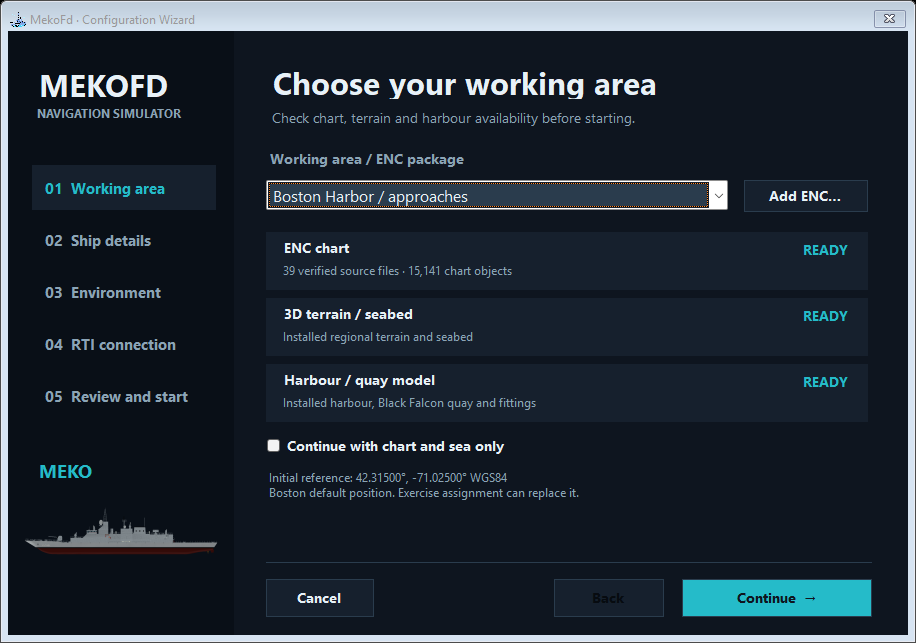

Chart/sea mode loads ocean, ships, supported ENC buoys and the chart, with no regional land/harbour meshes or Boston quay collision obstacles. The review explicitly names this mode. Boston keeps its default reference; imported regions use their chart-coverage extent centre, which is not a surveyed safe start. Set exercise initial positions in Sen. [Working-area policy and limits](../Shared/WorkingAreas.md).

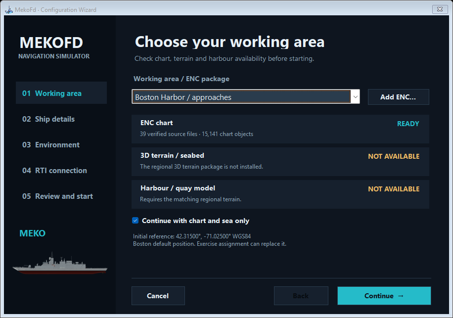

### Ship details

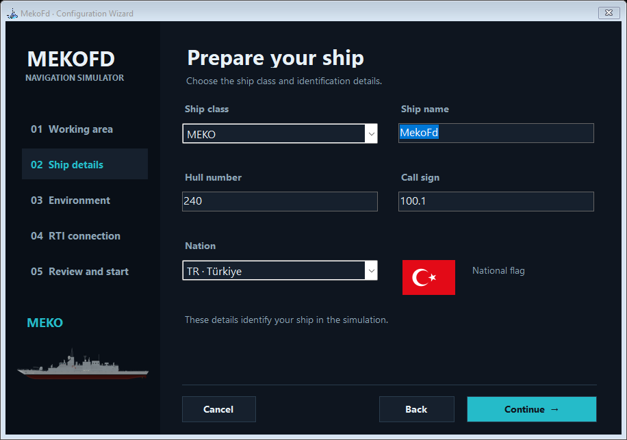

Enter the ship's name, hull number, call sign and nation. Nation offers **TR, US, GB, DE, FR, IT, ES, GR, NL, PT, CA and AU**, with country names and a matching flag preview. The selected national flag appears on your ship and works offline. The sidebar shows the selected ship's model profile. The wizard offers MEKO and KNOX for standalone use. RTI participation supports MEKO only. A blank ship name keeps the wizard on this page and displays a validation message.

| Setting | Current initial value | Meaning |
|---|---|---|
| Ship class | MEKO | Locally controlled model; KNOX is available offline |
| Ship name | MekoFd | Initial ship identity; a task order can assign a different name |
| Hull number | 240 | Initial identification value |
| Call sign | 100.1 | Initial communication identity |
| Nation | TR | ISO country code and displayed national flag; twelve bundled countries |

The hull number is identification data; changing it does not repaint the model's fixed F-240 artwork.

### Environment

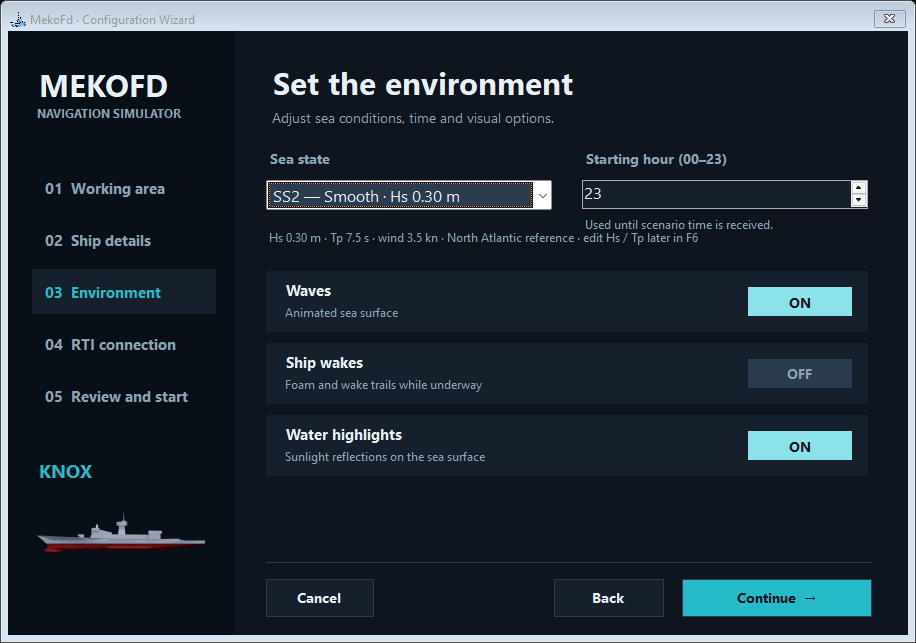

| Setting | Modern-rendering default | Effect |
|---|---|---|
| Sea state | SS0 — Glassy | All WMO codes 0–9 are available; selected Hs/Tp appear in the review |
| Starting hour | 13 | Local display clock and initial lighting hour, before scenario time arrives |
| Waves | ON | Animated sea surface |
| Ship wakes | ON | Wake/foam trails while underway |
| Water highlights | ON | Sea-surface light highlights |

The spectral ocean is the active sea model. Later federation Environment updates can also affect the scene. These wizard choices are initial local settings, not a permanent override of the exercise environment.

### RTI connection

The fourth step selects standalone or **Connect to RTI at startup**. Standalone is initially selected. Connection fields include the RTI address, federation, **Federate name**, local NavySim FDD XML and **Join an existing federation only**. **Use ship name** is checked by default: changing the ship name also changes the proposed federate name. Uncheck it to enter a separate name. An explicit `--client-name` is preserved and disables automatic naming initially. Federate names must be unique within the federation. Default address/federation are `localhost:15164` / `NSTMSS`. A failed connection leaves the simulation running. The fifth step reviews the selected area, scene mode and ship/environment/connection settings.

### Review and start

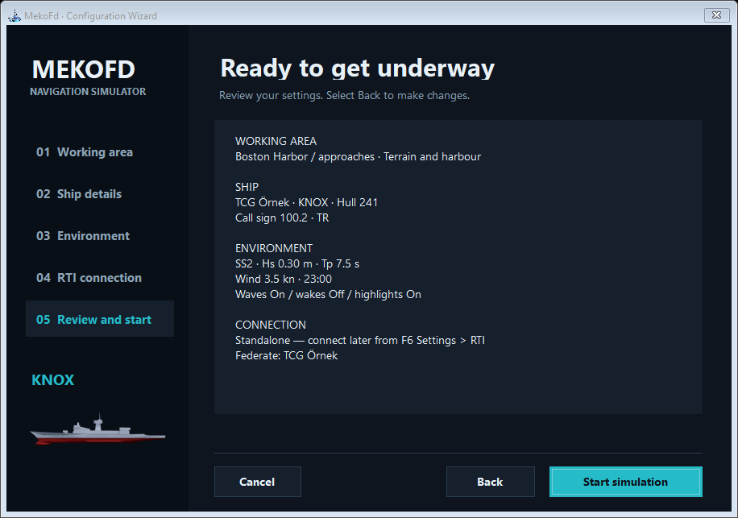

**Back** returns to the previous step without losing entered values. **Continue** advances; **Start simulation** accepts the review, or **Start chart & sea only** when that mode was selected. **Cancel** or Escape exits the wizard. Enter activates Continue/Start.

*The Environment and Review screenshots show an offline KNOX example with edited values. Connected MekoFd uses MEKO; the page flow and controls are the same.*

## 4. Displays and units

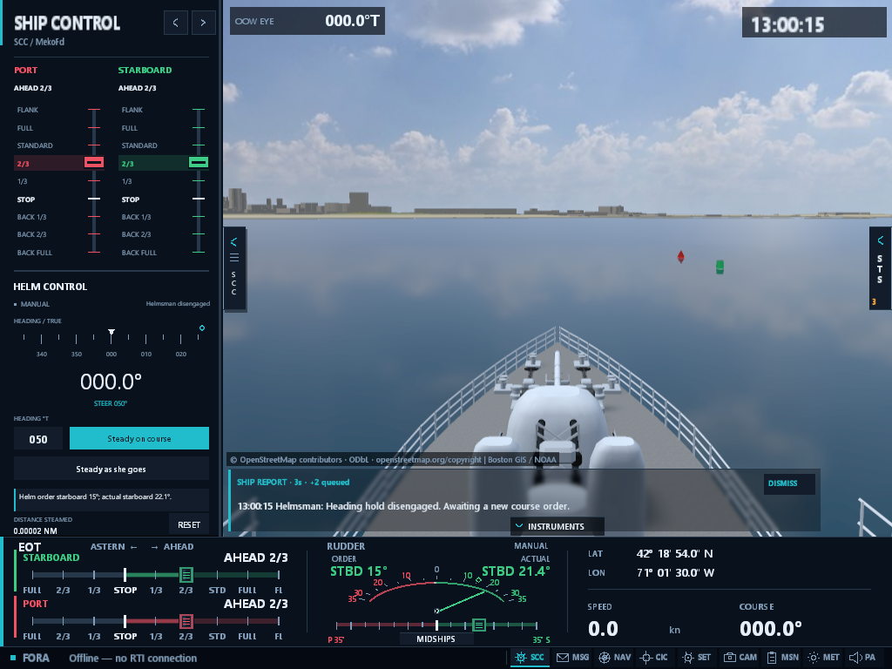

**OOW EYE** is now at the upper left of the main 3D view, above the scene rather than in the lower status instruments. Its **°T** value is the observer's true look bearing, distinct from ship course; it updates when looking around or changing observer mode. It stays visible in every center and follows the expanded view when drawers close. In NAV it overlays the small OOW view; NAV F8 retains it in a compact strip above the plot. At compact sizes with both drawers open, it sits below the clock to avoid overlap.

**INSTRUMENTS**, immediately above the lower bar, collapses or reopens it. It starts open. When collapsed, the scene/chart expands and a translucent read-only strip shows STARBOARD/PORT engine orders and RUDDER ORDER/ACTUAL. Narrow views use two rows. LOCKED remains visible during failures and actual feedback keeps updating. The repeaters do not accept commands, wheel changes or camera movement through them. Reopen the bar for its controls; existing keyboard and SCC commands remain available. The choice persists across centers, Settings, drawers and F8 during the session. Reports appear above the strip. [Shared behavior](../Shared/InstrumentStrip.md).

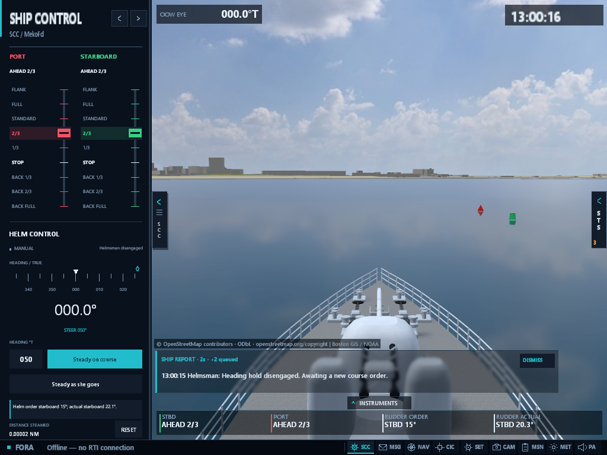

The existing digital speed, course and coordinate layout is retained; its text uses displayed-size dynamic glyphs and pixel-aligned positions for sharper rendering.

The lower **EOT DISPLAY**, when open, accepts mouse commands in every control center, including while F8 hides the side panels:

- **STARBOARD (upper green rail) / PORT (lower red rail):** click a detent or drag the handle horizontally, then release to order that shaft. Astern is left and ahead right; STOP has a prominent white tick. While held, **SET** and the handle preview the new order; the thin white marker shows the committed order when different. Release issues one command. The changed order uses the same machinery path and optional EOT bell as SCC; re-selecting the current order does not ring again.
- **Mouse wheel:** hover the desired rail; wheel up steps toward ahead, wheel down toward astern. Each whole wheel unit selects one order. Fractional input accumulates within that rail; leaving or changing rails clears it. No preliminary click is needed. Both ends clamp without wrapping.
- **RUDDER manual rail, below the arc:** click a detent or drag the gripped handle horizontally. Commands snap to 5° steps from −35° port to +35° starboard. Hover this rail and wheel up toward starboard or down toward port; from a fractional automatic order it selects the next 5° stop in that direction. **MIDSHIPS** orders 0° on release inside its button. Each committed manual command cancels active course holding.
- **LOCKED:** engine/rudder controls are disabled during the relevant failure or before an assigned scenario begins. Other centers, including the radio draft, remain open when using EOT.

The lower rudder instrument uses a bridge-style arc: red to port and green to starboard, with 5° ticks. **ORDER** is the outlined diamond and requested angle; **ACTUAL** is the solid needle and one-decimal physical rudder position. The two can indicate opposite sides while the actuator responds. The arc/readouts are passive; use the lower fifteen-position rail, its wheel control or MIDSHIPS to take manual helm. MANUAL / HELMSMAN / LOCKED states are explicit. SCC retains heading orders and two vertical engine-order levers. Ordering midships does not instantly stop the ship's rotation or enable course hold.

Each engine drag remains captured by its initial shaft, even when moved over the other rail, rudder, chart or 3D view. Release outside the rail commits its clamped horizontal position. A rudder drag also retains capture until release and clamps at its scale ends. Changing center, layout/F8 or window size, losing focus, opening Settings, or a machinery failure cancels a gesture; release and press again. Captured EOT input takes precedence over observer movement. Hovering shows the full order or rudder hint.

The EOT occupies the same lower strip in all centers. At 640 × 480 the redundant EOT/direction heading and intermediate arc numbers are omitted; both shaft rows, rudder 5° ticks, side readouts, zero and manual limits remain. The handle indicates the **committed order**, not actual RPM or pitch; SET is only a preview. STOP can leave a CPP shaft rotating according to the configured machinery policy. [Shared console and input behavior](../Shared/EotConsole.md).

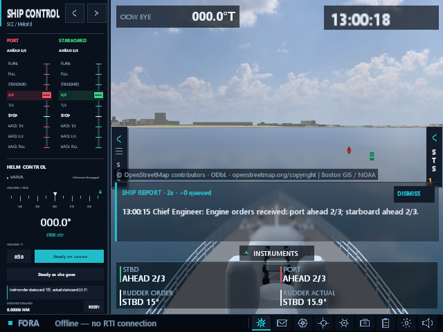

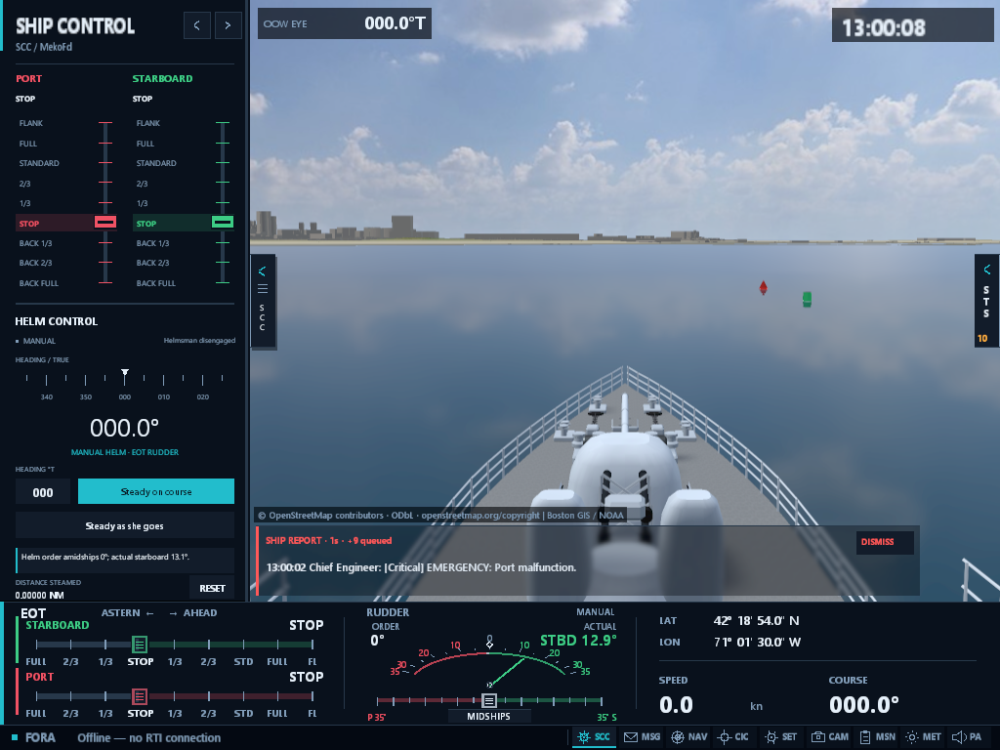

| Instrument / control     | Interpretation                                                                                                                                        |
| ------------------------ | ----------------------------------------------------------------------------------------------------------------------------------------------------- |
| PORT / STARBOARD         | Selected engine order on each side; LOCKED marks a failure or scenario lock                                                                           |
| RUDDER ORDER             | Commanded angle from −35° port to +35° starboard; outlined diamond on the bridge arc and signed PORT/STBD readout. Port red, starboard green                         |
| RUDDER ACTUAL            | Actual rudder position; solid arc needle and direction-coloured decimal readout, independently coloured from the order. It follows the physical actuator |
| OOW EYE, upper-left main view | True look bearing in °T, distinct from ship course; persistent across centers, drawer changes and F8 |
| LAT / LON                | Ship position in degrees, minutes and seconds with hemisphere                                                                                         |
| SPEED                    | Ship speed in knots; engine orders are not direct speed values                                                                                        |
| COURSE                   | Ship course in degrees, normalized to 000–360°                                                                                                        |
| DISTANCE STEAMED, in SCC | Accumulated distance in nautical miles; RESET sets the counter to zero                                                                                |
| Clock, upper right       | Local simulation display time before scenario time is received; authoritative scenario time afterward                                                 |

Bearings are north-based: 000° north, 090° east, 180° south and 270° west. Radar distances use NM. Ship motion responds over time; selecting STOP does not mean the ship's velocity instantly becomes zero.

## 5. Views for the officer

| View | How to select it | Layout |
|---|---|---|
| Ship view with centers | F2/F3/F5/F7/F9/F10, or a corresponding F1 selection | Sliding active center at the left; independent, initially closed Status Messages at the right; expanding 3D scene; fixed collapsible full-width EOT below |
| Tactical display | F4, or ATD in NCC | Right-side NOAA ENC plot, left MEASURE/INSPECT center and small live OOW, collapsible full-width EOT |

**Sliding center console:** click the labelled grip on the right edge of the left panel to close it; the panel slides left and the 3D ship view expands into its space. The grip remains on the left edge: click it to reopen, or swipe it right to open / left to close. A press must start on the grip. The transition takes about **0.34 s**; panel controls are inactive while sliding and when hidden. The lower **EOT, rudder and navigation bar stay stationary when open**; the independent INSTRUMENTS choice can replace them with passive repeaters over the expanded view. Port/starboard machinery orders and manual helm work in the lower EOT even with the console closed.

Closing retains the selected center/page, engine orders, heading control and radio draft. Reopen with the grip, the selected bottom center button, or its function key. Settings preserves the console state beneath the popup. Ship reports float above the full-width EOT as transient cards and reserve no dedicated area. Status history, source filters, scrolling, full-text clicks and Copy All are in the independent right archive, closed by default. TRD/ATD retain their dedicated chart/radar layout beneath the right archive overlay; F8 also retains access to this archive. [Shared implementation and validation](../Shared/CenterDrawer.md).

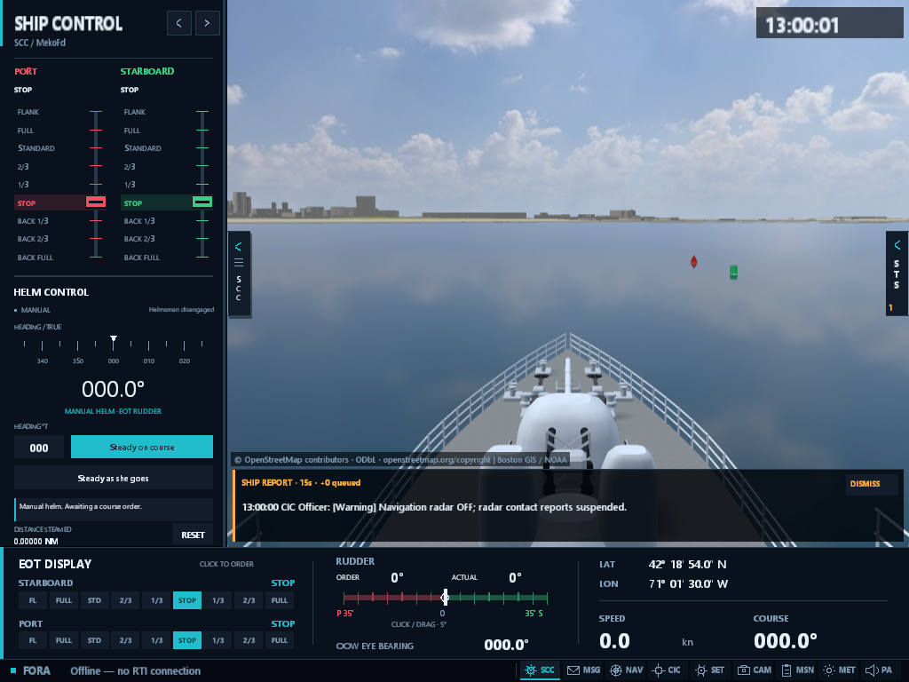

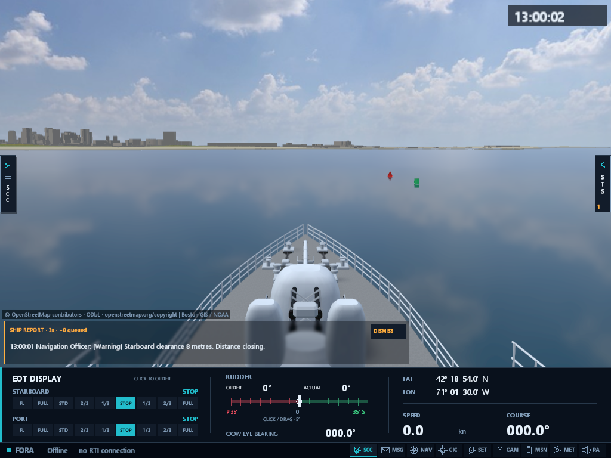

**F8 toggles panels, not the view.** First press hides both panels and remembers their individual states; next press restores those states. The selected center, TRD/ATD, drafts and machinery/heading orders remain unchanged. F8 preserves the separate INSTRUMENTS choice: full EOT/rudder when open, read-only repeaters when collapsed. Bottom center navigation stays visible. The ship scene or selected chart/radar expands into the released width. There is no separate F8 display mode, no instrument auto-hide and no effect on simulation or Fora. [Design and validation](../Shared/PanelVisibility.md).

Use the arrow keys to look left/right/up/down. The selected TCC observer station remains attached to the moving ship. The upper-right clock is omitted from the small ship viewport inside ATD; it remains available in the main ship view.

## 6. General keyboard controls

| Key | Current action |
|---|---|
| Arrow keys | Move the observer's look direction |
| F1 | Cycle SCC → MESSAGES → COMPOSE → ASuW → ASW → AAW → TRD → ATD → SETTINGS → TCC → MISSION → WEATHER |
| F2 | Open SCC |
| F3 | Open MCC MESSAGES archive |
| F4 | Restore the last selected NCC **TRD/ATD** view; a new session starts with ATD |
| F5 | Open CIC ASuW |
| F6 | Open / close Settings popup without changing workspace |
| F7 | Open Transportation |
| F8 | Hide both side panels / restore their previous open or closed states |
| F11 | Open About |
| F9 | Open Mission summary and readiness |
| F10 | Open Weather center |
| F12 | No action assigned |
| Alt+Enter | Toggle borderless full screen on the current monitor |
| Tab | Move focus through the active center's controls |
| Shift+Tab | Reverse focus in MCC, CIC, Settings and TCC |
| Enter / Space | Activate a focused button; see MCC/TCC exceptions below |
| Esc | Close the application and perform federation cleanup |

Shortcuts below that use number-row digits refer to the main keyboard's digit keys. TRD/ATD range shortcuts use numeric-keypad **+ / −**. TCC also accepts NumPad 1–8 on Yavuz (1–7 on Knox/legacy). Letter shortcuts refer to the physical key; there is no requirement to turn Caps Lock on.

## 7. Control centers user interface

### 7.1 Ship Control Center (SCC)

The active MEKO training profile now uses **three-stage heading control**: turn toward the order, check the swing using actual rudder/yaw response, then capture and hold the heading. The final approach is faster than the retained PI baseline. Manual rudder still takes over immediately; the SCC/3D layout is unchanged. [Control stages, measured comparisons and limitations](../Shared/ThreeStageHeadingControl.md).

SCC controls the two engine orders independently and issues heading orders. Manual rudder is operated in the lower EOT display or with the keyboard. The updated SCC capture below shows the combined helm and 3D layout.

The MEKO model has two independent shafts with controllable-pitch propellers. With rudder amidships, port ahead/starboard STOP turns to starboard; the mirrored order turns to port. Opposed orders can turn the ship as well. Astern changes blade pitch through neutral while the shafts continue rotating forward; the response takes time. Steering flow now changes continuously as propeller thrust passes through zero; weak braking does not instantly reverse the modeled incoming water. STOP uses the configured CPP policy: by default the shaft remains connected at minimum shaft RPM and neutral pitch. The ship continues coasting; the optional declutched policy permits windmilling. A failed engine affects only its own command; after repair, issue a fresh order.

The own-ship Yavuz propeller hubs and blades now rotate around their individual shafts using actual port/starboard RPM. A stopped ship can have rotating propellers; CPP astern does not reverse shaft rotation. STOP follows the configured connected-neutral or declutched policy. Bearings, brackets and rudders stay fixed. Visual blade pitch is still fixed, and remote ships do not transmit shaft RPM in the current FOM.

Turning, rudder resistance and unequal propulsion can reduce speed even while the healthy engine remains ahead. The current v8 is a stable MEKO-sized training surrogate using a 5415M-based hull and retained C4-40 CPP/estimated machinery settings; actual Yavuz performance remains uncalibrated. Configurable ahead/astern demands retain the same default handling. See [model and limitations](Architecture/Hydrodynamics.md) and [CPP demand programs](../Shared/PropulsionPrograms.md).

Use the two **vertical EOT levers** in SCC: **PORT** at left is red; **STARBOARD** at right is green. Click an order label and release, or press/drag a lever along its rail. Each lever snaps to its nine engine orders, with FLANK at the top, STOP at its marked neutral detent, and BACK FULL at the bottom. Dragging controls only the captured shaft and clamps at the ends. The lever shows the accepted engine order, not actual shaft RPM or physical CPP pitch. Selected order names remain visible; a failure/scenario lock shows LOCKED and blocks changes. **HELM CONTROL** remains below the levers, with its north-wrapping tape, large true heading and ordered heading. The **3D ship view** widens when the console closes. The lower **EOT display** spans the full window at a fixed position, with ship-report banners above it and history in the independent right archive. No popup or separate Helm/Machinery workspace is used.

Enter a true heading from **000–359** and select **Steady on course**. The **Helmsman** engages only when an explicit heading order is issued; issuing a heading order does not change the layout. Editing the next heading does not retarget the active controller. **Steady as she goes** captures the current heading precisely and checks any existing swing. The controller takes the shortest route through north and continues correcting after acquisition. The mode reads **COMING TO COURSE**, then **HEADING HOLD**; readbacks and warnings appear in the card and under **Ship / Helmsman**.

For manual helm, use the **lower EOT rudder scale**: click or drag through its **5° detents from P35 to S35**. Click zero for amidships. SCC no longer duplicates this slider, the Amidships button or the actual/order rudder rail. Port is red and starboard green, with P/S/0 labels. The outlined command diamond and direction-coloured ORDER readout distinguish demand from the solid white actual-position bar and independently direction-coloured ACTUAL readout. Actual and ordered angles can therefore show opposite colours while the actuator travels across zero. Any accepted manual rudder command, including zero or an unchanged angle, immediately disengages heading hold. A new heading order re-engages it; inertia can keep the ship turning after a command changes.

Known rudder failure or loss of scenario control authority releases heading control and blocks new orders. Repair or scenario start does not resume an old heading. Low inflow, stalled rudder response and poor heading progress generate separate warnings; these inferred warnings leave bounded control active for operator assessment. They are training heuristics, not a diagnosis of the real machinery. Sound starts off; enabling it permits English Helmsman readbacks through the existing ship speech service. This is heading control, without route following, collision avoidance or automatic berthing. **RESET** clears distance steamed. [Policy, warning thresholds, tests and limitations](../Shared/Helmsman.md).


*Actual application capture: red port and green starboard vertical EOT levers, heading orders below, and the right-hand 3D view preserved. Manual rudder remains in the lower display.*

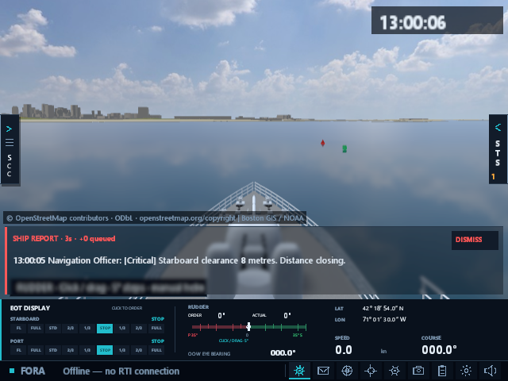

*At 640×480, F8 hides both panels while EOT and rudder stay visible. The report card floats above them and disappears after 3 seconds; history remains in the right archive.*

The nine engine orders are FLANK, FULL, STANDARD, ahead 2/3, ahead 1/3, STOP, astern 1/3, astern 2/3 and ASTERN FULL. The lower display distinguishes astern orders with an amber indication.

### CPP STOP and crash-stop configuration

Normal **STOP** keeps the modeled shaft connected at neutral blade pitch and minimum shaft RPM by default. Propellers can keep turning without thrust at rest. STOP does not instantly remove headway; the rudder remains effective while water flows past it. Engine failure separately inhibits its drive; repair requires a fresh propulsion order.

Copy the distributed `Configuration/propulsion-control.example.json`, adjust the policy, and launch:

```powershell
.\MekoFd.App.exe --propulsion-control "C:\path\to\my-propulsion-control.json"
```

`StopMode=Declutched` selects zero engine drive torque with a freely evolving rotor; it does not instantly stop the shaft. The file also configures minimum connected **shaft** RPM, a named crash-stop ramp and independent `AheadProgram` / `AsternProgram` tables. With headway, ASTERN FULL uses that table before holding astern demand; select STOP when appropriate. Changing an order cancels that shaft's ramp. Startup logs identify the policy. These settings are engineering assumptions, not validated Yavuz operating instructions. [ADR-001](../Shared/Decisions/ADR-001-CPP-Stop-And-Crash-Stop.md) explains units, examples and limits.

Each program lists its non-STOP engine orders with `PitchFraction` and `RpmFraction`; optional `RpmExponent` overrides that direction's RPM curve. Fractions are positive magnitudes: the program direction supplies pitch sign. RPM fraction is a curve input, not a percentage of actual shaft RPM, and pitch fraction is neutral-relative stroke, not physical P/D. The distributed example retains every existing value, so normal handling is unchanged. Old JSON files without these tables still use the same defaults. Supply all five ahead or all three astern points when replacing a table; omit the whole other program to keep it unchanged. [Fields, full default table, JSON example and validation](../Shared/PropulsionPrograms.md).

An optional `Configuration/propulsion-control.docking-training.json` selects the [docking training candidate](../Shared/DockingTraining.md). It retains ahead/RPM/FULL/STOP settings and reduces only BACK 1/3 and 2/3 pitch. Synthetic steady reverse levels fall to about 2.41/4.69 kn, but low-order stopping distances increase substantially. It is an opt-in handling experiment; the normal program remains selected unless this file is explicitly supplied.


| Key, while SCC is active | Action |
|---|---|
| 1 / 2 | Port engine: move one order toward ahead / toward astern |
| 3 / 4 | Starboard engine: move one order toward ahead / toward astern |
| 9 / 0 | Rudder −5° / +5°, limited to ±35° |
| H | Focus the heading entry field |
| I / D | Increase / decrease the draft heading by 1° |
| S / V | Steady on the draft heading / steady as she goes |
| Heading entry: Enter / Tab / Escape | Issue order / commit draft only / cancel editing |
| Tab, Enter/Space | Focus and activate an enabled control |

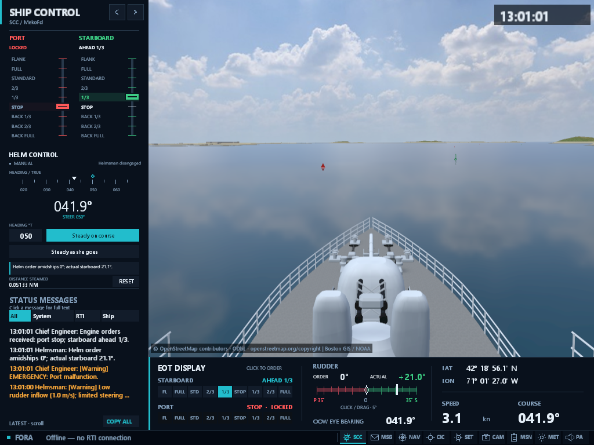

*LOCKED controls cannot be changed through SCC. A scenario waiting for its start or an injected component failure can cause this state. Engine failures force that engine to STOP; repair does not automatically restore the previous order.*

### 7.2 Message Control Center (MCC)

#### Message archive

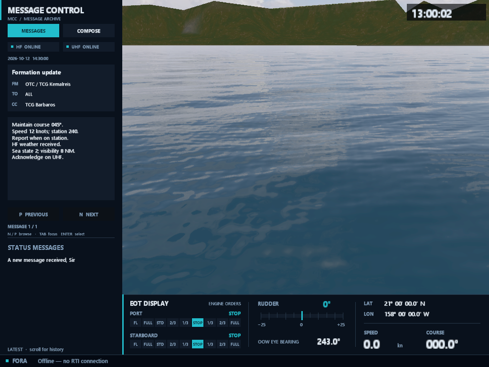

F3 opens **MESSAGES**. The archive contains received messages and locally submitted outgoing messages. It displays sender (**FM**), **TO**, **CC**, subject, timestamp, body and message index. Task orders and weather reports can fill up to six displayed body lines.

Select **PREVIOUS/NEXT**, or press **P/N**, to browse. Navigation is disabled at the ends of the archive. Scroll the mouse wheel over a long body to see wrapped lines; the line counter indicates the visible portion. An empty archive displays **NO MESSAGES YET**. History is bounded and old entries eventually roll out; it is not a saved message database.

#### Compose and address a message

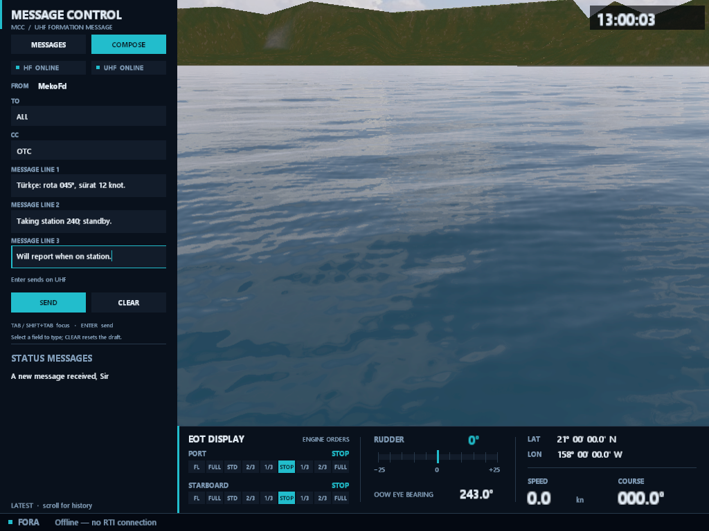

Select **COMPOSE**. **FROM** is filled from the ship's current name. Click **TO**, **CC** or one of the three message-line fields, then type. Input preserves case, punctuation and Unicode; text is appended at the end and Backspace removes the last character. Arrow keys continue to control the observer's look direction.

Use one **exact current ship name**, or **ALL**, in TO/CC. Matching is case-sensitive. The special broadcast address is uppercase `ALL`; ordinary ship names do not have to be uppercase. Space- or comma-separated recipient lists are not parsed. For example, use `ALL`, not `ALL MEKO`, to broadcast. CC may be left empty.

| Control/key | Action |
|---|---|
| MESSAGES / COMPOSE tabs | Switch views and retain the draft |
| Tab / Shift+Tab | Move focus forward / backward |
| Backspace | Remove the last character in the active field |
| Enter in a text field | Submit the formation message on UHF |
| Enter/Space on a button | Activate that button once |
| SEND | Submit TO, CC and the three message lines, with the ship name and scenario timestamp |
| CLEAR | Clear all five editable fields and return editing to TO |

A successful local submission clears the draft; typing after a field-based send resumes in TO. Each editable field is limited to 1,024 characters; long text is shortened visually while its stored value is retained. The subject is supplied as **Formation Message**; there is no subject editor.

Use the two MCC tabs when you want to retain a draft. Direct F1/F3 panel transitions retain the older reset behavior and can clear it. Automatic follow-up preserves an interrupted draft and field when you return to COMPOSE.

#### Radio availability and delivery

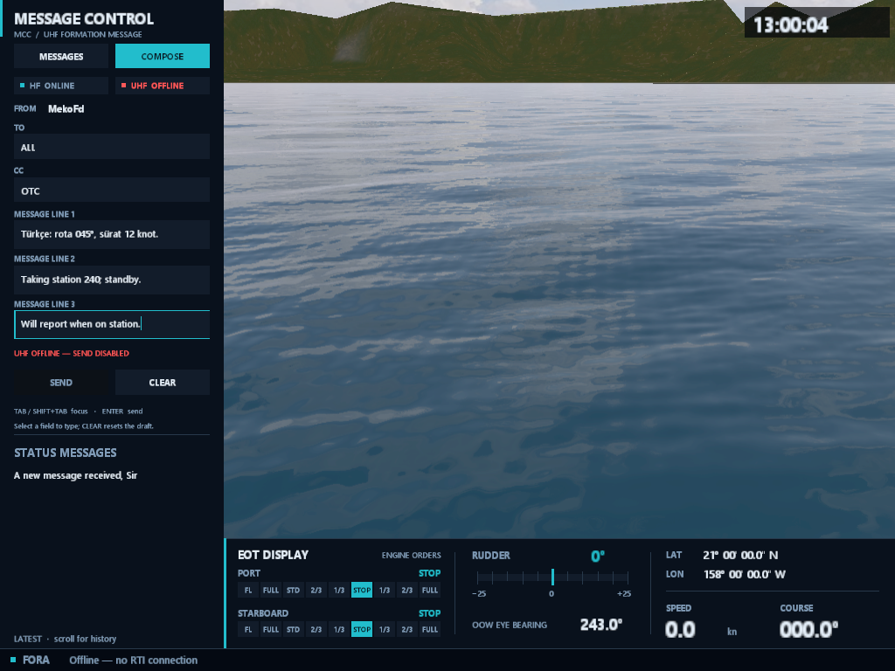

The HF/UHF indicators describe local radio availability. UHF failure or a full outgoing editor queue disables SEND and retains the draft. Incoming formation messages require UHF; weather reports and task orders require HF. An addressed injected failure can temporarily disable a radio. Hidden MCC controls cannot edit or send.

Each locally submitted UHF message now has an individual send state beneath its MCC archive header. Communications Officer reports every final result under **Ship** status messages; those reports retain full details for the existing copy/detail controls.

| MCC state | Meaning |
|---|---|
| **QUEUED** | Waiting for the RTI send result; local queuing alone is not success. |
| **RTI ACCEPTED** | The actual RTI send request completed successfully. This confirms RTI acceptance, not receipt by the addressed application or a person. |
| **SEND SKIPPED** | Generated relevance policy prevented the send because there was no interested subscriber; no RTI send call was made. |
| **NOT SENT** | The connection was unavailable, RTI explicitly rejected the request, or the session ended before this queued message was attempted. |
| **RESULT UNKNOWN** | An attempted send ended without a confirmed response, for example after a connection interruption. Delivery may have occurred. |
| **RECEIVED** | An incoming message; it has no local outgoing send state. |

Final states are not overwritten by later disconnects or duplicate notifications. No automatic application-level replay is performed after reconnect or a subscriber returning. Check the result before deciding to submit again: retrying **RESULT UNKNOWN** may duplicate a message. Read receipts and recipient delivery acknowledgments are not implemented. The archive remains bounded and in memory only; closing MekoFd clears it.

### 7.3 Navigation Control Center (NCC)

F4 and the **NAV** center button restore the last selected **TRD/ATD** presentation. A new application session defaults to ATD. Use the **TRD/ATD** tabs to change the remembered selection; switching centers, Settings and F8 retain it. Both are north-up. The current track set includes own ship and discovered Meko/Knox contacts.

#### Traditional Radar Display (TRD)

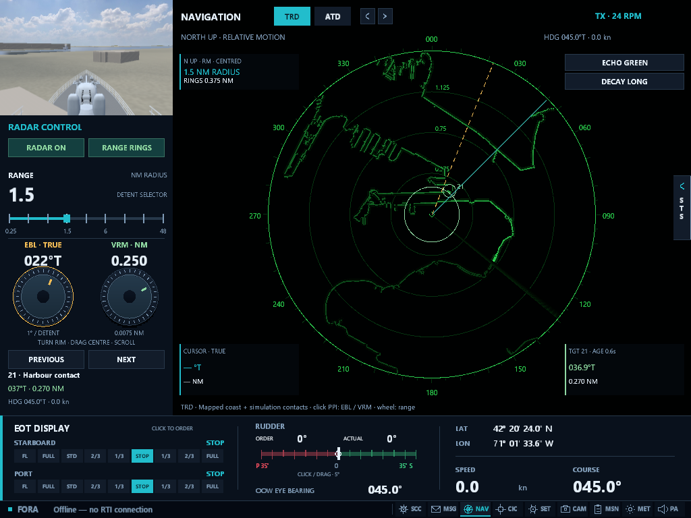

TRD occupies the **main right-hand area** with a circular green PPI; the **control panel stays on the left**, below the small live OOW view. EOT remains full width at the bottom. The display is north-up and centered on own ship, with a 360° bearing scale, heading line, scan sweep, optional range rings, green source-derived shoreline outlines and received contact echoes. **EBL / TRUE BEARING** and **VRM / RANGE** are shown at left. Click inside the PPI to position both; clicking near an echo also selects its contact. **PREVIOUS/NEXT** browse contacts, with selected name/number, true bearing, range, heading and speed below the controls. [Presentation and limits](../Shared/NavigationRadar.md).

**RADAR ON/OFF** controls the presentation; OFF shows **RADAR STANDBY** and hides echoes/sweep. **RANGE RINGS** toggles the three inner rings. The scan remains independent of render frame rate. TRD/ATD tabs stay in the main header; transitions preserve their independent ranges, measurements, chart pin and trail history. F8 hides the side controls while retaining and expanding the selected radar/chart; F8 again restores the prior panels. The selected NAV center button also restores controls.

| Control/key, while TRD is active | Action |
|---|---|
| EBL rotary encoder, or 1/2 | Wheel up/down or drag to adjust true bearing in 1° detents |
| VRM rotary encoder, or 9/0 | Wheel or drag to move the distance marker inward/outward |
| RANGE detent rail, or NumPad −/+ | Click/drag to a marked scale; wheel up selects a smaller radius and wheel down a larger one |
| RADAR ON/OFF or S | Toggle radar |
| RANGE RINGS | Toggle rings |
| Mouse wheel over PPI | Zoom in / out |
| Click in radar circle | Set bearing/distance together; pick a nearby contact echo |
| PREVIOUS / NEXT | Browse received contacts |

TRD **RANGE / RADIUS** selects **0.25, 0.5, 0.75, 1.5, 3, 6, 12, 24 or 48 NM**. These are Decca 1226-family reference display scales; they are not a claim of guaranteed target detection at 48 NM or a measured minimum detectable range. See the [source and model limits](../Shared/SystemArchitecture.md#radar-measurements-and-reference-scales--2026-10-16). Turning radar off does not disconnect the federate or remove its ships from the exercise.

Mapped coast and contact echoes are a training presentation of known geometry/tracks; this feature does not simulate radar detection, weather clutter, occlusion or ARPA estimation. Dragging, leaving the PPI, resizing, changing range, Settings or standby cancels a pending pick.

**Scan echoes and colour:** the antenna refreshes a contact at each passage (about every 2.5 s at 24 RPM). Its echo position is held between scans; the return brightens at the pass and fades afterwards. Coastline spans also brighten progressively as the sweep crosses them. EBL/VRM and selected-target marks remain readable independently of echo afterglow.

At the upper-right scope corner, click **ECHO** to cycle **GREEN / AMBER / MULTI**, and **DECAY** to cycle **SHORT / MEDIUM / LONG**. Startup is GREEN / MEDIUM. MULTI colours represent synthetic return strength (green → yellow → red), not allegiance or collision risk. These choices are separate from ATD chart palettes.

The upper-left corner shows range, ring interval and N UP / RM / CENTRED. Lower left shows cursor true bearing/range; lower right shows the selected scan echo's track number, age and measurement, or scan/standby status and echo count. Cursor values belong only to TRD; ATD pin/cursor are preserved. In F8 the values stay visible while the ECHO/DECAY buttons become read-only. Temporary ship report banners can cover the lower corners.

Standby clears returns; a range or geographic-origin change waits for new antenna passes. Palette, decay, center or F8 changes preserve acquired echoes. Source track heading/speed shown at left remain supplied simulation values, not radar-estimated motion. [Model, limits and tests](../Shared/NavigationRadar.md#scan-echoes-colour-and-corner-instruments).

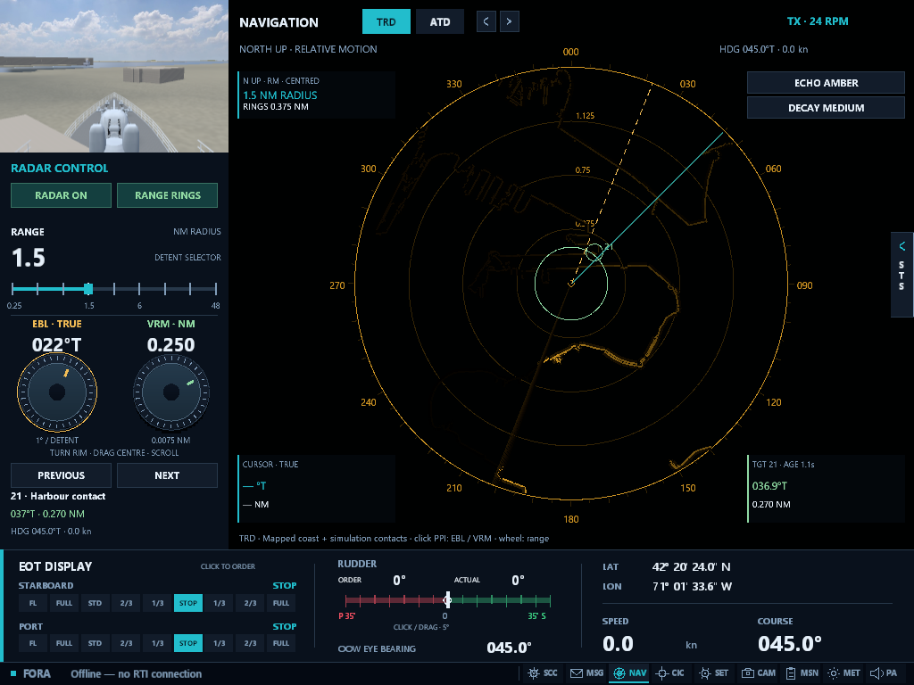

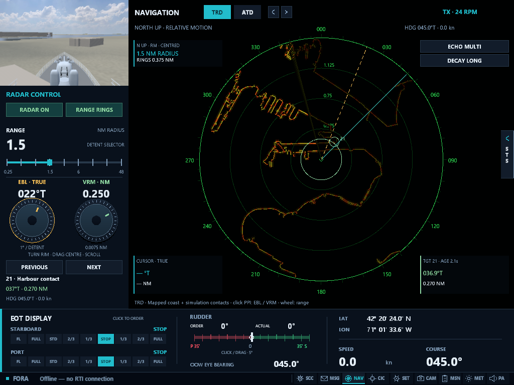

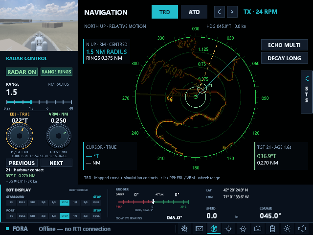

**Twin Encoder operation:** place the pointer over EBL or VRM and turn the mouse wheel: up increases the value, down decreases it. Hold the left button on the **rim** and rotate clockwise to increase, counterclockwise to decrease. Rotation is relative to the press and continues through multiple turns without resetting at north. EBL follows the mouse angle 1:1; one VRM turn covers the selected radius (at least 0.001 NM per fine step). A press in the central 30% of the diameter instead provides straight-line scrubbing: right/up increases and left/down decreases, four combined pixels per fine step. A stationary click only selects the control. The numeric readout, dial marker and PPI overlay update together. EBL wraps through 000°; VRM clamps between zero and the selected radius. A stationary click does not step the dial. The amber EBL line and pale-green VRM circle match their controls.

**Stepped range selection:** click or drag the RANGE rail to a marked stop, or use the wheel over the rail. The nine stops are scale choices, not a linear distance axis. Wheel input over a dial adjusts only that dial; wheel input over the PPI or range rail changes range. VRM is displayed to 0.001 NM and changes by 0.5% of the current radius per detent (at least 0.001 NM). Changing range preserves the physical VRM distance unless the smaller scale requires clamping it to the edge.

Release the mouse to finish a drag. Application focus loss, resize, Settings and center/F8 changes cancel it. A selected dial keeps its coloured focus ring after release; Tab / Shift+Tab cycle controls and buttons, and arrow keys make fine adjustments. An outside click clears selection. A held capture takes precedence over other controls, status overlays and OOW, so crossing them cannot cut off a turn or activate them on release. Moving across the other dial cannot switch the captured control; entering a dial with a held button cannot start adjustment. Console settings remain adjustable in STANDBY; PPI picks remain disabled. The live OOW remains above these controls, and the lower EOT/rudder remain available.

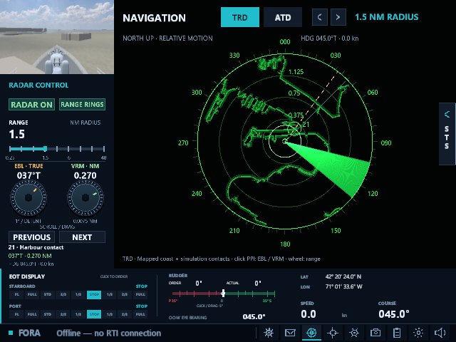

#### Advanced Tactical Display (ATD) and extensions (ATDX)

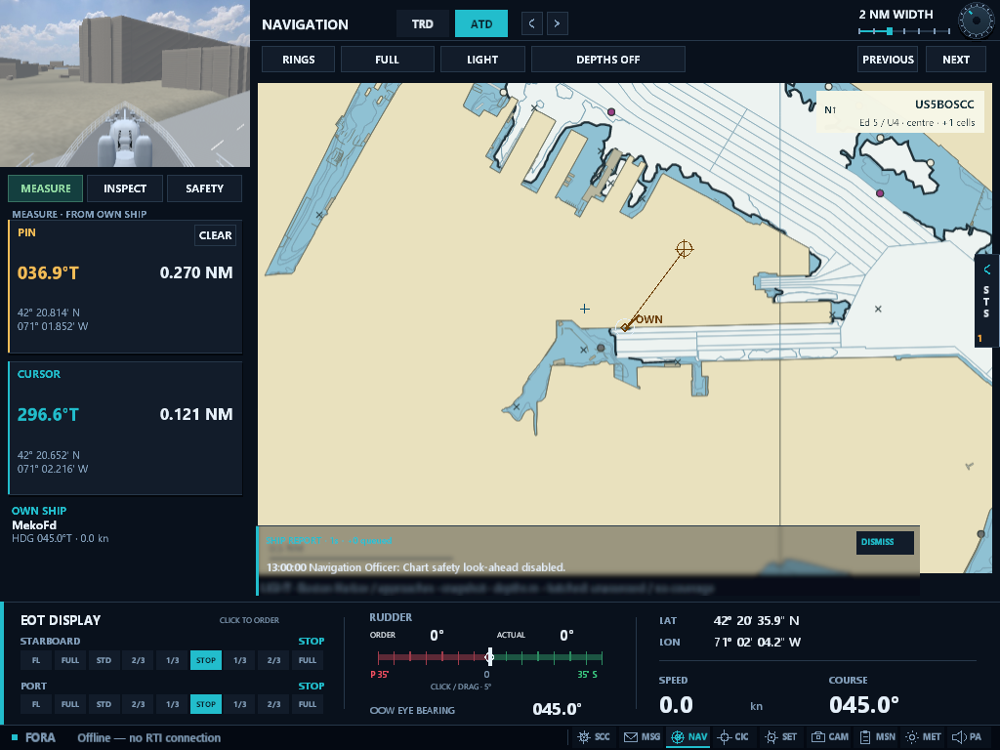

The main plot uses the bundled real NOAA Boston Harbor ENC portfolio (12 cells, snapshot 2026-10-23): depth areas, contours, soundings, land and navigation marks, overlaid with simulation contact symbols, direction indicators, trails and own ship. The chart is on the **right**. The **left center** has MEASURE / INSPECT / SAFETY tools below the small live OOW view. MEASURE shows PIN/CURSOR measurements and the selected name/track number, heading, speed, distance and true bearing. INSPECT shows ENC source information. The lower EOT spans the window, with **STARBOARD above PORT**. Full status history is available in the other centers. Select **PREVIOUS/NEXT**, press **P/N**, or click close to a contact symbol.

ATD always centers on the current **own-ship position**, including startup, movement and scenario reassignment. Zoom keeps own ship centered; the coastline and contacts move around it. The left MEASURE inspector shows WGS84 latitude/longitude for each measured point. Manual panning is disabled.

ATD **NM WIDTH**, at the top-right of the chart header, is the **total width** of the plot, from **0.5 to 10 NM**; it is not a radius. The recessed rotary selector and seven-stop rail replace the old chart −/+ buttons. Use the mouse wheel over the knob, rail or plot: **up zooms in**, **down zooms out**. Hold the left button on the knob rim and rotate **clockwise** for a wider chart or **counterclockwise** for a narrower chart; each 45 degrees selects one adjacent span. The centre supports straight scrubbing right/down to widen or left/up to narrow, four combined pixels per step. A stationary click only selects the knob. Turning further at either end stop does not delay reversal. Click/drag the rail to choose **0.5, 1, 2, 4, 6, 8 or 10 NM**. NumPad −/+ remain available. The 0.5 NM width is 926 metres, or 463 metres from center to an edge.

A range gesture never places a pin or moves the stored cursor, even if released over the chart. Releasing ends the drag; application focus loss, resizing, Settings and tool/center/F8 changes cancel it. The selected span knob/rail stays outlined after release and accepts arrow-key steps; Tab / Shift+Tab cycle controls. A captured gesture keeps ownership while passing over other controls or OOW. The range instrument remains available in MEASURE, INSPECT and SAFETY. [Console behavior and tests](../Shared/AtdConsole.md).

**Depth numbers (soundings):** values such as **0.6**, **4.3** and **6.1** are charted water depths in **metres**, referenced to the ENC sounding datum. They are not live depth measurements or under-keel clearance. Use the chart toolbar's **DEPTHS ON / DEPTHS OFF** button to show or hide them. Depths start ON; the selection is retained through zoom, chart-source changes, MEASURE/INSPECT/SAFETY, center and TRD/ATD switches for the current session. It is not saved across application restarts. At spans above 4 NM, the existing decluttering rule hides the labels even with DEPTHS ON.

Hiding the numbers leaves depth shading, contour lines, navigation marks, Inspect source information and the Safety Contour look-ahead watch active. LIGHT/DARK/AUTO work with either visibility setting.

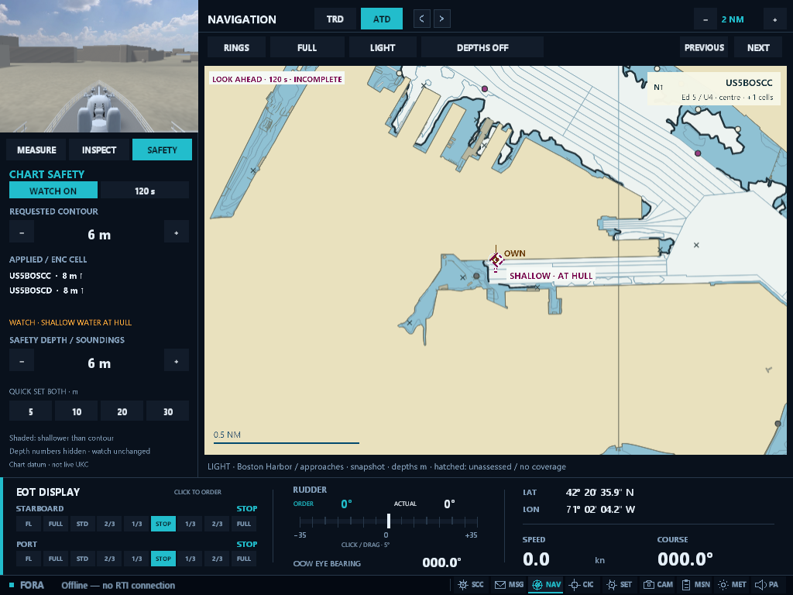

**Chart appearance:** the chart toolbar's **AUTO / LIGHT / DARK** button cycles AUTO → LIGHT → DARK → AUTO. AUTO is the startup default: it uses LIGHT from **06:00 inclusive to 18:00 exclusive** on the local simulation clock, and DARK otherwise. The chart footer identifies the resolved LIGHT/DARK palette. Explicit LIGHT or DARK overrides the clock until you select AUTO again. The choice survives center/TRD switches for this application session; it is not saved across restarts. It does not change the OOW scene lighting, weather, pin, inspected object, selected contact, zoom or trail history.

The dark chart uses dimmer depth/land shading and contrasting soundings, marks, contact/trail colours and measurement targets. Hatching remains visible outside chart coverage. These are simplified training palettes, not certified S-52 day/dusk/night colour tables; AUTO uses a fixed local-hour convention rather than calculated sunrise/sunset.

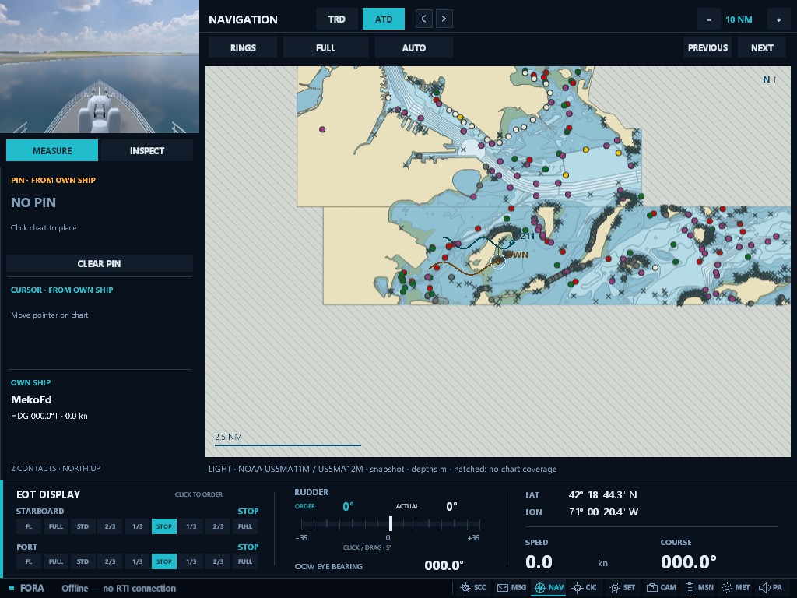

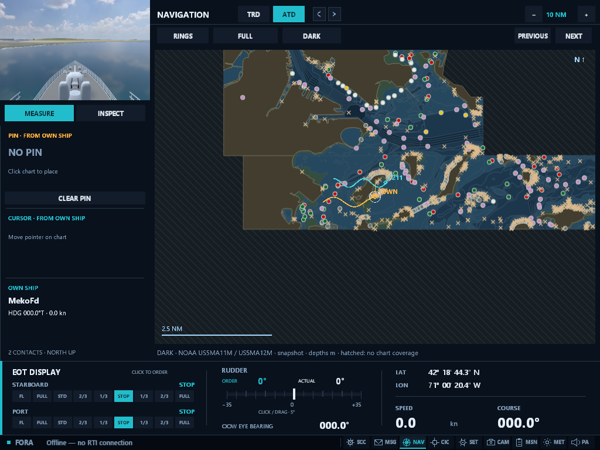

**ECDIS** means *Electronic Chart Display and Information System*. Its navigation-chart functions and approval requirements are distinct from this tactical plot. IMO specifies ECDIS performance; IHO defines chart data and presentation standards (including S-57/S-101 and S-52). ATD zoom levels are NavySim interface choices; they do not establish ECDIS conformance or approval. See [IMO MSC.530(106)](https://wwwcdn.imo.org/localresources/en/KnowledgeCentre/IndexofIMOResolutions/MSCResolutions/MSC.530%28106%29.pdf) and the [IHO ENC/ECDIS standards](https://iho.int/en/enc-ecdis).

Select **MEASURE** for independent **CURSOR** and **PIN** instrument cards, each explicitly measured **FROM OWN SHIP**. Amber identifies PIN and cyan identifies CURSOR; each card shows true bearing and NM range together, with WGS84 coordinates below. Moving the pointer over the chart updates cursor true bearing (0.1°, labelled **°T**) and range in NM. Clicking in MEASURE fixes a pin; moving the pointer afterward leaves that pin unchanged. A line connects own ship to the pin, and its bearing/range update continuously as own ship moves. Zoom or a center change does not move the pinned world position. The **CLEAR** button in the PIN card header removes only that mark and its measurement; **NO PIN / NO CURSOR** distinguish absent measurements. At coincident positions the range is zero and bearing is shown as undefined rather than a fabricated north bearing. TRD and ATD tabs remain visible in the navigation header. **TRD** opens the classical radar and ship view; **ATD** restores the chart. Switching preserves chart pin, span, selected contact and trail history, as well as TRD EBL/VRM/radius and power. The toolbar supplies range-ring and trail controls and previous/next contact selection; chart rings are independent of TRD rings.

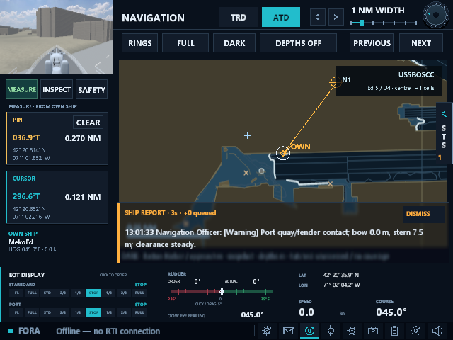

The selected-contact area separately retains its own-ship range and contact line. Measurements use the same horizontal north/east metre coordinates as the 3D ship positions; 1 NM = 1,852 m. Range is between ship reference positions, not the closest gap between hull surfaces. Contact/CIC bearings retain whole-degree rounding.

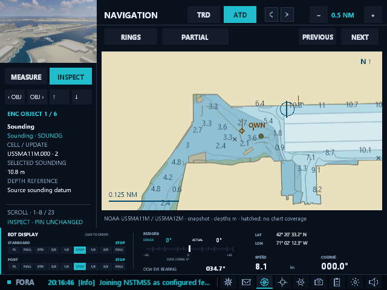

**Inspect chart:** select **INSPECT**, then click a chart buoy, light, sounding/depth area or quay. The blue target identifies the inspected source location; the existing amber pin is preserved. The panel shows the available ENC name/class, cell/update, depth or signal/construction attributes and source notes. Use **‹ OBJ / OBJ ›** when several objects overlap, including a buoy and its light. Use **↑ / ↓** or scroll over the details to read the remaining fields, feature ID and edition/date. Chart hover does not replace the inspected object. Switching back to MEASURE restores the existing measurements; INSPECT clicks do not select simulation contacts.

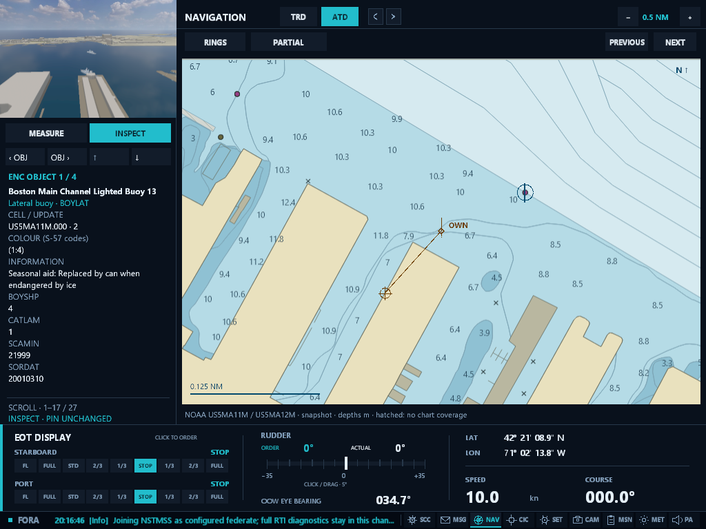

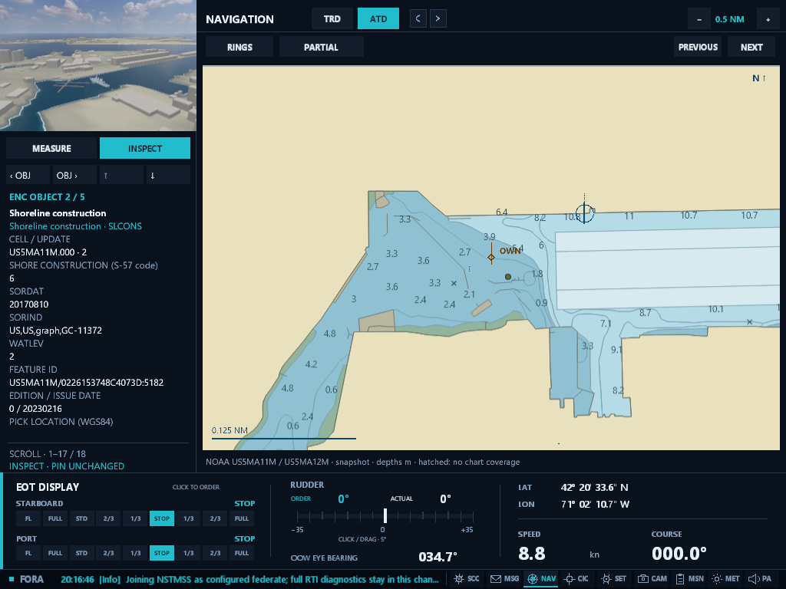

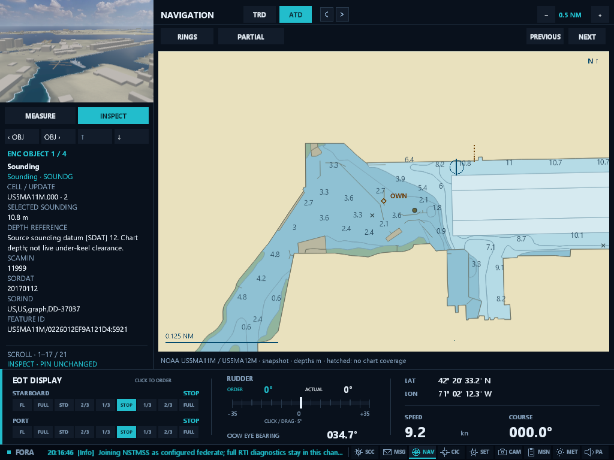

Sounding depth comes from the selected ENC sounding point, while depth areas/contours retain their supplied depth attributes. Values are in source-confirmed metres with the source sounding-datum code; they are not live depth or under-keel clearance. Some attributes remain S-57 codes, clearly labelled. No-hit/no-coverage selections report **No ENC object at this position** and replace the previous result. Dragging, leaving the plot or changing tool/size cancels a pending click. Source attributes that were not supplied are not invented.

The chart is a **bundled NOAA snapshot with simplified training portrayal**. Hatched areas have no drawn chart coverage. Outside the available Boston cells a coverage message appears; contacts and measurements remain usable. These are charted depths in metres, not simulated seabed clearance. The layer excludes municipal/OSM/authored fittings; the independent 3D berth and collision geometry remain. [Data, shared architecture, validation and limits](../Shared/EncNavigation.md).

| Key, while ATD is active | Action |
|---|---|
| NumPad + / − | Increase / decrease display span |
| T | Cycle FULL → PARTIAL → NONE trails |
| N / P | Next / previous selected contact |
| 1 / 2, 3 / 4 | Port and starboard engine-order steps |
| 9 / 0 | Rudder −5° / +5° |

TRAILS controls the history drawn for own ship and contacts. FULL displays the retained history, up to 10,000 positions per track. PARTIAL displays the latest 100 without discarding older samples. NONE hides the trails while sampling continues. Selecting FULL again restores the earlier trail, including movement recorded while NONE was selected. History continues to collect in other centers and F8. Returning to ATD preserves it. Zoom, screen changes and following own ship do not reset history: world-metre positions are reprojected using the current span and own-ship center, and out-of-view points remain available when zooming out. Changing FULL/PARTIAL/NONE does not reset history. Removed contacts lose their trails, and simulation-time rewind starts a new history. The 10,000-sample bound still applies while hidden; history is not an unbounded voyage archive and does not survive application exit. Chart detail and coverage are limited by the bundled ENC cells and simplified portrayal.

#### Chart Safety

Select **SAFETY** beside MEASURE and INSPECT. **REQUESTED CONTOUR** is your chosen threshold; **APPLIED / ENC CELL** shows the real contour available in each displayed ENC cell. An upward arrow means the next deeper source contour was substituted. For example, current inner-harbor cells apply **8 m** when you request **6 m**, while several approach cells apply **10 m**. Each cell retains its own source contour set; [current source table](../Shared/BostonEncData.md#changed-contour-availability). The selected contour is thicker and shallower depth areas have a distinct shade.

**SAFETY DEPTH / SOUNDINGS** independently makes displayed soundings at or below its value bold and more prominent. Both requested settings start at 30 m. Adjust each with −/+ in **0.1 m** steps; hold to repeat. **QUICK SET BOTH** explicitly sets both to 5, 10, 20 or 30 m, after which either can be adjusted independently. These are operator chart-depth settings, not calculated from draft.

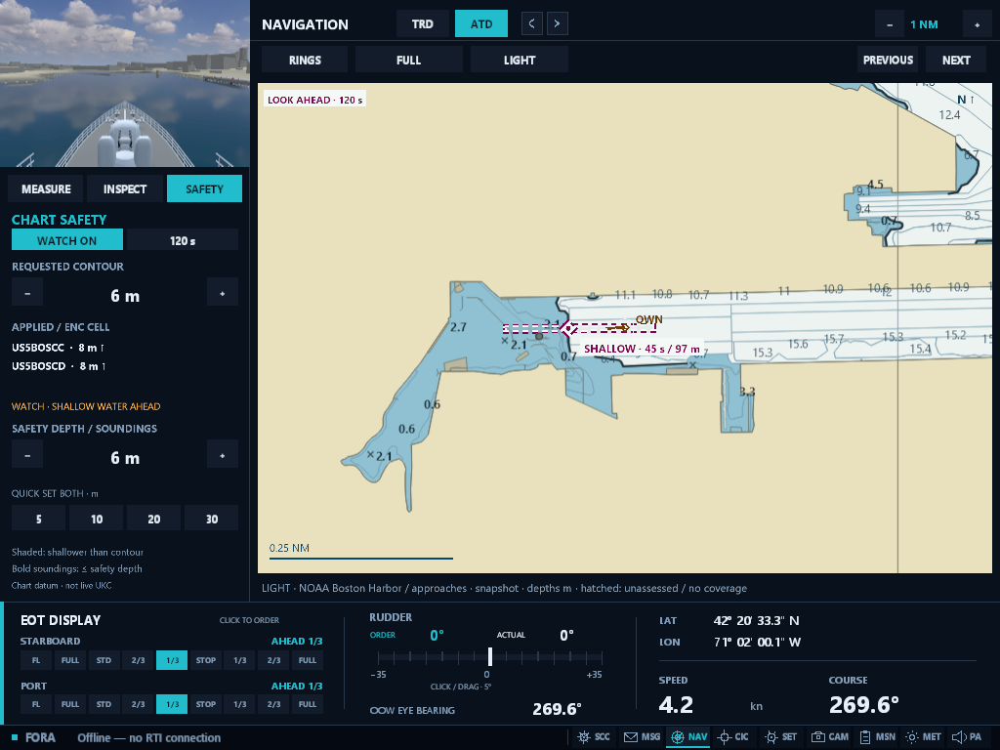

A cell without an equal/deeper contour shows **UNAVAILABLE**. Its water depth areas are gray/hatched as unassessed; missing depth attributes are also unassessed. A location without ENC coverage shows **NO ENC COVERAGE**. Never interpret gray hatching as assessed deeper water. Safety Depth can still emphasize valid soundings when an applied contour is unavailable.

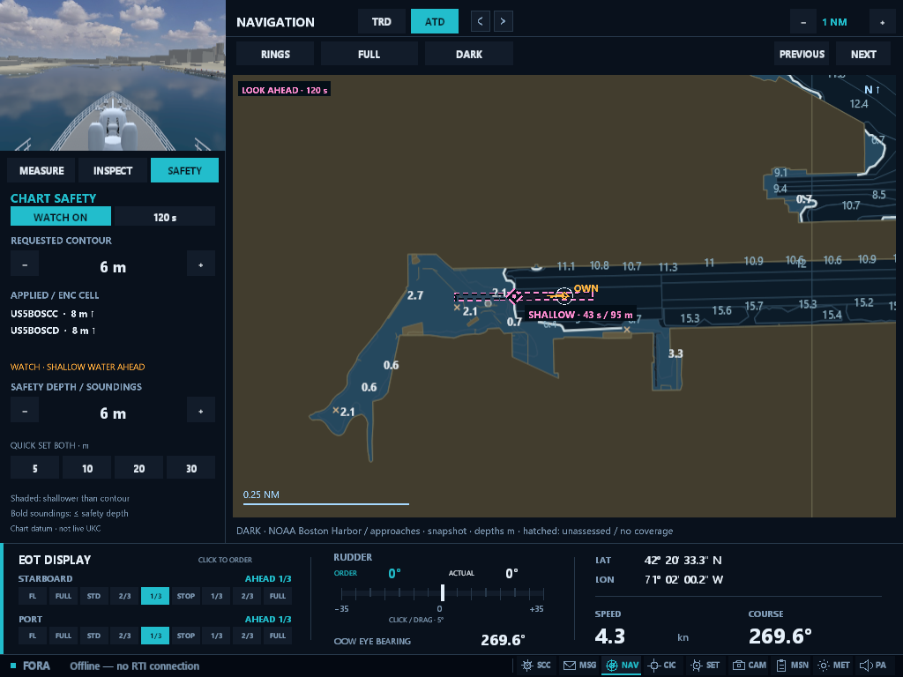

LIGHT/DARK/AUTO preserve the requested and applied depths. Settings remain active in MEASURE and INSPECT and survive center/TRD changes for the current session. Clicking the chart in SAFETY preserves the pin, inspected object and selected contact. The OOW view, EOT and vessel physics are unaffected. Sounding labels retain their existing decluttering and disappear above 4 NM span. Values refer to the source chart datum: this feature does not calculate tide, squat or live under-keel clearance, and does not establish measured grounding risk. The Navigation Officer look-ahead below provides a separate chart-depth advisory. [Rules, assumptions and validation](../Shared/ChartSafety.md).

**Look-ahead watch:** **WATCH ON/OFF** enables the Navigation Officer's shallow-water approach reports. The time button cycles **60 / 120 / 180 / 300 s**; default is ON / 120 s. Monitoring continues in other centers, TRD and F8, even with radar OFF. Read full reports in **Ship** messages. A forecast within 30 s escalates to “Shallow water imminent”; current envelope overlap is reported separately. Repeated warnings are bounded to 120 s; confirmed clearance requires five assessed simulation seconds.

The watch follows current straight ground motion with the ship's hull width and a 5 m margin, including drift and sternway. Reported metres are the projected envelope's travel before intersection, not live UKC or range to a selected chart object. Missing depth/coverage or an unavailable applied contour produces **assessment incomplete**, never an automatic clearance. WATCH OFF suspends these advisories; changing Safety Depth alone does not affect them. Turning, braking, tide, squat and isolated dangers are outside this check. [Watch behavior, assumptions and tests](../Shared/ChartLookAhead.md).

**On-chart look-ahead:** while WATCH is ON, the dashed, lightly filled corridor shows the actual hull-envelope sweep in MEASURE, INSPECT and SAFETY. Blue/cyan is an assessed corridor; amber plus **INCOMPLETE** indicates missing depth/contour coverage. A magenta diamond/dot marks the first known shallow intersection, with estimated entry time and envelope travel; **AT HULL** means current overlap. The point can be beside the centerline because the whole hull is checked. It is separate from the measurement pin and Inspect target and does not capture clicks.

LIGHT/DARK/AUTO adjust the corridor and label colours together. Zoom scales world geometry without changing the physical prediction. A **SHALLOW NEAR/OUTSIDE EDGE** badge means zoom out to see the full marker; an edge point is not invented. WATCH OFF, preparation, obsolete origin/contour/options or an assessment over two simulation seconds old hides the overlay. The corridor is a current straight-motion estimate, not an intended route or a promise of safe clearance. [Geometry, visual key and validation](../Shared/ChartLookAhead.md#atd-corridor-and-first-contact-marker).

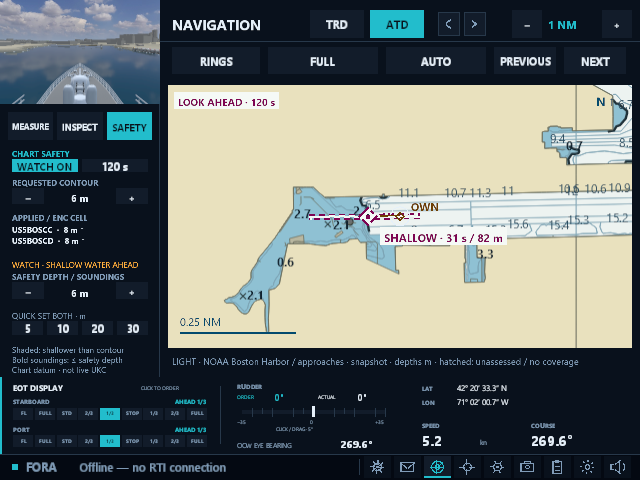

#### ENC buoys in the 3D view

The 3D view automatically shows source ENC buoys within **2 NM horizontally of own ship**, in all centers and F8. ATD's small OOW view shows the same aids. Source colours, stripe order and shape category are retained; lights use associated ENC light objects and their signal periods. At night, a lamp can be dark during its normal eclipse. Not every buoy is lighted. Beyond 500 m from the eye the model becomes simpler; moving outside the own-ship 2 NM envelope unloads it.

Buoys heave and tilt with the selected spectral sea while their chart anchors remain fixed. SS0/WAVES OFF removes background motion. Changing the geographic origin preserves their geographic position and source identity. Use ATD **INSPECT** to read the same buoy's source information.

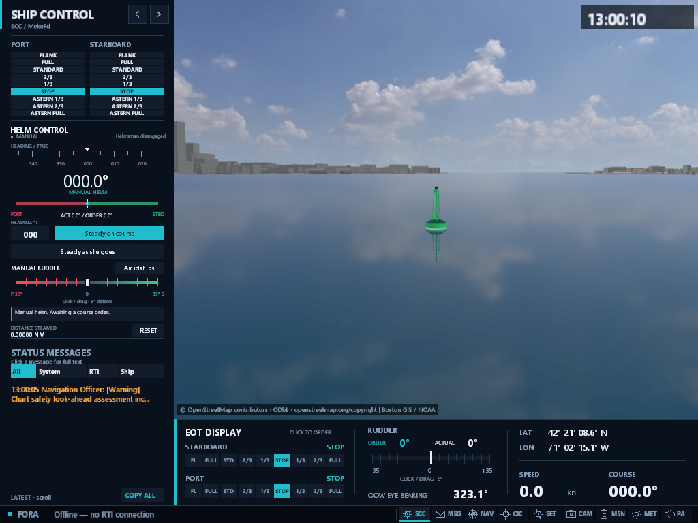

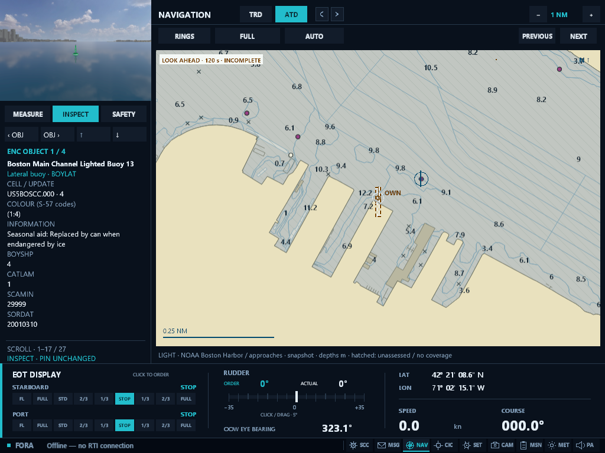

Physical dimensions and fine structural details are estimated because the installed ENC does not supply them. Seasonal replacement, surveyed replicas, mooring/collision physics and a calibrated luminous-range model are not included. [Source fields, behavior and limits](../Shared/EncBuoys.md).

### Active ENC identity

The upper-right chart card shows the cell code (for example **US5BOSCC**) and applied **Ed / U** revision from the source DSID fields. The most detailed cell covering the view centre is shown; other visible cells are counted. **visible** distinguishes a cell away from the centre, and **NO ENC COVERAGE** clears the code outside the package. It follows Light/Dark/Auto and compact layouts. [Identity rules](../Shared/WorkingAreas.md#active-enc-code-at-the-atd-upper-right).

### 7.4 Combat Information Center (CIC)

F5 opens **ASuW**. Select **ASuW**, **ASW** or **AAW** to change mode. The center shows the selected weapon, relative training/elevation and available movement controls.

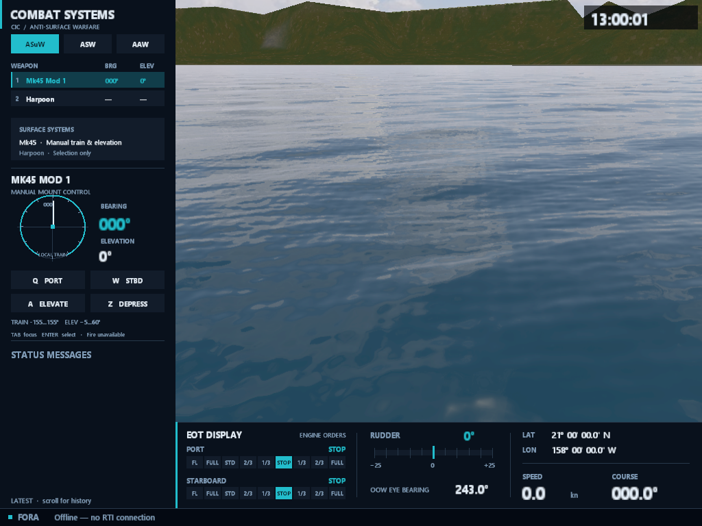

| Mode | Selection | Available behavior |
|---|---|---|
| ASuW | 1: Mk45 Mod 1; 2: Harpoon | Mk45 training/elevation; Harpoon selection only |
| ASW | No active weapon | Information/placeholder view |
| AAW | 1: Mk45; 2–4: Sea Zenith 1–3; 5: Sea Sparrow | Mk45/Sea Zenith training/elevation; Sea Sparrow selection only |

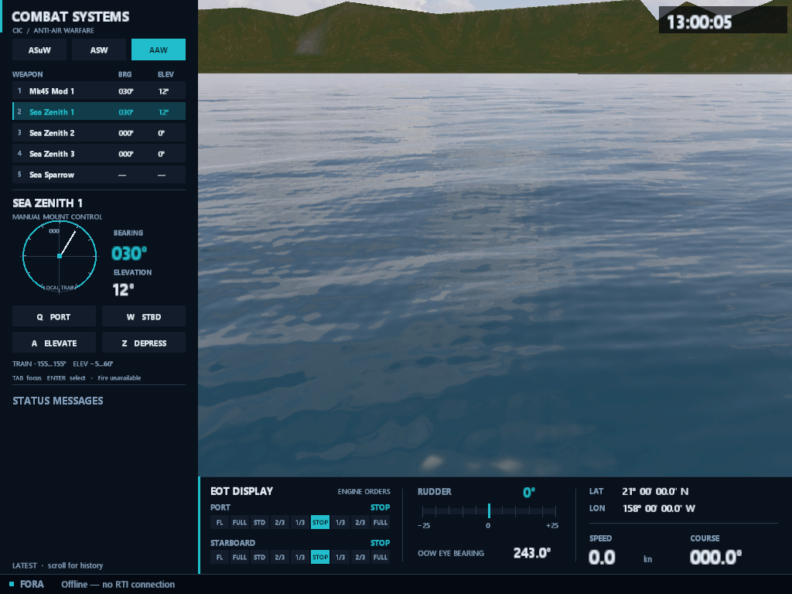

Use **Q PORT**, **W STBD**, **A ELEVATE** and **Z DEPRESS**, or the corresponding letter keys, to train/elevate the selected aimable gun. Training moves in 5° steps and elevation in 1° steps. Movement stops at the mount's limits; elevation is bounded from −5° to +60°. Click a weapon row or use its number-row key. Tab/Shift+Tab and Enter/Space also select controls.

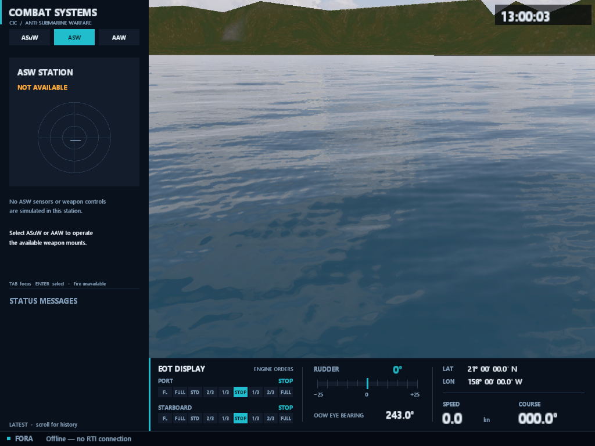

Firing is unavailable. **F is not a working fire command**. Harpoon and Sea Sparrow do not have manual training/elevation; their movement controls are disabled. ASW has no selectable active weapon. Changing CIC mode does not launch a weapon or send a fire order.

### 7.5 Transportation Control Center (TCC)


F7 opens Transportation. Click a numbered point on the ship plan or a station button. **CURRENT** identifies the view; number-row or NumPad keys 1–8 select a Yavuz station directly (1–7 on Knox/legacy).

| Key / station | Location |
|---|---|
| 1 | Bridge roof (Yavuz); original bridge view on Knox/legacy |
| 2 | Port bridge wing |
| 3 | Starboard bridge wing |
| 4 | Quarterdeck |
| 5 | Forecastle |
| 6 | Port Sea Zenith |
| 7 | Starboard Sea Zenith |
| 8 | Bridge interior, looking through the front windows (Yavuz) |

Yavuz presets use a standing 1.80 m observer with an estimated 1.68 m eye height above the authored deck. Station 8 stands inside the bridge, behind transparent framed glazing and a low console. Presets inherit ship roll, pitch and heave.

**Hold the right mouse button and move the mouse to look around in every control centre and display layout**, including when the pointer starts over a panel, radar or status area. This also works at every fixed OOW preset and in the bridge interior. A fixed preset keeps its eye position and mode; right-button look does not activate walking or flight. Release RMB to free the cursor. Selecting the preset again restores its authored look.

Arrow keys also change the look direction at a station. The observer moves with the ship. Selecting a station restores its original position/direction and leaves special/free-flight views. Tab/Shift+Tab selects controls; Enter/Space activates the focused control.

### Deck walking

On the current Yavuz model, select **4 — QUARTERDECK**, **5 — FORECASTLE** or **8 — BRIDGE INSIDE**, then press and hold **both left and right mouse buttons inside the 3D view** to start WALK and move forward. A fresh press of the second button starts the gesture; simply entering the view with both already held does not. The **WALK** button in F7 Transportation remains available as an alternative. WALK is unavailable on other stations, external/free-flight views, Knox and the legacy FLT model. Use RETURN STATION or select a preset before entering WALK from another camera mode.

| Control | Walking action |
|---|---|
| Hold left + right mouse buttons in the 3D view | Start WALK from a supported preset and walk forward |
| Release left mouse button | Stop mouse-forward walking; keep right-button look/WASD available |
| Hold right mouse button anywhere in the application + move mouse | Look around in WALK |
| Hold right mouse button + W / S | Walk forward/back |
| Hold right mouse button + A / D | Walk sideways |
| Shift while walking | Fast walk: 2.0 m/s |
| Ctrl while walking | Careful walk: 0.5 m/s; takes precedence over Shift |
| Esc | Release captured mouse input and pause walking; resume with a fresh right press |
| RETURN STATION / numbered preset | Leave walking and restore the selected preset |

Normal speed is **1.2 m/s**. Both mouse buttons act as W: combining them with W does not increase speed, and S brakes the forward movement. The shortcut also works when a control centre other than Transportation is displayed, but only a fresh gesture inside MainView can start it. Feet follow the selected walking surface, with an estimated **1.68 m eye height** for a **1.80 m observer**. Looking upwards does not lift the observer. The person follows ship roll, pitch and heave; FOLLOW SHIP cannot be disabled while walking. Esc also pauses input when WALK is selected and the mouse is already free. Outside WALK/captured navigation, the application's existing Esc exit shortcut still applies.

The ship plan shades the available walk area green, marks major blockers orange and shows the walking position. Perimeter clearance and a 0.30 m body radius prevent crossing rails/deck edges, windows, closed boundaries, consoles, mooring bitts and the authored fire-equipment blockers. At a boundary the observer stops or slides along it. Walking keys belong to the camera only during mouse capture and remain blocked from ship/message controls until released.

Walking covers three separate areas: quarterdeck, forecastle and bridge interior. It does not climb stairs, open doors, jump, fall overboard or connect the quarterdeck to other decks. Small flush tie-down details remain traversable; there is no additional step-bob effect. On the forecastle, height follows the rising bow deck and the low centre inspection hatch is a traversable 22 cm step. The gun pedestal, windlasses, chains/stoppers, bitts and side hatches remain protected obstacles. Release the right mouse button to use panels without changing your walking location. FRAME SHIP leaves WALK and frames the ship in free flight.

**FREE FLIGHT** in F7 Transportation starts at your current eye position and viewing direction. Select **FRAME SHIP** for an exterior view aimed at the ship. Orbit and middle-button pan have been removed; the left button alone does not capture or move the camera.

| Control | Action |
|---|---|
| Hold right mouse button + move mouse | Look around |
| Hold left + right mouse buttons | Fly forward along the viewing direction |
| Hold right mouse button + W / S | Fly forward/back; W with both mouse buttons does not add speed, S brakes forward movement |
| Hold right mouse button + A / D | Move sideways |
| Hold right mouse button + Q / E | Descend/ascend |
| Mouse wheel over the 3D view | Zoom in/out by moving the camera forward/back along its current look; works with a free cursor or RMB held. Look direction and flight speed stay fixed. |
| Shift while flying | Four-times speed boost |
| Release left mouse button | Stop mouse-forward motion while retaining right-button look/WASD |
| Release right mouse button | Stop navigation and free the cursor, even if the left button is still held |

**FOLLOW SHIP: ON** is the default: the camera travels/turns with the ship while keeping a level horizon. Turn it **OFF** to hold the flight position in world coordinates. Switching follow preserves the eye and viewing direction. Fixed stations and WALK always follow the ship.

**FRAME SHIP** puts the free-flight camera at a useful exterior position looking towards the ship; it creates no orbit pivot. **RETURN STATION** restores the last selected preset. Selecting a station also restores its original pose.

Start with a fresh right-button press anywhere inside the application window. Adding the left button inside the 3D view can also begin a fresh two-button gesture. The cursor is hidden while captured. Release RMB or press Escape to free it. Focus loss and panel/view changes also release capture and require a fresh press to resume. Left/middle buttons alone do not start navigation. Panel mouse actions retain their usual meaning. Ordinary panel and typing keys are suppressed during captured look and held keys stay blocked until released; function-key centre changes and Alt+Enter remain available. Panel clicks/holds interrupted by looking are canceled; release both mouse buttons before a fresh panel click. Outside WALK/captured navigation, Escape retains the application's exit shortcut.

Flight has no gravity or collision avoidance and can cross ship geometry, terrain or water. Use FRAME SHIP to recover the view. Changing centres retains flight selection, while movement still requires a fresh RMB gesture. WALK controls and deck limits remain as described above. The Yavuz stern and aft side apertures now open into a modeled lower working deck with a floor, inner plating and deckhead fixtures. Free flight can inspect this space; WALK remains limited to its three supported areas.

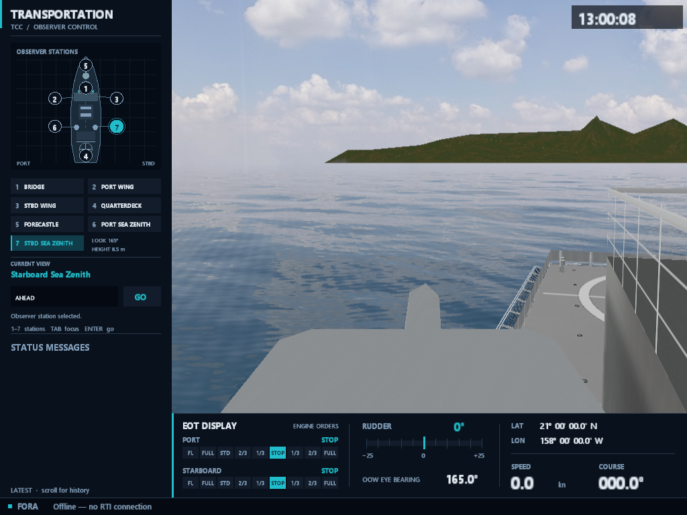

Type a code in the field, correct with Backspace, then select **GO** or press Enter. When the code is nonempty, Enter executes it rather than activating a focused station. See [section 8](#8-special-views-and-codes) for the codes and the empty-code Enter behavior.

### 7.6 Settings

Press **F6** or select the **SET** gear to open the Settings popup over the current workspace. The underlying center, ATD span, selected contact and unsent message draft are retained. The ship and RTI continue running; the popup owns mouse and keyboard controls, so clicks and typing do not operate the instruments behind it. Close it with **Done**, **×**, **Escape** or **F6**. Escape closes Settings before it can request application exit.

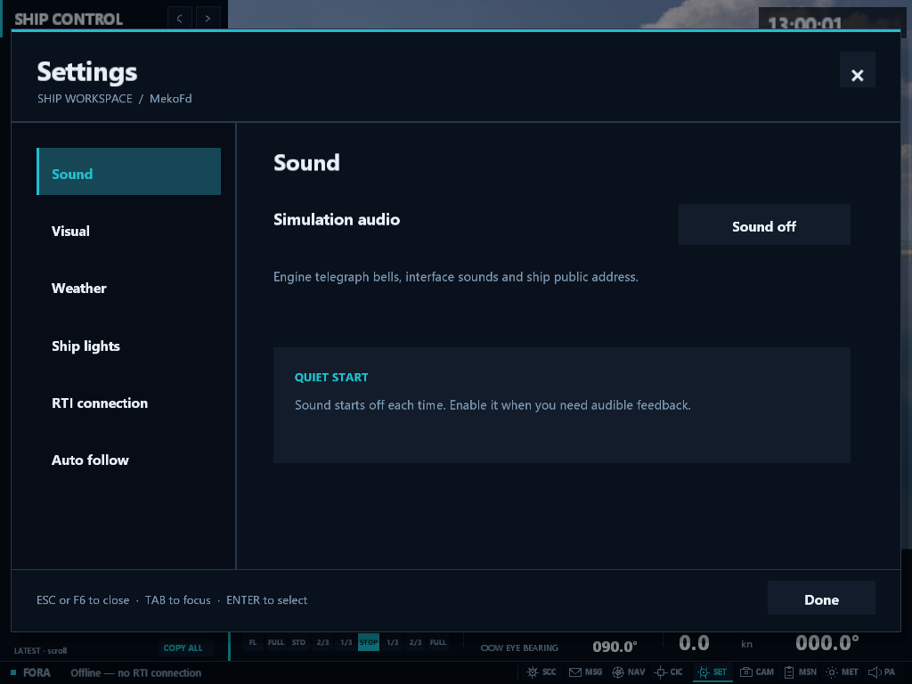

| Page | Controls |
|---|---|
| Sound | Simulation audio, including EOT bells, interface sounds and public address. **Off at every launch**; enabling is a session preference. Muting cancels active audio without removing announcement text. |
| Visual | Window size (1024×768 / 640×480), windowed / borderless full screen, Standard / High render quality. |
| Weather | Sea state, significant wave height Hs, peak period Tp, waves FROM, wind speed, spectrum, wave enable and fog. Sea presets set their reference wind; later wind changes override it. Incoming Environment updates remain live. |
| Ship lights | Underway / anchor / alongside condition, independent deck-light policies, darken ship / restore and local lighting time. |
| RTI connection | Current RTI status and **Manage connection…**, which opens the existing endpoint/federation/FDD connection window. Closing Settings does not disconnect. |
| Auto follow | Optional switching to received communications or newly discovered contacts. Defaults off; switching waits while Settings is open. Received messages take priority over contacts; an unsent draft is retained. |
| Charts | **Add S-57 folder…**, retained-package **Previous / Next**, **Use Boston default**, active source-folder/status and package index. |

**Load another ENC:** extract its ZIP first, then select **Charts → Add S-57 folder…** and choose the extracted folder/`ENC_ROOT`. Keep `.000` and all supplied updates together. After background import succeeds, ATD, chart-safety monitoring and nearby 3D buoys share the new source. Failure leaves the previous chart active. **Previous / Next** browses registered packages; **Use Boston default** restores the bundled 12-cell portfolio. Registrations persist under `%LOCALAPPDATA%\NavySim\Charts`. Startup working-area selection defaults to Boston; choose another area explicitly in the wizard.

Selecting a chart does **not** relocate the ship or generate terrain. Use a scenario with matching coordinates. Buoys can be generated from the ENC; a new area's land/seabed needs separate elevation/bathymetry and datum processing. [Shared chart-library and 3D workflow](../Shared/ChartLibrary.md).

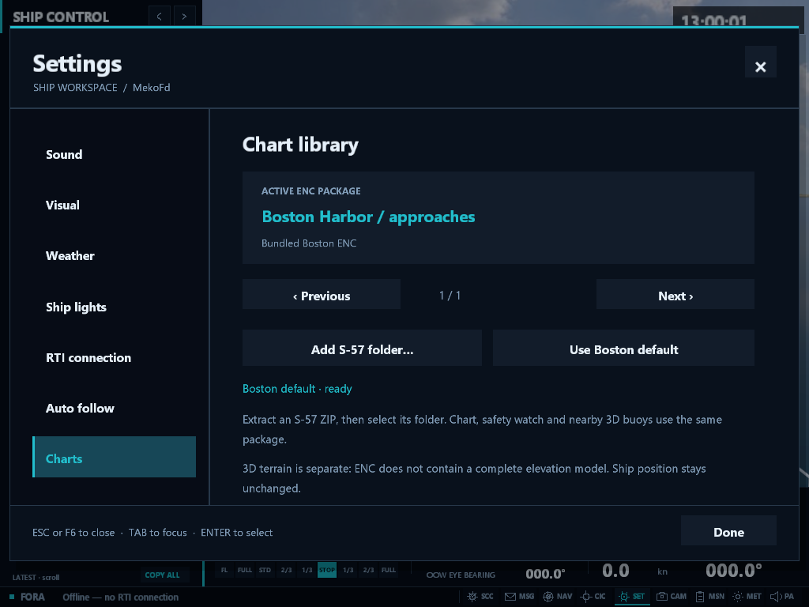

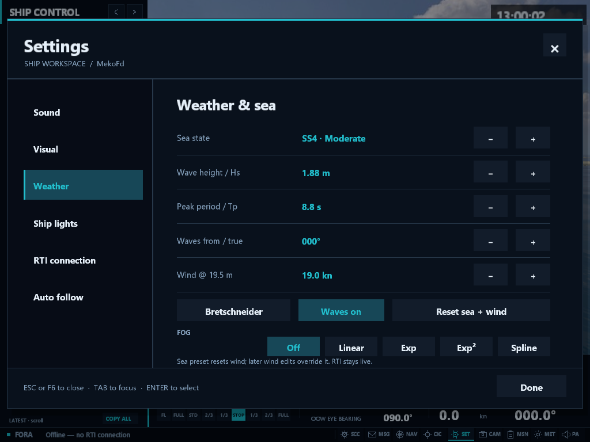

Use the mouse, **Tab / Shift+Tab** and **Enter / Space**. **S** toggles sound, **Shift+R** switches window size, **Alt+Enter** toggles borderless full screen, and **A** toggles automatic follow. These controls work across the popup pages. **L** opens/leaves Ship lights. Outside that page, **0–9** select sea presets and **Q/W/E/R/T** select fog off/linear/exp/exp²/spline. **X/Z** adjust lighting time. Selecting a window size leaves full screen; Alt+Enter also works outside Settings. Local lighting time does not overwrite an authoritative scenario clock.

Sound and visual choices are local session settings. Weather edits can be superseded by federated Environment updates.

### Ocean, wake and spray appearance

Free flight can inspect the hull and propellers below the waterline. The previous green atmosphere-ground fallback is replaced by blue water absorption/scattering, a refracted sky window and a local visual seabed around the own ship. The default Boston world now uses the measured NOAA seabed geometry; the procedural nominal 28 m bottom is disabled there. The chosen starting point has approximately 5.65 m depth relative to local MSL. Imported terrains without measured metadata retain the bounded visual fallback. This does not add grounding or certified clearance checks.

Own-ship propeller wash begins at each submerged hub, travels in the signed thrust direction and rises into the surface wake. Port/starboard use their actual individual RPM, pitch and thrust. One shaft can produce wash independently; CPP astern reverses the jet direction. Neutral windmilling does not create a full powered bubble plume. WAKES OFF removes the plumes and surface interaction while retaining the underwater environment. OTHER has no shaft bubbles unless real shaft telemetry is available; current remote tracks do not provide it. STOP/shaft dynamics are unchanged. [Underwater model and limits](Underwater.md).


The default Stride/Direct3D 11 sea includes twin propeller wash, a world-fixed turning trail, a raised pressure wave and adjacent trough along the bow shoulders, broken contact foam and airborne spray. The narrower wash merges into irregular turbulence; foam follows the displaced water surface. Reverse motion moves pressure spray toward the stern. **WAKES ON/OFF** controls these local effects together; OFF leaves the background sea visible. **ALL** is the default: own ship retains detailed wave/wash/spray, while visible moving contacts receive lightweight bow foam, approximate stern wash and a fading trail. Up to four nearby contacts share the existing transparency batch; distant/offscreen effects are reduced or omitted. Contact wash is estimated from motion because remote shaft telemetry is unavailable. Explicit startup review modes `--wake-target own` and `--wake-target other` retain the earlier own-only / detailed contact-only behavior. **WAVES** controls the background wave strength. Wind speed is in knots and direction is the weather source (FROM); a zero value is no longer replaced by a default wind in this path. EnviFd can replace local environment settings.

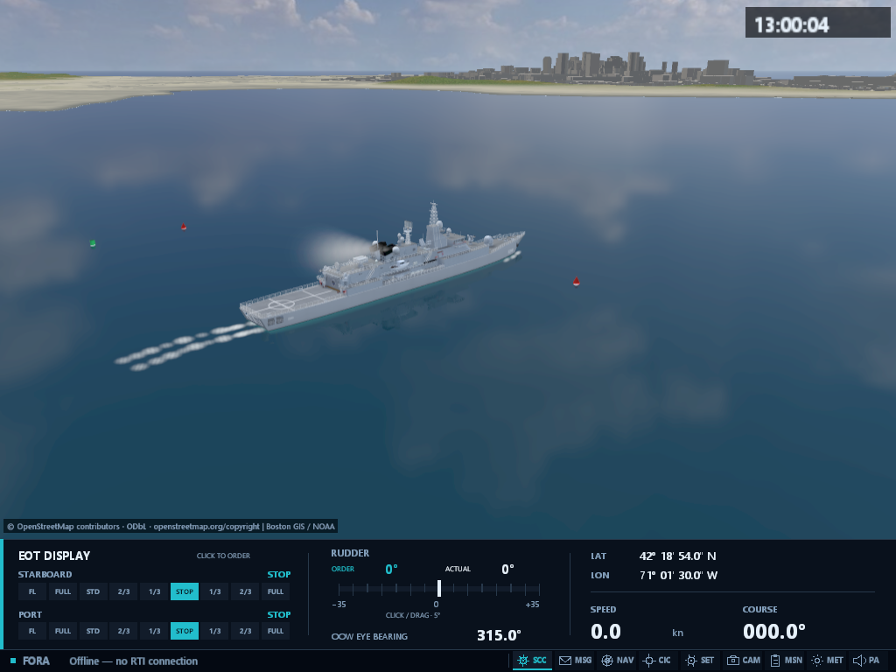

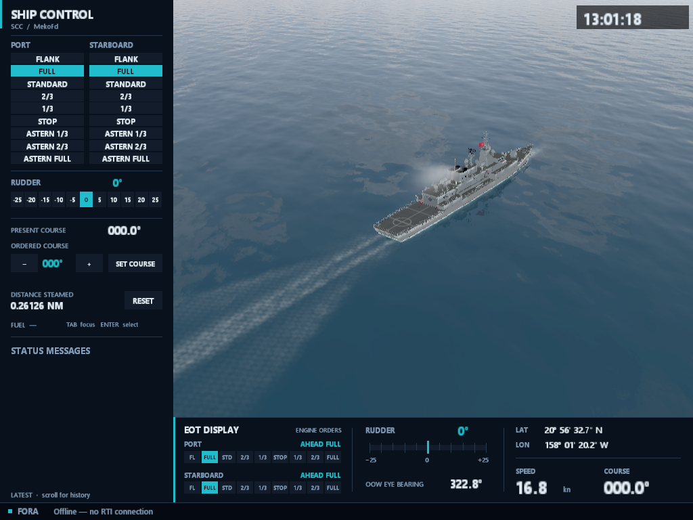

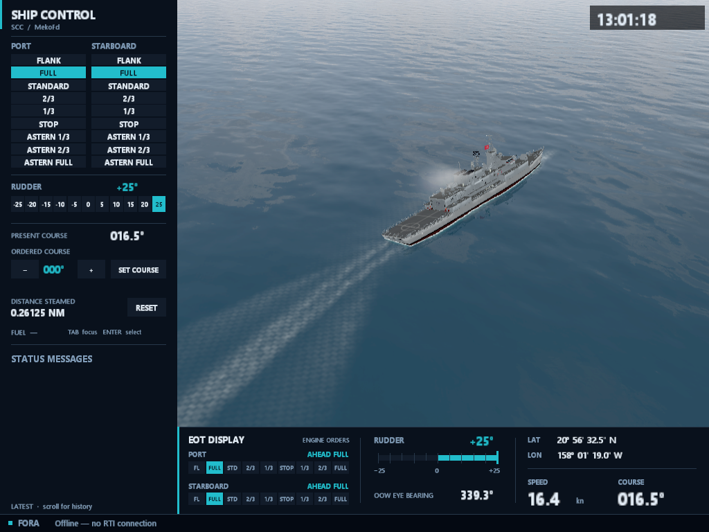

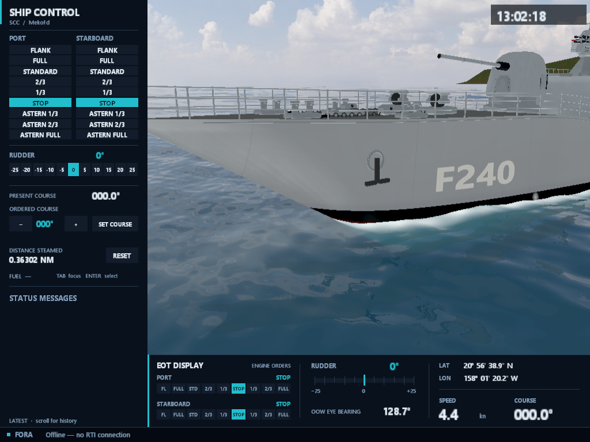

The rougher case shows a slowing ship (about 4.4 kn), not a stationary wave-impact experiment. Contact spray uses irregular ballistic droplet bursts and a restrained mist component; it is still an approximate visual effect rather than a full breaking-wave fluid plume. These are visual approximations and do not add wave forces or buoyancy to ship motion. This package does not install WaveWorks or Omniverse. Displayed-size detail selection and High motion-aware smoothing now reduce distant thin-fitting artifacts; some subpixel shimmer can remain.

The Hs/Tp spectral sea is the only sea model. Use F6 → Weather for its presets and physical inputs; ALL/OWN/OTHER and WAKES control ship-water effects independently. See [ocean architecture and limits](OceanInteraction.md).

High smooths the main 3D view through higher-resolution rendering and depth-checked motion history on solid geometry. Standard uses less scene sampling and a final edge filter. Text, controls and radar panels stay at native resolution. To start in Standard, use `Code/Run.ps1 -RenderQuality standard`. For very large displays, High can use native-size filtering to stay within its render-surface budget.

TIME OF DAY changes the local lighting hour. It also changes the main clock until authoritative scenario time arrives; afterward, the scenario clock remains authoritative. EnviFd/other Environment publications may replace locally selected environment values.

#### Exterior lighting and night operation

Open **F6 → Ship lights** (or **L** in Settings). The current Yavuz profile has three explicitly selected light conditions; selecting a condition does not anchor/moor the physical ship or change its engine orders. A stopped vessel remains UNDERWAY until the operator changes this selection.

| Condition | Automatic night combination |
|---|---|
| UNDERWAY | Red port / green starboard, two white masthead lights, white sternlight; low-level shielded route lighting |
| AT ANCHOR | Forward and lower aft all-round white anchor lights, plus white deck work lighting |
| ALONGSIDE | Harbour deck work lighting; running/anchor lights are off |

**UNDERWAY DECK** and **HARBOUR DECK** each retain their own **AUTO / ON / OFF** setting. AUTO uses environmental TOD: night is **18:00–06:00**, matching the scene's simplified sunrise/sunset. TOD advances with simulation time; a received Environment.TOD or local X/Z selection rebases it. Scenario UTC remains a separate clock. Fog also enables the appropriate running/anchor lights in daylight; anchoring in fog enables AUTO deck lighting too.

**DARKEN SHIP** overrides both programs and extinguishes every modeled exterior light, including navigation/anchor lanterns. It stays selected across TOD changes and RTI disconnect. **NORMAL LIGHTS** restores the selected programs in one action; it does not erase their ON/OFF choices. Normal civil navigation and tactical blackout are distinct operator choices. A Navigation Officer notice appears under Ship when blackout is changed.

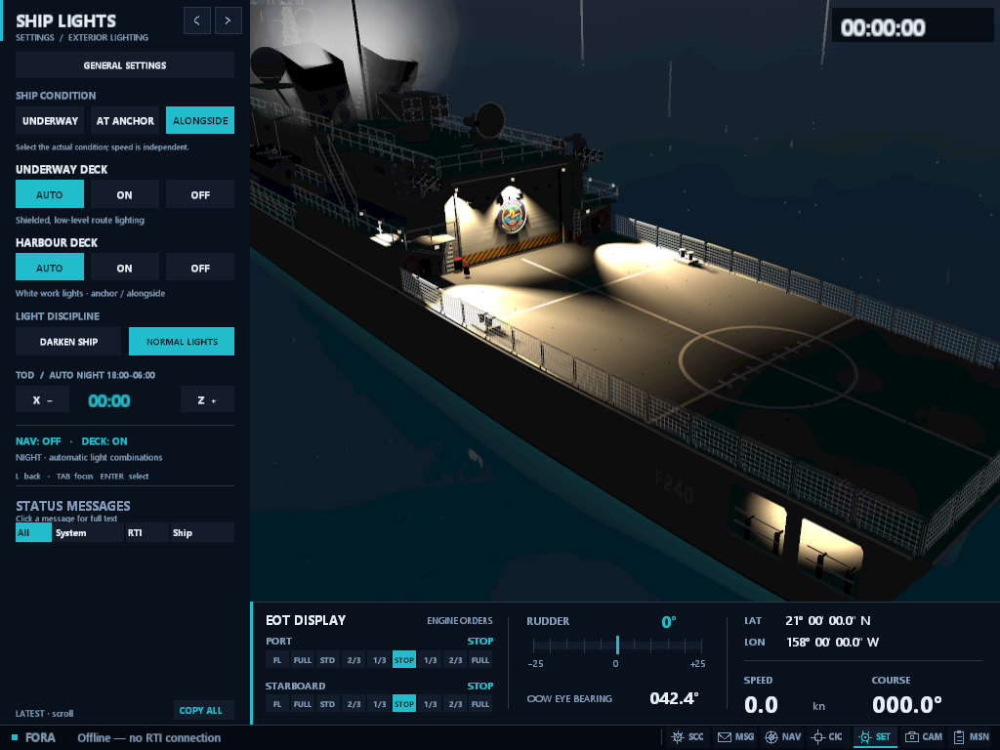

The work lights now illuminate the flight deck, hangar frontage, forward working decks and lower stern bay with shadowed light pools. Navigation lanterns are aspect-limited: their colours are not visible indiscriminately through every bearing. The stowed commander's launch keeps its own lamps off. The 640×480 layout supports the same controls.

This implementation follows the public COLREG light combinations and naval light-management principles described in [the design/source note](../Shared/ExteriorLighting.md). The fixed hours, route-light level, fixture placements, beam strengths and rendering visibility are simulation settings, not a certified NATO/Yavuz installation or photometric survey. Remote ship light status is not sent through the current FOM; remote Yavuz models use an explicit ordinary-underway assumption.


Automatic follow-up is OFF initially. When ON:

- A newly accepted incoming radio message opens MESSAGES.
- A newly discovered ship contact opens ATD and selects that contact.
- Position updates, removals, diagnostics, unaddressed messages and outgoing messages do not switch centers.
- A message takes priority when message/contact notifications arrive together.
- An interrupted compose draft and active field are retained for the return to COMPOSE.

Disabling follow-up clears pending automatic navigation. Waves, wakes and water highlights are startup choices; WAVES and independent wind editing are also available on SEA CONDITIONS.

### Hull clearance and docking lookout — 17.10.2026

Press **F4 / NAV → ATD** and select a nearby ship using the plot or **PREVIOUS / NEXT**. Below its reference-position range, **VISUAL HULL GAP** shows the shortest horizontal separation between the two model hull envelopes in metres. The following line gives **PORT / STARBOARD / AHEAD / ASTERN**, and **CLOSING / OPENING / STEADY** with the sampled separation rate in m/s. It appears within 150 m hull clearance; an overlapping pair shows **OVERLAP**, not a negative distance. The number is a visual estimate, independent of radar center range. It excludes fenders, projecting equipment and pier geometry. Current Yavuz clearance/contact uses the full plating outline, including raked ends and a conservative roll/pitch projection; legacy models retain approximate envelopes.

The Navigation Officer reports close visual hull gaps under **Ship**, including with the radar switched off. Reports start at 50 m; 25 m, 10 m and overlap are progressively closer bands. They identify the track, side, clearance and motion; for example, “Starboard clearance 8.0 m, track 1; closing at 0.20 m/s (visual hull estimate).” The first report says the rate is pending. A first usable rate or changed motion is reported after at least five seconds; steady conditions remind after 30 seconds. Very close gaps (10 m or less) and overlap are warnings. Ship movement now has a separate solid-hull contact guard; normal operation resolves penetration before the lookout samples the scene. Within 50 m this visual report replaces the duplicate center-range warning for that contact; more distant powered-radar CPA warnings continue.

Closing rate comes from consecutive model clearances, including yaw, rather than an assumed speed/course vector. It is unavailable after a gap in sampling or a position/heading jump. It is a sampled aid and can reflect delayed/stepped remote updates. The EOT speed readout adds **ASTERN** when the modeled surge is negative; the officer announces sustained sternway/headway transitions. A crash-stop's first zero-surge event is distinct from later travel astern. The current estimated plant still gives about **23.18 kn astern FULL**; it has not been calibrated to MEKO trials and is not an operational speed specification.

### Solid ship contact — 17.10.2026

With RTI, the local collision guard includes a conservative allowance for remote position age and observed update cadence. Moving ships can therefore be constrained slightly before the displayed hulls touch. This allowance shrinks when reported motion stops. It does not control the other federate. A live two-process test covered head-on, side contact and astern separation; physical position corrections remain immediate under sparse updates. The model and ship-following eye now blend small contact corrections over a short transition; numeric radar/clearance data and RTI use the immediate physical position. The display keeps hulls separated and can snap on a large relocation or when needed for safety (COL-002).


Ship-to-ship contact is enabled automatically. The controlled ship is constrained at the other hull: inward contact motion is removed, while tangential sliding and backing away remain possible. Machinery orders stay as commanded; select STOP or astern yourself when needed. CPP reversal still takes time. A coarse frame or a moving/rotating remote target is sampled in smaller collision steps so the two rendered hulls do not simply cross between endpoint checks. Initially overlapping placements are separated.

**System** displays “Hull contact, track …: inward motion constrained.” It is latched for continuing contact. Navigation Officer clearance/closing reports remain under **Ship**. The controlled ship's corrected posture is the one rendered, used by GPS and published on the existing RTI update path. Another ship's orders or network state are not changed locally. RTI object-instance identities distinguish equal-name overlapping ships and exclude the local object itself.

The current Yavuz guard follows full hull plating rather than only its shorter waterline footprint, with conservative roll/pitch coverage. This is a local, frictionless, inelastic nonpenetration aid; it adds no damage, crush or two-body restitution model. The separate authored Black Falcon Berth 7 now has quay friction and compliant fender contact; other piers and terrain retain visual-only geometry. Remote publishers remain authoritative and can push the local position through their updates; this does not constitute a shared momentum-conserving two-body collision solver. Use updated MekoFd clients for consistent local behavior. See [collision architecture and limits](ShipCollisions.md).

### 7.7 Status display and Fora messages

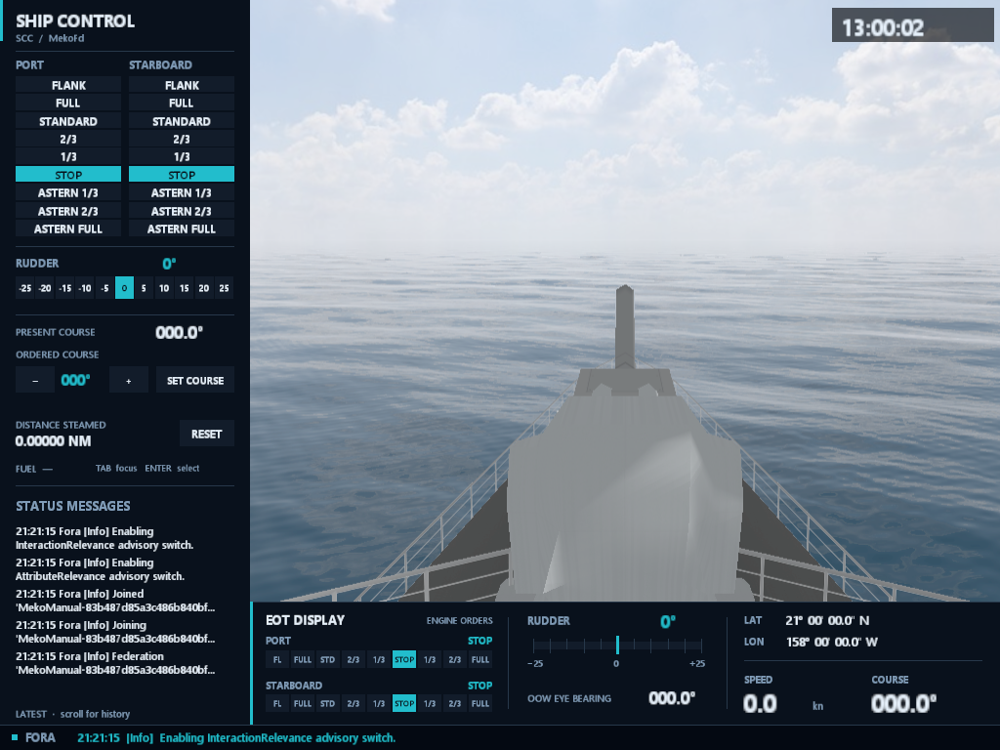

*A real connection to an isolated local Fora server, during federation startup. The test uses its own federation and port 25164; the normal operator default remains localhost:15164. The ship instruments still show local simulation time, while each diagnostic carries its own wall-clock timestamp.*

**STATUS MESSAGES is a right-side sliding archive, closed by default.** Click the STS grip at the right edge to open/close it, or swipe left to open and right to close. It is independent of the left center, and remains available in NAV and F8. In ship view the 3D scene expands/shrinks; in TRD/ATD it overlays the chart without changing chart scale or positions. Close it to reach covered chart controls. Opening it never changes machinery/heading orders or selects another center.

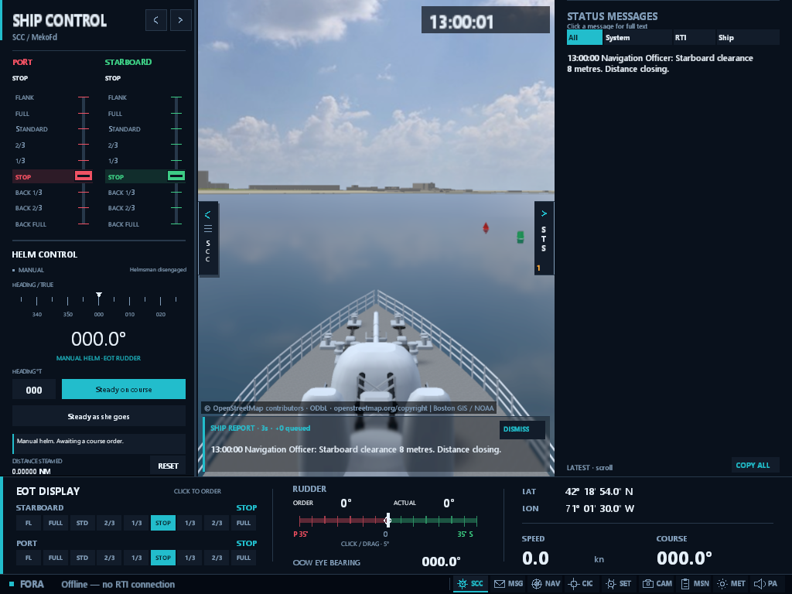

**Ship reports also appear immediately above EOT**, even with both drawers closed and irrespective of the archive filter. All report cards, including amber warnings and red critical reports, stay for **3 visible seconds** and disappear automatically. Their background is translucent and softly blurred; the text remains sharp. EOT and rudder remain permanently visible. A higher-priority report interrupts a lower one, which resumes with its remaining time; equal-priority reports use FIFO. The band shows pending count. Dismiss/expiry removes only the band, preserving retained history. **Dismissal or expiry does not repair a failed engine, rudder or radio.** Click banner text for full details. Settings and inactive-window time pause the countdown. Reports never automatically open a pane or steal text focus.


The STS count means active plus queued banners, not unread messages. The pending queue is bounded to 128; during a flood, omitted low-priority banners are counted as archive-only. History is bounded to 4,096 entries in memory and is not persistent across application restarts. See [priority, retention and overflow policy](../Shared/StatusMessages.md).

**All / System / RTI / Ship** source selectors:

| Source | Messages |
|---|---|
| All | Combined retained history |
| System | Application notices, collision detection, terrain/audio/clipboard errors |
| RTI | Fora diagnostics, connecting/joining/disconnecting, federation/scenario communication notices |
| Ship | Personnel-style reports, equipment failure/repair and radio receipt/submission notices |

The latest items appear first. Scroll here for older entries; **HISTORY** identifies a scrolled view and **LATEST** the newest view. Filtering preserves all retained messages. Two-line previews fit the available layout. **Click a message** to open the complete history for the selected source in a resizable text window, with that message selected. Use **Copy selection**, Ctrl+C or **Copy all** there. Footer **COPY ALL** copies the selected source's full retained text, including multiline/off-screen entries; choose **All** first to copy every source. The detail window is a snapshot; open it again to refresh.

#### Watchkeeper roles and Ship reports

All role-based reports appear under **Ship** (and **All**), with the simulation time and officer name. Warnings use amber; injected machinery/rudder/radio emergency reports use red Critical and are shown above EOT for 3 seconds; they remain in the archive afterward. Open/copy them like other status messages.

| Role | Station | Reports |
|---|---|---|
| Helmsman | Bridge / Helm | Explicit heading orders, acquisition, manual handover, actual rudder response and limited steering authority |
| Navigation Officer | Seyir Merkezi | Close contacts/predicted close approaches, visual hull clearance/closing reports, headway/sternway/nearly stopped, heavy roll/pitch and easing, rudder failure/repair |
| CIC Officer | SHM — Savaş Harekât Merkezi | Newly acquired radar surface contacts with track number/true bearing/range, navigation radar OFF/resume |
| Chief Engineer | Makine Dairesi / Başçarkçı | Changed port/starboard engine orders received, engine failure/repair |
| Communications Officer | Muhabere Merkezi / MCC | Message receipt with sender, UHF transmission queued with addressee, unavailable transmission/queue, HF/UHF failure/repair |
| Meteorology Officer | Meteoroloji Merkezi / MET | Changed received sea state, effective true wind, cloud, fog/ranges and environment time |

Communications reports use the local simulation clock, including received messages with a different sender timestamp. Original message timestamps and contents remain in the archive. **Queued for transmission** confirms local submission, not delivery to another ship. If forwarding to the federation is unavailable, the Communications Officer posts a warning under Ship; Fora connection/transport diagnostics remain under RTI.

Meteorology Officer reports EnviFd Environment updates after the complete update is applied. Sea state resets reference wave/wind conditions; an explicit wind speed in the same update wins. One report summarizes changed groups. Identical repeats stay quiet; a repeated SS that restores a different wind is reported. Time-only corrections within one minute stay quiet. These personnel reports remain under **Ship**; raw RTI diagnostics remain under **RTI**.

The watchkeepers report existing simulation data; they do not change helm/engines or send radio/HLA messages. Engine-order reports acknowledge the local order, not completion of a mechanical response. Failure reports are immediate; repeating the same active failure extends its timer without duplicating the initial alarm. A repair is reported once.

Radar-derived navigation contact warnings require powered navigation radar and an in-range track. The initial exercise policy warns at **0.25 NM** current range, or a predicted **CPA ≤ 0.25 NM within the next 10 minutes**. CPA is the estimated closest point of approach; TCPA is time until then, assuming constant horizontal velocities. Receding or equal-velocity distant contacts do not trigger a future-approach warning. A 0.35 NM/12-minute clear band limits threshold jitter; continuing risks can remind after 120 seconds, and escalation to close range is immediate at the next watch check. These are simulation thresholds, not an automatic collision-avoidance or COLREG decision system.

Watch checks run at most once per simulation second, with at most three contact warnings per check. Making way starts at 1 m/s; nearly stopped requires speed below 0.2 m/s and both engine orders at stop. Heavy motion starts at absolute roll ≥ 12° or pitch ≥ 6°, and clears below 8° roll and 4° pitch. Motion/engine/radar state reports occur on changes rather than every frame. Rapid engine-order changes between checks are summarized by the final pair of orders.

CIC reports at most three new radar contacts per illustrative antenna scan (2.5 simulation seconds); unchanged contacts are not repeatedly announced. Radar off pauses contact reports. These use received exercise tracks, not modeled RF detection/classification; the report does not identify a ship by its HLA name. Disconnect clears contact-watch memory. System collision-detection messages and Fora/RTI diagnostics retain their separate sources.

The bottom **FORA** bar shows the latest client diagnostic with time, level and message. Warnings are amber and errors red. Long on-screen text is shortened; `MekoFd.log`, beside the executable, contains the emitted client log text and startup/shutdown diagnostics. The normal client level is Info, so Debug/Verbose details are not all displayed by default.

The bar displays **Offline — no RTI connection** before any client diagnostic is available, including in the offline examples here. Once logs exist, it shows the latest diagnostic; it is not a dedicated live connection-status lamp. Confirm join/startup or a transport failure from the message text and log. These are this client's messages, not the global Fora server console stream.

History and pending diagnostic delivery are bounded. Under a heavy diagnostic stream, an overflow notice reports skipped older entries. A transport failure is reported by the worker and connection panel; local simulation continues in standalone mode. Reconnect explicitly from F6 Settings > RTI.

### 7.8 About

F11 opens About. **Version** and **Credits** switch the information panel; **OK** closes it.


The dialog retains historical artwork; the version label reads the current assembly version (**4.0.0**). See [release notes](ReleaseNotes.md#version-history) for the changes grouped by module.

### 7.9 Mission summary and readiness

Open **F9**, select **MSN** in the bottom status bar (clipboard icon in compact windows), or use the heading arrows / F1 page cycle.

- **BRIEFING** shows current ship/hull, call sign/nation, scenario title/version, task group, operating area, departure/arrival locations and UTC times, scenario start/current time, orders and description. Missing values say **Not received**; no sample mission is substituted. Before an assignment, the displayed identity is the current local ship identity.
- **READINESS** shows five received/applied prerequisites: ship assignment, UTC scenario clock, complete geographic reference origin, applied initial position, and start order. **READY** and **WAITING** are textual as well as coloured indicators. An early start order can be ready while other data is still pending.
- **LOCAL SESSION** and **AWAITING ASSIGNMENT** allow local controls. After an assignment, **WAITING TO START** means controls are locked until all required data and **BeginToPlay** arrive. **EXERCISE RUNNING** means the scenario has begun. Component failures can independently restrict controls in any state.

Use the mouse wheel over the panel, **Page Up / Page Down**, or **Home / End** to read long content. It wraps without preview truncation; the line counter and scroll marker show the current position. **Tab**, then **Enter / Space**, selects BRIEFING or READINESS. Changing pages returns to the top. F8 hides the panel; its status-bar icon restores it.

This is an information panel. The exercise controller supplies the assignment/start data through RTI; opening the panel cannot start or reset the scenario. **F6 Settings > RTI** manages the connection. Disconnect clears exercise fields and readiness, retaining the local ship identity and posture. See [mission architecture](MissionReadiness.md) for the precise data boundary.

### 7.10 Weather center

Open **F10**, click **MET** (sun icon) in the bottom status bar, or use the heading arrows/F1 sequence.


The compass shows **true wind FROM**: the teal arrow points inward from the bearing where the wind arrives. The amber line marks own-ship true heading. Wind speed is **knots at the 19.5 m reference height**. This is true wind, not apparent wind over the moving deck.

The sea card shows SS, significant wave height **Hs** in metres and peak period **Tp** in seconds. Standard values are labelled reference conditions; locally overridden spectra are labelled separately. Sky density, fog far range and environment time appear below. Fog far range is not a measured meteorological visibility. Wave direction remains independent of wind direction.

**LOCAL CONDITIONS** identifies startup/local settings; **ENVIRONMENT / RTI** identifies conditions that have received a federated weather update. This is a source label, not an RTI connection indicator. The footer shows the last Meteorology Officer report time; retained conditions remain visible after disconnection. F6 keeps the editable sea/lighting controls. RMB observer look remains available.

### Ship stations and public address — F12 / PA

Open **F12**, click the **PA speaker icon**, or use center arrows/F1. F11 remains About.

1. **Navigation stations** calls navigation stations.
2. **Manoeuvring stations** calls manoeuvring stations and increases berth-watch reminders.

Click a card, press **1/2**, or use Tab/Enter. Teal marks the selected routine. The same selection stays quiet; **Repeat announcement** deliberately repeats it. A call does not confirm that personnel are physically at stations.

The local ship public address produces speech and full text under **Ship / Officer of the Watch**, independently of RTI/HF/UHF. **F6 Sound OFF** mutes speech without removing text. All controls, officer reports, retained announcements and speech are English. An English Windows SAPI voice is required for speech; if unavailable, the call remains as text and the audio status explains the limitation.

The lookout card shows registered quay/fender side, minimum hull gap, bow/stern distances and sampled closing/opening rate. Navigation Officer now reports these fixed surfaces even with radar OFF. A fresh/jumped position first shows that closing speed is being measured. Only authored training berths are covered; these are model estimates.

SCC and PA show **rudder order, actual angle and turn rate**. The officer acknowledges manual helm orders, reports actual arrival and warns of weak measured rudder inflow. **STOP does not disable steering while there is headway**; zero headway plus no wash is a separate case. Hydrodynamic coefficients were not tuned in this update.


[Architecture, audio fallback and measured response](../Shared/ShipStationsAndPA.md).

## Black Falcon berthing exercise

The Boston region includes **Berth 7**, a 213.36 m authored concrete face with timber rubbing strips, five fenders, plan-labelled 30/100-ton bollards and ladders. Fixed shore contact is enabled with the region: the ship can slide, turn on eccentric contact and back clear. Fenders have estimated spring/damper compression and a backing stop; their visual geometry remains rigid. Shore contact notices appear under **System**. Machinery orders remain the OOW's responsibility.

For offline practice, launch with **--offline --no-dialog --training-berth black-falcon-7**. The ship starts at the same WGS84 position as Sen's exercise, 45 m seaward of the concrete face, heading 088.74 degrees, engines STOP. This 45 m is measured from the ship's model origin, not its hull edge. The saved scenario is under **Documents → Scenario Projects → Black Falcon MEKO Berthing → BlackFalcon.xml**. In a federated exercise, FDD 5.1.0 TaskOrd applies initial true heading before Begin (088.74 degrees for this exercise). Speed remains an authored reference; the OOW controls machinery and manoeuvring. See [plan, coordinates, contact equations and limitations](../Shared/BlackFalconBerthing.md).


## 8. Special views and codes

These codes are entered in **F7 / Transportation**, not in the message editor.

| Code | Current behavior |
|---|---|
| IBELIEVEICANFLY | Observer above the ship, looking toward it |
| AHEAD | Observer ahead of the ship, looking back |
| BACK | Observer behind the ship, looking toward it |
| SOCLOSENOMATTERHOWFAR | Toggle the local dolphin visualization |


Press Enter or select GO after entering a code. An unknown code displays a notice. With an empty code and no focused station control, Enter retains the historical shortcut to the above-ship view. With a station control focused, Enter activates that station instead. Select any available numbered station to return to a normal deck/bridge view.

Dolphins are a local visualization toggle, not a federated ship contact. The code is implemented in the current application; the old manual's placeholder status no longer applies.

## 9. Fora connection, offline use and shutdown

### Standalone and connected launch

MekoFd starts standalone by default. Ship handling, cameras, radar presentation and visual controls work without RTI. Standalone mode does not publish a ship or send federation messages. `--offline` explicitly forces standalone startup; connection can still be requested later from F6.

Select **Connect to RTI at startup** in the wizard, or use `--connect` / `Run.ps1 -Connect`. Connection runs in the background while the scene opens. The default RTI address is **localhost:15164**, the federation is **NSTMSS**, and the initial ship/federate name is **MekoFd**. The wizard normally follows the edited ship name for the federate name; an explicit name remains separately configurable. Port 15164 is the Federate Protocol listener, distinct from the HTTP management endpoint.

```powershell
& 'C:\OkPer\Projects\NavySim\Implementation\FdApps\MekoFd\Code\src\MekoFd.App\bin\Release\net10.0-windows\MekoFd.App.exe' --connect --rti localhost:15164 --federation NSTMSS
```

The selected local NavySim FDD XML is validated and supplied by content to Fora; the RTI does not need the local path. Connect creates or joins the federation and registers the current MEKO ship. The join uses the configured federate name and fixed application type **MekoFd**. A separate `HLAobjectRoot.Frigate.Meko` object gets an RTI-assigned instance handle, and its `Name` attribute is the configured/current ship name. Its current position, speed and identity are published; received exercise assignments retain their existing positioning/control rules. KNOX remains standalone-only in this application. SOM/FOM capabilities are unchanged.

### Connect, cancel, disconnect and reconnect

Open **F6 Settings > RTI**. Edit RTI address, federation, **Federate name (unique)** and FDD; select **Join an existing federation only** when creation should be skipped. CLI equivalents are `--client-name`, `--fdd` and `--join-only`. Select **Connect**. While connecting, **Cancel** cancels the pending attempt. Once connected, **Disconnect** returns to standalone. **Close** closes the panel without disconnecting.

The panel shows Standalone, Connecting, Connected, Disconnecting or Connection Error and includes the detailed failure message. Network waits do not block the render loop. A startup failure or lost connection leaves local simulation available; restore the RTI/address and select Connect again. Reconnect creates a fresh client, worker and object identity; it does not reuse a previous object handle. Reconnection is manual. **FederateNameAlreadyInUse** means another participant already holds the requested federate name: close that session or change Federate name in this panel, then reconnect. Changing only the ship identity of an active session does not rename the joined federate. **FederationExecutionAlreadyExists** during create-or-join is expected when the exercise already exists; joining can proceed.

Disconnect clears federation contacts, scenario authority and pending network transmissions. Own ship position, speed, engine/rudder state, identity, current weather and terrain remain; the displayed clock continues locally. Local radio submissions made while disconnected are not replayed on a later join. Existing engine/radio failures remain in effect.

### Shutdown

Esc or the main window close button ends the application. A connected session sends its final state and performs the existing generated resign/cleanup sequence. Cleanup errors are written to `MekoFd.log`; failure to connect does not require restarting the application.

## 10. Scenario, environment and failures

### Exercise assignment and start

A task order can assign the ship's name, hull number, call sign, nation and initial position. It stops the engines and locks normal ship controls while the assigned scenario is waiting. To begin, the application needs the assignment, scenario start time, a usable origin/initial-position combination and **BeginToPlay**. These may arrive in different orders; an early BeginToPlay request is retained until the other prerequisites are available. Open **F9 > READINESS** to see exactly which prerequisites are missing.

The exercise controller supplies these values; there is no local Start Scenario button. Once the scenario begins, the controls become available except for failed components. The received task order appears in the message archive, with its assigned identity and position details.

### Time and reports

Before scenario time is received, the displayed clock starts at the configured hour and advances locally. With authoritative scenario time received, it waits at that time until the assigned scenario begins, then advances from the exercise start. The top-right display does not substitute the computer's current clock when it is waiting for a scenario.

Automatic ship status reports use the scenario **ReportInterval**, in minutes. Zero disables periodic reports. Reports require HF; missed reports while HF is unavailable are not accumulated for a burst after repair. Formation messages use UHF. Generated relevance policy also requires an interested receiving subscriber for ordinary sends.

### Sea conditions

Startup and F6 support WMO Sea State **0–9**. SS0 is glassy, SS3 slight and SS4 moderate; the previous three-level labels have been replaced. Open **F6 → Weather**. Adjust significant crest-to-trough wave height **Hs**, peak period **Tp**, wave direction **FROM** and Bretschneider/JONSWAP. Hs changes automatically update the WMO code; Reset restores its reference Hs/Tp. Done closes the popup. Tab/Shift+Tab and Enter/Space also operate the buttons.

Preset Hs/Tp and reference wind values use NATO ANEP-70's open North Atlantic reference, not a mandatory period for every region. SS1's 3 s period and SS9's 15 m height/65 kn wind are labelled simulation choices. SS selection initializes the ANEP mean wind at 19.5 m; wind may then be edited independently. SS9 uses a labelled 65 kn wind choice. SS0 and WAVES OFF remove incident waves; underway wake/spray remains controlled separately by WAKES. The existing estimated vessel response settles rather than stopping instantly. [Table, sources and limits](SeaConditions.md).

These detailed values are currently local. An RTI SeaState reflection restores reference Hs/Tp and wind. A subsequent WindSpeed update overrides wind only; explicit WindSpeed in the same reflection wins regardless of field order. Custom Hs/Tp and wave direction are not received. RTI status explains the reference preset. Meko subscribes to eleven supported Environment fields; retired Wave1…Wave4 values are no longer received or stored. [FOM/SOM findings](SeaConditionsFederation.md).

### Environment and terrain

The flag now drapes in calm/light wind and develops moving folds as wind increases. Its existing response to wind FROM bearing, wind speed and ship motion is preserved. Country artwork keeps its native proportions; the reverse is naturally mirrored. Task assignment can replace the selected country. Unsupported externally assigned codes retain the staff and hide the fabric. These are national flags; official country-specific naval ensigns are not represented.


Environment updates can change sea state, fog, time of day, wind, waves, origin and terrain filename. The displayed sea, sky and flag respond to applicable settings. The regional name `boston-harbor` selects the bundled measured package. A received `.flt` terrain filename loads a locally available imported model; success/failure is reported in status history. ATD's coastline then follows the loaded terrain.


The default is **Boston Harbor**, at **42.315°N, 71.025°W**, matching Sen. The shared NOAA CUDEM package covers 12.8 × 12.8 km with a 25 m land/seabed mesh. GPS and 3D use the same regional frame, and ATD derives its coastline from that surface. Land cover remains generic. A companion layer adds 6,573 source-derived building parts and 519 pier geometries around the inner harbor; 3D and ATD use the same footprints as Sen. Buildings are simple flat-roof volumes; pier deck heights and some widths are estimated. Terrain collision and grounding remain further work. See [harbor sources, coverage and visual limits](../Shared/HarborStructures.md). Source vertical datum is NAVD88, shifted +0.092 m to the chosen Boston MSL zero. This is a constant regional approximation, without live tides. See [regional terrain sources, equations and validation](../Shared/RegionalTerrain.md).

### Ship visual profiles and rollback

The default **Yavuz v1 / visual revision 21** has photograph-referenced bridge glazing and wings, stepped deckhouses and side working wells, detailed boats/funnels/equipment, a closed detailed hangar door, and true open stern working bays with a lower deck. Current propellers, rudders, masts, directors, weapon mounts, identity artwork and wind-responsive ensign are part of the approximate authored model. Own ship and MEKO contacts use the selected profile; Knox remains separate. The asset is not a surveyed ship reconstruction.

[Open the larger before/after and detail gallery](../../../Implementation/FdApps/MekoFd/Docs/VisualReview/index.html). The previous integration remains a dated snapshot; its FPS/test/package figures do not measure this refined model.

The previous enhanced FLT model is still available, including its earlier materials and fittings. Select the profile before launch; there is no in-session profile switch:

```powershell
# Source checkout, from MekoFd:
Code/Run.ps1 -Offline -ShipProfile legacy
Code/Run.ps1 -Offline -ShipProfile yavuz
# Delivered package:
./Start.ps1 -Offline -ShipProfile legacy
# Direct executable:
MekoFd.App.exe --offline --ship-profile legacy
```

`legacy` changes the visual model; controls, dynamics, HLA posture/radar frame and collision behavior remain the same. The new visual hull targets 115.5 × 14.2 m with nominal 4.1 m draft, and current runtime contact uses a separate full-plating 115.50 m convex outline with conservative roll/pitch projection. The original FLT proxy remains a legacy diagnostic/rollback asset. Sections/equipment detail are approximate, not a surveyed representation of a certified refit. A profile hash/map error is reported explicitly; restore the profile files/rebuild it or select `legacy`.


The aft upper deck now includes a separate rear-facing dish/director assembly on the hangar roof, launcher service landing, braced gun platforms and hangar-facing hose racks, valves/nozzles, ladders and liferings. Hooded door/platform lamps and service floodlight fixtures have visible warm-white lenses. The flush outer hull-side walls remain clear of these fittings.


Exterior lamp emission now follows the selected condition, independent underway/harbour policies and TOD. Shadowed work lights illuminate nearby decks; F6 → SHIP LIGHTS provides DARKEN SHIP and NORMAL LIGHTS controls. The added director is static visual detail; its exact equipment type is not established from the supplied model render.


Other control-center and earlier material captures retain their 2026-10-12 appearance; the controls remain applicable. [Refinement image provenance](images/yavuz-refined/SOURCES.md) identifies current renderer captures. [Earlier integration evidence](../../../Implementation/FdApps/MekoFd/Docs/Validation/yavuz-v1/README.md) and [revision 1 FPS results](../Shared/Benchmarks.md) remain historical.


### Injected failures

An addressed injection can fail the rudder, port/starboard engines or HF/UHF for a supplied duration. Failed ship controls show LOCKED, failed engines are placed at STOP, and radio failures change the MCC indicators. The application reports the emergency and later repair. After repair, issue new engine/helm orders as needed.

Task-order targeting defaults to the legacy object-instance identity. The advanced `--taskord-identity federate` option is for an exercise controller that deliberately uses federate handles; both sides must agree. It does not change ordinary TO/CC ship-name matching.

## 11. Launch options

Use the executable path from section 9, or the equivalent path in the delivered build. Quote paths containing spaces.

| Option | Purpose |
|---|---|
| `--offline` | Local session without Fora; permits offline KNOX selection |
| `--rti localhost:15164` | RTI Federate Protocol endpoint |
| `--federation NSTMSS` | Federation name |
| `--join-only` | Join an existing federation without creating it |
| `--fdd "C:\path\NavySim.xml"` | Select the local FDD |
| `--root "C:\path\MekoFd"` | Locate the MekoFd/package folder containing `Assets` |
| `--no-dialog` | Skip the wizard and use Boston/default options; also suppress startup error dialogs |
| `--working-area boston` / `<library-id>` | Select a registered startup area with matching ENC and initial reference |
| `--chart-sea-only` | Explicit startup without regional terrain, harbour or quay collision surfaces |
| `--chart-library "C:\path\Charts"` | Use another shared ENC registration library |
| `--ship Meko` / `--ship Knox` | Select the ship class; Knox requires `--offline` |
| `--ship-profile yavuz` / `--ship-profile legacy` | Default new Yavuz visual profile or the preserved previous enhanced MEKO model |
| `--hydro-profile training` / `--hydro-profile previous` | Default stable training handling or retained previous v7 hydrodynamics. Independent of visual profile; full profile IDs and `default` are accepted |
| `--time-of-day 18` | Initial lighting/display hour |
| `--station 3` | Initial observer station, using zero-based indices 0–7 on Yavuz (0–6 on Knox/legacy); 3 is quarterdeck, 4 forecastle and 7 bridge interior |
| `--observer-mode flight` | Open TCC in free flight with a framed exterior ship view; normal startup remains at the bridge. The old `orbit` value is accepted as an alias for flight. |
| `--terrain boston-harbor` | Advanced legacy terrain override with `--no-dialog`; separate from working-area selection |
| `--terrain sinop.flt` | Request a locally available imported terrain model |
| `--waves`, `--calm-water`, `--wakes` | Initial visual sea/wake choices |
| `--legacy-ship-look` | Select original FLT and older material presentation; use `--ship-profile legacy` for the previous enhanced look |
| `--legacy-terrain-look` | Use the earlier Hawaii land material presentation |
| `--taskord-identity object` / `federate` | Select the agreed task-order targeting convention |
| `--check-assets` | Check required local model/texture availability and exit |

For example, a local Knox session with no wizard:

```powershell
& 'C:\OkPer\Projects\NavySim\Implementation\FdApps\MekoFd\Code\src\MekoFd.App\bin\Release\net10.0-windows\MekoFd.App.exe' --offline --no-dialog --ship Knox
```

Ordinary wizard values are initial session choices; subsequent scenario/environment data can replace them. The separate `--verify-*` capture modes are developer verification tools, not normal exercise modes.

## 12. Troubleshooting

| Symptom | What to check / do |
|---|---|
| Startup says a model or texture is unavailable | Check the selected root and local `Assets` files. For OneDrive placeholders, select **Always keep on this device** and run `--check-assets`. |
| Cannot connect to Fora | Start the RTI, confirm the Federate Protocol endpoint/port and federation name, then inspect `MekoFd.log`. Do not use the HTTP management port as `--rti`. |
| `--join-only` fails | Have the exercise controller create the federation first, or remove `--join-only` for the normal create/join path. |
| Invalid FOM/schema or contract error | Use the compatible deployed NavySim FDD and current binaries. Rebuild/regenerate through the normal workflow rather than manually editing generated model types. |
| Knox launch is rejected when connected | Use `--offline --ship Knox` for local use. This connected federate publishes Meko and only subscribes to Knox. |
| Port FULL / starboard STOP behaves like both STOP | Update/rebuild to the 2026-10-16 twin-shaft correction. A healthy port engine now provides sustained thrust independently; the resulting speed also depends on turning/rudder. See [implementation](../Shared/Hydrodynamics.md#current-twin-shaft). |
| Engine/helm buttons are LOCKED | Check scenario assignment/start prerequisites and status history for a component failure. Wait for repair/start, then issue the required orders. |
| SEND is disabled | Check UHF availability and the outgoing-queue notice. The editor retains the unsent draft. |
| A submitted message is not seen by another ship | Check exact TO/CC name or ALL, receiver UHF availability, matching federation and an interested subscriber. Inspect the MCC send state and Communications Officer details. RTI ACCEPTED confirms RTI acceptance only; recipient delivery is not acknowledged. |
| Draft disappears after navigation | Use MCC's MESSAGES/COMPOSE tabs to retain it. F1/F3 transitions can use the older reset rule; automatic follow-up preserves an interrupted draft. |
| No radar contacts | Check that peers are joined/publishing, their updates arrived, the plot range/span covers them, and TRD is ON. Offline sessions do not create exercise peers. |
| Radar zoom seems different between tabs | TRD range is a radius; ATD DISPLAY SPAN is total plot width. |
| R changes fog instead of resolution | Use Shift+R in Settings, or click its resolution button. |
| Local hour changes but scenario clock does not | Once scenario time arrives, it controls the main clock. Settings TIME OF DAY can still change lighting. |
| Settings change again after a local edit | Check incoming Environment data; the exercise's publisher can replace local scene choices. |
| Sound is absent | Enable SOUND, inspect the audio files/device and log. Sound failures are reported; disabling sound stops active audio. |
| Connection is lost | Read the diagnostics, restore the endpoint and reconnect explicitly from F6 Settings > RTI. Standalone simulation continues; reconnect is not automatic. |

The runtime log is replaced at each launch. Preserve a copy before restarting if a previous failure needs investigation.

## 13. Current scope and limitations

The current 4.0.0 build is a functioning C# migration; complete equivalence with every historical C++ feature is not claimed. In particular:

- Connected own-ship publication supports Meko; Knox is an observed contact and an offline local model.
- MEKO uses an estimated Yavuz/DTMB 4-DOF maneuver model plus reduced heave/pitch wave response. Reverse speed, stopping and turning figures are simulation results pending vessel trials, not operational predictions.
- CIC supports available gun movement, not firing. ASW and missile selection have the limits described above.
- There is no local scenario-authoring, recipient-list editor, radio-frequency tuner or automatic reconnect UI.
- UI histories are bounded and are not persistent archives.
- ATD coastline comes from terrain geometry; detail and geographic coverage follow the loaded model.
- The ship's visual hull markings and About artwork are fixed presentation assets, separate from assigned identity/version data.

P/S, callback discovery, advisory-based sending and startup readiness come from the generated runtime. Custom developer policies belong in the manual SimulationManager rather than in generated files; see the [generated API guide](../../../Implementation/Library/Maritime/Code/src/NavySim.Hla.Fora/README.generated.md). These extension points do not introduce extra controls into the operator UI.

## Abbreviations

| Term | Meaning |
|---|---|
| AAW | Anti-Air Warfare |
| ASuW | Anti-Surface Warfare |
| ASW | Anti-Submarine Warfare |
| ATD / ATDX | Advanced Tactical Display / its extension controls |
| CIC | Combat Information Center |
| EBL | Electronic Bearing Line |
| EOT | Engine Order Telegraph |
| FDD / FOM | Federation Description Document / Federation Object Model |
| HF / UHF | High Frequency / Ultra High Frequency radio |
| MCC | Message Control Center |
| NCC | Navigation Control Center |
| NM | Nautical mile |
| NSTMSS | Naval Surface Tactical Maneuvering Simulation System, former NavySim name |
| OOW | Officer of the Watch |
| OTC | Officer in Tactical Command |
| RTI | Runtime Infrastructure |
| SCC | Ship Control Center |
| SOM | Simulation Object Model |
| SS | Sea state |
| TCC / TC | Transportation Control Center |
| TRD | Traditional Radar Display |
| VRM | Variable Range Marker |

## Screenshot and implementation references

The control-center and earlier terrain screenshots were captured on **2026-10-12**. Current Yavuz reference-correction ship images were captured on **2026-10-13** and are identified separately in `images/yavuz-refined/SOURCES.md`. All use actual application assets/output. Except for the connected Fora example in section 7.7, the examples run **offline**; populated messages, injected failures and contacts are controlled demonstration data. The wizard's edited KNOX example is explicitly offline. Images use the actual window/render output, with no drawn replacement controls.

[Screenshot sources and hashes](images/current/SOURCES.md) identify the capture modes and build. The controls were checked against the current simulation/input code and the screenshot runs completed successfully. Operator behavior is described here; build/import/runtime design and earlier live integration checks remain in the [C# project guide](../../../Implementation/FdApps/MekoFd/Code/README.md) and [release notes](ReleaseNotes.md).

## C2SIM exercise control

Sen 3.0.0 authors packages and ExMFd 4.0.0 executes them. Configure a unique RTI federate name matching the package System name, such as MekoFd1. ExMFd assigns ship name/hull/call sign/nation, initial position and true heading before BeginToPlay; wait for Run to unlock controls. Authored speed remains a reference and does not set speed or engine orders. Initial heading does not enable autopilot. A missing InitialHeading keeps current orientation; repeated assignments after Begin cannot overwrite position or heading. Use FDD 5.1.0 and current participant binaries in a newly created compatible federation.

During a controlled exercise, simulation time and physics follow ExMFd clocks. Pause freezes movement and normal helm/EOT controls; Resume continues. Timed component failures recover by scenario time. Mission readiness distinguishes Running, Paused, Stopped and Completed. Restart restores authored initial state; Stop/End lock controls and stop machinery orders. Legacy task/start/injection commands cannot override an active controlled run. Disconnect restores the normal standalone state.

[ExMFd operator workflow](../../ExMFd/UserManual.md) · [Shared execution architecture](../Shared/FederationIntegration.md#c2sim-controlled-execution) · [C2SIM contract](../../../../Implementation/Library/Scenarios/README.md).
