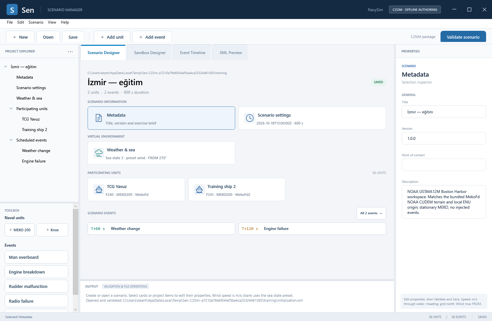
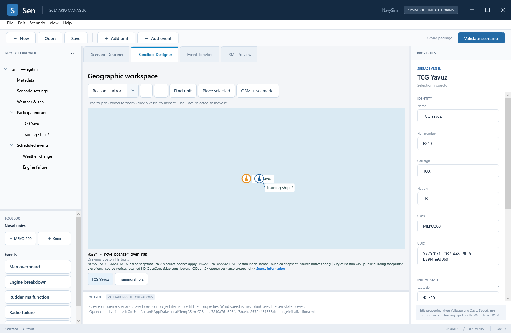
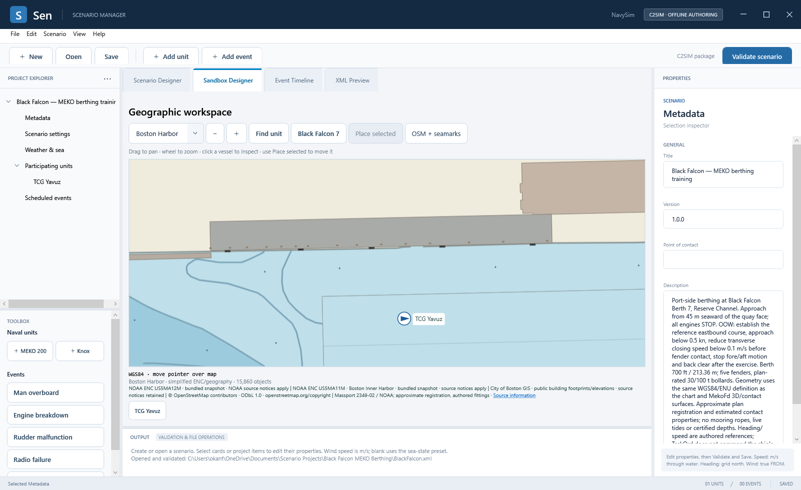
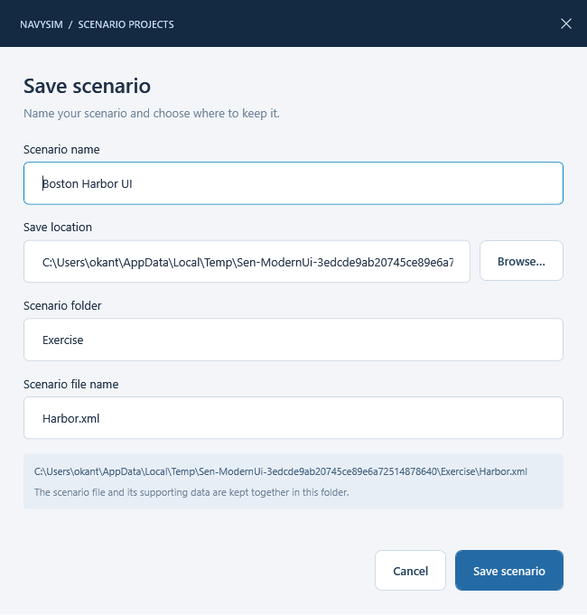
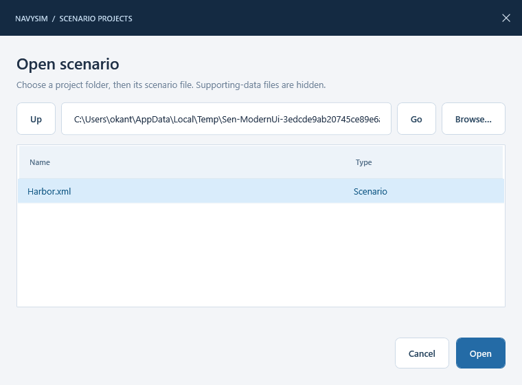

# Sen — Scenario Manager User Manual

| Document information | Value |
|---|---|
| Application | Sen 3.0.0 |
| Interface | Windows desktop · Scenario Designer |
| Scenario format | NavySim C2SIM profiles 1.0.0 / 1.1.0 |
| Execution application | ExMFd 4.0.0 |
| Last updated | 18 October 2026 |

Sen prepares naval exercises: participating ships, initial conditions, weather changes and timed equipment failures. You can create, edit, validate and save a scenario without editing XML. ExMFd loads the saved package and controls its execution with the participating applications.

## Contents

1. [Getting started](#1-getting-started)
2. [Workspace and controls](#2-workspace-and-controls)
3. [Scenario information and time](#3-scenario-information-and-time)
4. [Participating ships](#4-participating-ships)
5. [Weather and sea conditions](#5-weather-and-sea-conditions)
6. [Scheduled events](#6-scheduled-events)
7. [Saving and opening projects](#7-saving-and-opening-projects)
8. [Validation and XML preview](#8-validation-and-xml-preview)
9. [Worked example: machinery training](#9-worked-example-machinery-training)
10. [Running an exercise](#10-running-an-exercise)
11. [Troubleshooting](#11-troubleshooting)
12. [Supported scope and related documents](#12-supported-scope-and-related-documents)

## 1. Getting started

### Requirements and launch

Run `Sen.exe` from its complete application folder on Windows x64 with the .NET 10 Windows Desktop runtime installed. Keep the accompanying application files together. Bundled charts and scenario editing work offline; the optional OSM/OpenSeaMap view requires Internet access. ExMFd uses an RTI connection to run the prepared exercise.

The window opens maximized on the monitor containing the mouse pointer at launch. See the [Installation Manual](InstallationManual.md) for installation and build instructions.

### First scenario

1. Start Sen, or choose **New**. The Boston Harbor scenario is created automatically.
2. Select **Metadata** and enter the exercise title, description and contact in **Properties**.
3. Select **Scenario settings** to check the UTC start, duration and north reference.
4. Select a ship card to check its identity, initial state and **System / federate** assignment.
5. Review **Weather & sea** and add events as required.
6. Choose **Validate scenario**. Resolve any reported errors.
7. Choose **Save**, enter the project location and names, then choose **Save scenario**.

### Default Boston Harbor scenario

Startup and **New** use the following template:

| Setting | Default |
|---|---|
| Title | Boston Harbor — training |
| Vessel | TCG Yavuz · MEKO200 · F240 |
| System / federate | `MekoFd` |
| Call sign / nation | `100.1` / `TR` |
| Latitude / longitude | `42.315`, `-71.025` degrees |
| Altitude / heading / speed | 0 m MSL / 000° grid / 0 m/s |
| Start | Current UTC date at 13:00:00Z |
| Duration | 1,800 seconds · 30 minutes |
| Sea state / wind | SS3; preset wind speed; wind FROM 270° true |
| Events | None |

The location is the shared Boston Harbor authoring workspace, not a live ship position. Each **New** creates a fresh vessel UUID. MekoFd now includes the matching Boston land/seabed package. Both applications use the same initial WGS84 position and shared geographic frame. Its current terrain covers 12.8 × 12.8 km at 25 m visual spacing; chart placement does not validate grounding or clearance.

A ready-to-open copy is included in the application folder at `Samples\boston-harbor\initialization.xml`. Its example date is fixed; the new-scenario template uses the current UTC date.

## 2. Workspace and controls

The header contains minimize, maximize/restore and close controls. Drag its empty area to move the window; double-click to maximize or restore. Window edges remain resizable. Closing an edited scenario still asks before changes are discarded.

The scenario badge shows **NEW**, **SAVED** in green or **UNSAVED CHANGES** in amber. This describes file state; use **Validate scenario** to check authored content. Dropdowns support mouse selection, arrow keys and Escape. Tables retain editable cells in the table editor.



Select a project-tree entry, scenario card, ship or event to display its editable properties on the right. Selection changes do not save the project.

| Area | Use |
|---|---|
| **Project Explorer** | Navigate scenario information, ships and scheduled events. |
| **Toolbox** | Add MEKO/Knox units, weather changes and equipment failures. |
| **Scenario Designer** | Review the scenario overview and select items for editing. |
| **Sandbox Designer** | View real NOAA ENC or OSM geography, select ships and place initial positions. |
| **Event Timeline** | Review event times and failure durations; add, select, sort or remove events. |
| **XML Preview** | Generate and inspect the validated scenario documents. This view is read-only. |
| **Properties** | Edit the selected item's fields. Some identifiers and class information are read-only. |
| **Output** | Read validation results, file-operation messages and error details. Select text and copy it with Ctrl+C. |
| **Status bar** | Check selection, unit/event counts and saved/unsaved status. |

The pane dividers can be dragged to adjust the workspace. Scroll the Properties panel to reach fields below the visible area.

| Action | Control |
|---|---|
| New scenario | **New** or Ctrl+N |
| Open scenario | **Open** or Ctrl+O |
| Save current scenario | **Save** or Ctrl+S |
| Save with another name or destination | **File → Save as…** |
| Validate current draft | **Validate scenario** |
| Remove selected unit/event | **Edit → Remove selected unit / event**, or **Remove** in Event Timeline |
| Change workspace | Workspace tabs or the **View** menu |

### Geographic placement

Open **Sandbox Designer**. Boston Harbor combines the bundled NOAA US5MA12M and US5MA11M cells, including their update files, with municipal building and OSM pier footprints. These footprints are the same ones used by MekoFd 3D. Building footprints are shown in tan and piers in gray-brown; this remains simplified authoring portrayal. İzmir–Alsancak uses a real OSM geographic extract. The source and attribution are shown below the map.

1. Drag the map to pan and use the wheel or **− / ＋** to zoom.
2. Click a vessel symbol or its name below the map to select it in Properties. **Find unit** centers the selected vessel.
3. Choose **Place selected**, then click the new initial position. The tool switches off after one placement. Latitude/Longitude update immediately and the scenario becomes unsaved.
4. Review the coordinates, then **Validate scenario** and **Save**. Reopening retains the same vessel UUID and saved position.

**OSM + seamarks** switches to optional online OpenStreetMap geography with OpenSeaMap seamarks. Switch it off to return to the bundled chart and source-derived structure overlay. Online OSM building outlines can differ from the municipal snapshot used by the offline map and 3D. It requests the visible area only and reuses the local cache. A region or layer change moves the view; it does not relocate ships. Existing projects retain their positions. Map view/layer preferences are not saved in the scenario yet.



The map does not validate depth, under-keel clearance or safe placement. Its simplified ENC portrayal is intended for scenario composition. Numeric coordinate fields remain available, including positions outside the bundled charts. See [shared geography and Boston 3D sources](../Architecture/Geography.md).

### Black Falcon berthing exercise

Choose **File → New Black Falcon berthing exercise**, then Validate and Save. A ready-to-open copy is under **Documents → Scenario Projects → Black Falcon MEKO Berthing → BlackFalcon.xml**. Its associated BlackFalcon.NavySim.xml is supporting data, not the entry to open.

In **Sandbox Designer**, use **Black Falcon 7** to inspect the detailed berth and its fender/bollard footprints. The ship starts at 42.3429207267 N, 71.0344359867 W, with reference heading 088.74 degrees, zero speed, SS1 and explicit calm wind. The berth, MekoFd 3D and physical contact surfaces derive from the same geographic definition. The ship origin is 45 m seaward of the face. [Exercise and model limits](../Maritime/Shared/BlackFalconBerthing.md).



## 3. Scenario information and time

### Metadata

Select **Metadata** to edit:

| Field | Meaning |
|---|---|
| **Title** | Human-readable exercise name. The save dialog's **Scenario name** updates this field. |
| **Version** | Your scenario revision, independent of the Sen application version. |
| **Point of contact** | Person or organization responsible for the exercise. |
| **Description** | Exercise purpose, intended participants and operating notes. |

### Scenario settings

| Field | Entry format and meaning |
|---|---|
| **Start UTC** | UTC timestamp ending in `Z`, for example `2026-10-18T13:00:00Z`. |
| **Duration** | Positive elapsed simulation seconds, for example `600` for ten minutes. |
| **Grid north offset** | Clockwise angle of local grid north from true north, in degrees; valid range is −180 inclusive to +180 exclusive. |

The start timestamp is not interpreted as the computer's local time. Enter a UTC value explicitly. Event times are elapsed seconds from that start; pausing ExMFd freezes its event schedule; independent ship clocks continue.

Ship heading is measured from grid north. True heading is calculated as `grid heading + grid north offset`, wrapped into 0–360°. For example, a 045° grid heading with a +2° offset gives 047° true.

Use a decimal point for numeric input: `5.5`, rather than `5,5`. Fields do not accept values such as `10 kn`; enter the number in the displayed unit.

## 4. Participating ships

### Add and configure a ship

1. Choose **Add unit**, **＋ MEKO 200**, **＋ Knox**, or the corresponding **Scenario** menu command.
2. Select the new ship in the overview or project tree.
3. Complete its identity, initial state and assignment in **Properties**.

| Group / field | What to enter |
|---|---|
| **Name** | Unique display name, such as `TCG Yavuz`. |
| **Hull number** | Unique hull identifier, such as `F240`. |
| **Call sign** | Unique call sign used by the exercise. |
| **Nation** | Nation code supported by the ship application, such as `TR`. |
| **Class** | Selected when the unit is added; read-only in Properties. |
| **UUID** | Automatically generated identity; retained across open/save and read-only. |
| **Latitude / Longitude** | Signed decimal degrees: north/east positive, south/west negative. |
| **Altitude MSL** | Metres above mean sea level; use `0` for the surface-vessel example. |
| **Heading** | Clockwise degrees from grid north; enter 0 inclusive to 360 exclusive. |
| **Speed** | Nonnegative metres per second through water. Ten knots is approximately `5.144444` m/s. |
| **System / federate** | Exact execution participant name, such as `MekoFd` or `MekoFd2`. |

**System / federate** identifies the application participant; **Name** identifies the ship. They can differ. For example, TCG Yavuz may be assigned to participant `MekoFd`. Configure that same participant name when connecting the ship application.

The current execution profile supports one MEKO200 own-ship per configured participant. Knox units can be represented in an authored package, but live Knox own-ship execution is not currently supported. Use a local operating area; the current projection does not validate geographically extensive or cross-zone exercises.

### Rename or remove a ship

Changing **Name** updates displayed event targets while preserving their UUID references. To remove a ship, select it and use **Edit → Remove selected unit / event**. If an event targets that ship, first retarget or remove the event. Sen prevents removal while those references remain.

## 5. Weather and sea conditions

Select **Weather & sea** to configure initial conditions. Use a **Weather change** event to change them during execution.

| Field | Initial conditions | Weather-change event |
|---|---|---|
| **Sea state** | Select SS0–SS9. | Select SS0–SS9, or **Keep unchanged**. |
| **Wind speed** | Metres/second. Blank uses the selected sea state's preset wind. | Metres/second. Blank supplies no explicit speed override. |
| **Wind FROM** | True bearing in degrees, from 0 inclusive to 360 exclusive. | Same reference; blank retains the current direction. |

Wind direction describes where the wind comes **from**: 270° means wind from the west. Wind speed is in m/s; 10 knots is approximately 5.144444 m/s.

When a sea-state update is applied, its preset wind speed is set first. An explicit wind speed in the same update then overrides that preset. A later sea-state-only update selects that sea state's preset wind again. A wind-only update leaves the sea state unchanged.

| Example event | Result |
|---|---|
| SS4; speed blank; direction blank | Apply SS4 and its preset wind speed; retain wind direction. |
| SS4; speed `8`; direction `270` | Apply SS4, then override wind to 8 m/s FROM 270° true. |
| Sea state unchanged; speed `0`; direction blank | Set zero wind speed; retain sea state and direction. |

Blank and zero are different. Zero is an explicit command. A weather event must change at least one field.

## 6. Scheduled events

### Weather changes

Choose **Weather change** in the Toolbox or **＋ Weather** in Event Timeline. Enter **At** in elapsed seconds and set the fields described above. A new weather event initially selects the current initial sea state; choose **Keep unchanged** if you intend only a wind update.

### Typed ship events

Choose **Man overboard**, **Engine breakdown**, **Rudder malfunction**, **Radio failure** or **＋ Failure**. Use the **Event type** dropdown in Properties to change the kind. The inspector rebuilds its parameter fields for that type; unrelated choices are removed.

Every ship event has **At** (elapsed seconds), **Target unit** and **Description**. Targets retain their UUID when a ship is renamed.

| Event type | Additional fields |
|---|---|
| Man overboard | **Side: Port / Starboard** only; required description, maximum 4,096 characters. No failure duration. |
| Engine failure | **Engine group: Port / Starboard / Both**, positive duration in seconds. |
| Rudder failure | Positive duration in seconds; no component dropdown. |
| Radio failure | **Radio channel: HF / UHF / Both**, positive duration in seconds. |

Failure descriptions are optional, up to 4,096 characters. A failure at `120` with duration `180` has expected local expiry at elapsed time `300`. Do not add a separate recovery event: the ship expires the fault on its own clock. Man overboard generates a side-bearing report and leaves recovery manoeuvring to the OOW.

Packages containing Man overboard or a failure description are saved using NavySim supplement **1.1.0**. Other packages retain **1.0.0**. Both are supported by current Sen and ExMFd; the upstream C2SIM schema is unchanged.

### Timeline rules

Weather and Man-overboard markers represent instantaneous events. Failure bars represent their durations. Positions and widths scale against the authored scenario duration. Select a marker, bar or event entry to edit its Properties; dragging bars is not supported.

- Event times must be nonnegative and earlier than the scenario end.
- Failure recovery must occur at or before the scenario end.
- Failures affecting the same equipment on the same ship must not overlap. This includes combined components such as `BothEngines` and `PortEngine`.
- After changing event times, choose **Sort by time**. Events must be ordered by time; sorting preserves their relative order when times are equal.
- To delete an event, select it and choose **Remove** or the corresponding **Edit** command.

## 7. Saving and opening projects

### Default location and project structure

Sen uses the current user's Windows **Documents** folder followed by **Scenario Projects**. Windows folder redirection is respected, including Documents stored in OneDrive. No additional `Scenarios` directory is added.

For example:

```text
Documents\Scenario Projects\
└── Hawaii Training\
    ├── Sortie-01.xml
    └── Sortie-01.NavySim.xml
```

Each project folder holds one two-file scenario package. `Sortie-01.xml` is the chosen scenario entry file; `Sortie-01.NavySim.xml` contains its supporting data. Keep both files together when copying, sharing or moving a project. Different exercises should have separate folders, even when their entry filenames differ.

New saves associate supporting data with the entry filename: `Hawaii.xml` uses `Hawaii.NavySim.xml`. Renaming the entry through Save as updates the supporting filename and its reference together. Legacy packages using `navysim.xml` still open and adopt the associated filename when saved.

### First Save and Save as

Choose **Save** for a new scenario, or **File → Save as…** for an existing one.

| Save-dialog field | Purpose |
|---|---|
| **Scenario name** | Exercise title stored in Metadata. |
| **Save location** | Parent directory; defaults to `Documents\Scenario Projects`. Use **Browse…** to select another location. |
| **Scenario folder** | Project subfolder. Initially suggested from the scenario name; editable. |
| **Scenario file name** | XML entry filename. Initially suggested from the scenario name; editable. |



*Example: the save location follows this user's Documents folder into OneDrive.*

1. Enter the scenario name.
2. Review the save location, project folder and XML filename.
3. Check the complete destination displayed at the bottom.
4. Choose **Save scenario**.

The folder and file suggestions follow changes to the scenario name until you edit those fields yourself. The title, folder and filename may differ. If you omit `.xml`, Sen adds it. The entry file cannot be named `navysim.xml` or end in `.NavySim.xml`; Windows-reserved names and path separators are rejected.

Saving validates the entire draft before writing. Replacing an existing nonempty destination asks for confirmation, and unrelated folder contents are rejected. **Cancel** leaves the document unchanged. A failed Save as retains its previous title, entry filename, location and unsaved state.

### Subsequent Save

**Save** and Ctrl+S update the current project at its existing location, using its selected XML filename. They do not move an opened project into the default directory. Use **Save as** to choose another destination or name.

### Open, move and close

Choose **Open**, browse from `Documents\Scenario Projects` and select the scenario entry XML. The browser hides supporting-data files (`*.NavySim.xml` and legacy `navysim.xml`); only the scenario entry should be opened. Older examples may use the entry filename `initialization.xml`; both naming styles are supported.

Use **Up**, **Go** or **Browse…** to navigate project folders in the Open window. Select a folder and choose Open (or double-click) to enter it; select a scenario file to load it.



New, Open and Close ask before discarding unsaved changes. Choose **No** to return to the current draft and save it first. Failed Open retains the current draft. To move a saved project, move its complete folder and open the entry file at the new location.

Keep normal backups of authored work. Saving provides rollback for ordinary write/rename failures; it does not provide recovery from a process or power failure during folder replacement.

## 8. Validation and XML preview

**Validate scenario** checks field values, required content, identities, references and event timing against the supported C2SIM profile. Save runs the same package validation before writing.

Numeric input errors appear below the affected field. Invalid text is retained when you select another item; hidden invalid fields still prevent saving. Return to the affected item and correct its value.

Package errors appear in **Output** with the source/field and reason. Select and copy this text when investigating an error. Validation does not establish that execution participants are connected or capable; ExMFd performs those checks before starting a run.

Open **XML Preview** to generate the current validated scenario XML and its matching supporting-data XML. If validation fails, diagnostics are displayed instead. Later edits invalidate the generated output; validate again or reopen the tab to refresh it. The preview cannot be edited directly.

## 9. Worked example: machinery training

Prepare a ten-minute authoring example using the Boston Harbor starting position and matching MekoFd terrain:

1. Choose **New**. In Metadata, set **Title** to `Boston Harbor — machinery training`.
2. In Scenario settings, set **Duration** to `600` and review **Start UTC**.
3. Keep TCG Yavuz assigned to `MekoFd`. Keep the initial heading and speed at zero.
4. Add a weather change at `60`: select SS4 and leave wind speed/direction blank.
5. Add an engine breakdown at `120`: target TCG Yavuz, select `PortEngine`, duration `180`.
6. Choose **Sort by time**, then **Validate scenario**.
7. Save into project folder `Hawaii Training` with entry filename `Sortie-01.xml`.
8. Open `Sortie-01.xml` again and verify the title, ship assignment and two events.

| Elapsed time | Expected exercise action |
|---|---|
| 0 s | Initialize TCG Yavuz and initial SS3 conditions. |
| 60 s | Apply SS4 and its preset wind speed. |
| 120 s | Fail the port engine. |
| 300 s | Recover the port engine. |
| 600 s | End the exercise. |

This example specifies initial state and scheduled incidents. It does not issue an ahead engine order; use the ship's EOT controls during execution.

## 10. Running an exercise

1. Save the validated project in Sen.
2. Start Fora, EnviFd and the required MEKO clients on the same federation.
3. Match each MEKO client's federate name to its **System / federate** assignment. For the default assignment, use `MekoFd`. Check that each vessel simulator has the matching geographic terrain installed. For multiple ships, use distinct matching participant names.
4. Connect ExMFd, configure its environment participant and discover the participants.
5. In ExMFd, open the selected scenario entry XML, then start the exercise.
6. Review ExMFd's preflight and action-status feedback. Correct missing, duplicate, unavailable or unsupported participants before proceeding.

Use the [ExMFd User Manual](../ExMFd/UserManual.md) for execution controls, pause/resume, restart and reporting. Sen prepares the package; ExMFd manages the run and application acknowledgements.

## 11. Troubleshooting

| Symptom | Check or corrective action |
|---|---|
| Save is blocked after selecting another item. | Return to the field named in the error. Invalid input remains active even when its Properties panel is hidden. |
| A number or timestamp is rejected. | Use a decimal point, the displayed unit and a UTC timestamp ending in `Z`. Use a real calendar date and a positive scenario duration. |
| An event is rejected after changing its time. | Use **Sort by time**; check that the event occurs before the end and its recovery fits within the exercise. |
| Overlapping failures are reported. | Check target, component and time intervals, including combined engine/radio failures. |
| A ship cannot be removed. | Retarget or delete the ship events that reference it. |
| A project cannot be opened. | Select its entry XML and check that the matching `.NavySim.xml` file is beside it (or `navysim.xml` for a legacy package). Read Output for the exact validation or file error. |
| A save destination is rejected. | Check the folder/file names and choose a dedicated project folder without unrelated files. |
| The default path contains OneDrive. | This is expected when Windows Documents is redirected there. Change **Save location** if another location is required. |
| The map is blank or reports unavailable. | Keep `Geography\Data` and the native runtime files with Sen.exe. Select Boston Harbor for the bundled ENC; for other locations enable online context or load an installed chart region. The OSM toggle needs Internet access. |
| A valid package will not start in ExMFd. | Check participant names, federation, readiness and supported vessel type. Package validation is separate from runtime preflight. |

## 12. Supported scope and related documents

Sen 3.0.0 supports scenario information, UTC start/duration, surface-vessel identity and initial state, sea state/wind, and timed weather, equipment-failure and Man-overboard events in the NavySim C2SIM profile.

Terrain loading, routes, condition/objective authoring, organization/OTC editing and full C2SIM task interchange are outside the current profile. No active `.sprj`, NSDL or MSDL importer is provided. Historical formats are described in [Legacy NSDL](Architecture/LegacyNSDL.md).

| Document | Use |
|---|---|
| [Installation Manual](InstallationManual.md) | Runtime requirements, installation and builds. |
| [Architecture](Architecture.md) | Scenario format, editor design and persistence behavior. |
| [Release Notes](ReleaseNotes.md) | Delivered Sen functionality and release history. |
| [Known Issues](Known%20Issues.md) | Current limitations and operational boundaries. |
| [ExMFd User Manual](../ExMFd/UserManual.md) | Running, controlling and reviewing an exercise. |
| [Shared scenario contract](../../../Implementation/Library/Scenarios/README.md) | Detailed data fields, units and validation rules. |
