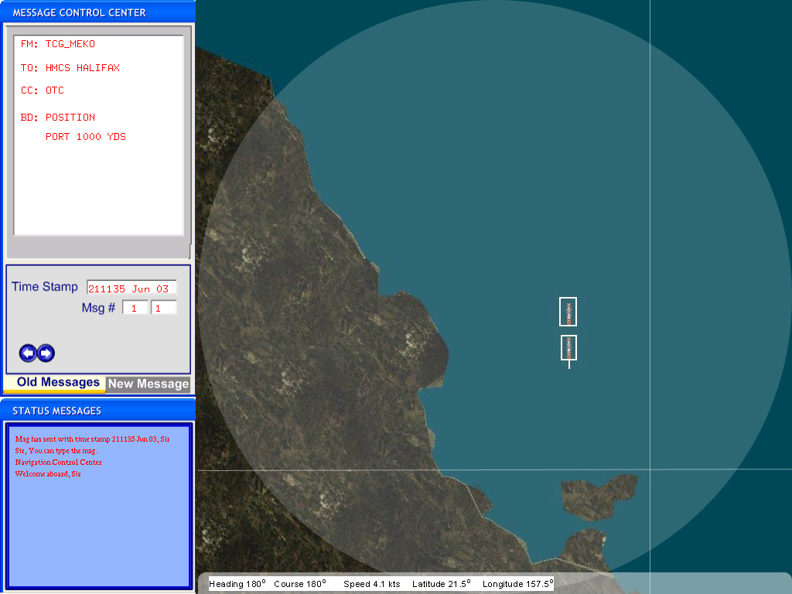

# TacPicFd User Manual

> Source: *Implementation/FdApps/TacPicFd/Docs/TacPicFd Installation and User Manual.docx* (Sections 2–3)
>
> See also: [TacPicFd Installation Manual](InstallationManual.md) · [TacPicFd Release Notes](ReleaseNotes.md) · [NavySim Architecture – Tactical Picture Federate](../Architecture/03-Federates.md#32-tactical-picture-federate)

> **Note:** The *Introduction* and *Functionality* sections of the source manual are empty, and the two figures listed in it (*TacPicFd Monitoring Interface*, *TacPicFd Report Sample*) are not included. The content below is taken from the NavySim technical report ([Architecture, §3.2](../Architecture/03-Federates.md#32-tactical-picture-federate)) and the planned functions in the [release notes](../Roadmap.md#main-functions).

## Contents

- [1. Introduction](#1-introduction)
- [2. Functionality](#2-functionality)
- [Abbreviations](#abbreviations)

## 1. Introduction

The Tactical Picture Federate (TacPicFd) is a tactical-level interactive simulation that maintains the tactical picture of the operational area, including task group formations and maneuvers. It gives the user — the Officer in Tactical Command (OTC) — interfaces to control and order the formations of the surface task group to achieve a given operational objective.

*TacPicFd user interface (technical report, Figure 59)*

## 2. Functionality

### Graphical user interface (technical report)

The interface is designed to:

- scroll the tactical display up and down,
- scroll the tactical display right and left,
- zoom in and out,
- send and receive messages,
- read the geodetic coordinates.

### Planned main functions (release notes)

1. **Advanced Tactical Display** — zooming, scrolling, displaying the area/chart, displaying the contacts.
2. **Message Center** — sending and receiving tactical messages.
3. **Pinning** — measuring distances and bearings on the chart, rulers.
4. **Commanding the Surface Task Group and formation** — grouping/ungrouping ships, ordering the STG course/speed/formation type.

## Abbreviations

| Term | Meaning |
|---|---|
| OTC | Officer in Tactical Command |
| STG | Surface Task Group |
| TacPicFd | Tactical Picture Federate |
