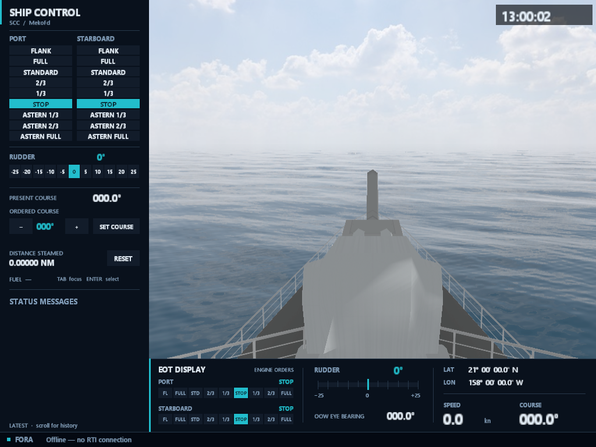

# NavySim

**Navy Simulation (NavySim)** is a High Level Architecture (HLA) based distributed simulation suite for the naval domain. It provides a networked virtual environment in which players control frigates in real time, tactical players command groups of ships, an environment application sets the shared weather and time of day, and an exercise manager distributes, controls and monitors a common scenario. New formations can be evaluated and tested, and existing ones practiced and analyzed; a typical application is training naval cadets.

NavySim was formerly known as **NSTMSS** (Naval Surface Tactical Maneuvering Simulation System, pronounced *"NiSTMiSS"*). The suite is being modernized to **.NET 10**, the **Fora** IEEE 1516-2025 (HLA 4) client and the **Stride** 3D engine.

**[Explore Components](Components.md)** · **[Read the FOM](FOM/Fom.md)** · **[See What's New](WhatsNew.md)**

Current suite: **NavySim 2026.1** (in development); last release 6.0. Read [What's New](WhatsNew.md) for highlights or [Release Notes](ReleaseNotes.md) for the full history.

## The federation

- **Ship-handling federates:** [MekoFd](Maritime/MekoFd/UserManual.md) (MEKO-class frigate) and [KnoxFd](Maritime/KnoxFd/UserManual.md) (Knox-class frigate) are 3D ship-handling simulators built on a shared maritime runtime — sea and wind, hydrodynamics, controllable-pitch propulsion, ENC charts, navigation radar and bridge consoles.
- **Exercise management:** [ExMFd](ExMFd/UserManual.md) executes C2SIM scenarios, injects typed events, shows workspace status and produces after-action reports. [Sen](Sen/UserManual.md) authors the scenarios.
- **Environment:** [EnviFd](EnviFd/UserManual.md) controls time of day, wind, fog and cloud for every federate.
- **Monitoring:** [FedMonFd](FedMonFd/UserManual.md) monitors the federation live through the HLA Management Object Model, with P/S matrices, traffic, network and service views.
- **Tactical picture:** [TacPicFd](TacPicFd/UserManual.md) is the tactical-display prototype.
- **Shared foundation:** the [NavySim FOM](FOM/Fom.md) and the [NavySim Foundation Library (NFL)](NFL/ReleaseNotes.md) are used by every federate.

See [Components](Components.md) for versions and links to each component's manuals, architecture and release notes.

## Platform

| Item | Version / Configuration |
|---|---|
| Runtime platform | .NET 10 / C# 14 |
| OS | Windows 11 x64 |
| RTI | Fora RTI / Fora.Client; IEEE 1516-2025 (HLA 4) |
| Graphics | Stride / Direct3D 11; WPF for EnviFd, FedMonFd, ExMFd and Sen |
| Federation model | FDD 5.1.0 — [FDD Release Notes](FOM/FDD/ReleaseNotes.md) |

Legacy components keep their documented toolchains. The [Release Notes](ReleaseNotes.md) list exact versions.

## Documentation

- **[Components](Components.md)** — Federates, tools and libraries with their manuals and release notes.
- **[Federation Object Model](FOM/Fom.md)** — Object and interaction classes, scenario execution and typed event injection.
- **[Roadmap](Roadmap.md)** — Planned and completed migration work.
- **[What's New](WhatsNew.md)** and **[Release Notes](ReleaseNotes.md)** — Suite history from NSTMSS 1.0 to NavySim 2026.1.
- **[Disclaimer](Disclaimer.md)** — Usage terms, licensing and the AI-assisted documentation notice.

Background: [Developing an HLA Based Naval Maneuvering Simulation](https://doi.org/10.1111/j.1559-3584.2005.tb00319.x){ target="_blank" rel="noopener" } (Naval Engineers Journal, 2005) and [Guide to Distributed Simulation with HLA](https://www.springer.com/gp/book/9783319612669){ target="_blank" rel="noopener" } (Springer).

## Links

- **[NavySim project page](https://sites.google.com/view/distributed-simulation/navysim){ target="_blank" rel="noopener" }**
- **[Simulation Environments](https://sites.google.com/view/distributed-simulation/home){ target="_blank" rel="noopener" }**
- **[SimGe documentation](https://otopcu.github.io/simge-site/){ target="_blank" rel="noopener" }**
- **[Contact](https://sites.google.com/view/okantopcu/contact){ target="_blank" rel="noopener" }**

NavySim is a research and academic application set. It is not intended for production use, and no support is guaranteed.

---

© oToT — Okan Topçu
